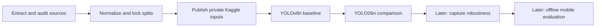
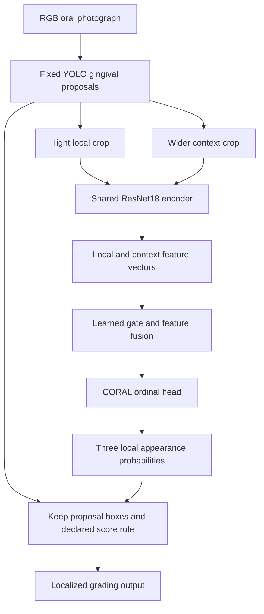

# DentalSelfie — Project Plan

Updated 21 October 2026. Active documentation and notebook content are in English. Previous plans are preserved in `docs/archive/`. Sections 8–13 below define the next research stage and supersede the earlier generic improvement roadmap.

**Proposed title:** *DentalSelfie: An Offline Mobile Application for Camera-Guided Screening of Visible Dental Caries and Gingival Inflammation*.

**Current implementation scope:** prepare and publish datasets, then benchmark and train models on Kaggle. Mobile development, export and a phone-selfie pilot are deferred.

## 1. Research story

Clinical photographs do not automatically establish performance on self-captured phone images. Build a reproducible detection baseline, compare a newer model fairly, later study capture robustness, and measure on-device deployment trade-offs.

The contribution is a documented research and deployment process. A newer model is allowed to lose; no algorithmic novelty or improvement is assumed in advance.

## 2. Fixed data decisions

| Task | Original source | Measured source images | Prepared images |
|---|---|---:|---:|
| Visible caries | [Zenodo 14827784](https://zenodo.org/records/14827784) | 6,265 | 2,175 |
| Gingival appearance | [Mendeley 3253gj88rr v1](https://data.mendeley.com/datasets/3253gj88rr/1) | 1,096 | 1,067 |

Use two independent detectors. Missing cross-disease annotations are not negatives. Sources are retained unchanged, and every exclusion has a recorded reason. See the [executed data card](docs/reports/data_preparation/DATA_CARD.md).

Caries uses named D/d rectangles merged into `visible_caries`. Gingivitis uses three research groups: MGI 0, MGI 1–2, and MGI 3–4. Jaw ROI boxes are excluded. These are local appearance labels, not a complete patient diagnosis.

## 3. Milestones and evidence

| Milestone | Notebook/artifact | Completion evidence |
|---|---|---|
| Extract and audit | `01_data_audit.ipynb` | Archive fingerprints, actual counts, caption checks, geometry overlays, duplicate and exclusion reports |
| Normalize and lock | `02_prepare_splits.ipynb` | Two YOLO datasets, source/output hashes, same-split constraints, class coverage and fixed splits |
| Publish inputs | `02b_upload_kaggle.ipynb` | Private remote datasets, ready status, versions and SHA-256 receipts |
| Old baseline | `03_yolov8n_baseline.ipynb` | Smoke benchmark, training logs, checkpoints and validation metrics |
| Newer model | `04_yolo26n_comparison.ipynb` | Same split/input/budget comparison, error examples and actual resource measurements |
| Later improvements | Create only when implemented | Pilot-informed augmentation and capture ablations |
| Later deployment | Create only when implemented | FP32/INT8 parity, real phone latency/RAM and offline Android demo |

## 4. Experimental controls

| Control | Rule |
|---|---|
| Source isolation | Never pool missing labels from the two datasets as negative annotations |
| Splits | Approximately 70/15/15 under observed filename/hash/visual groups, seed 42 |
| Independence | Do not claim certified patient-disjointness without independently verifiable patient IDs |
| Model comparison | Same dataset version, split, input size, declared training budget and checkpoint selection rule |
| Screening/repeats | One seed for screening; three declared seeds for the selected final comparisons |
| Model selection | Use validation only; never tune on test |
| Metrics | Per-task/per-class mAP50–95, mAP50, precision/recall at declared thresholds, and error analysis |
| Honesty | Retain failed or non-improving experiments; no manufactured metrics or custom-paper reproduction claims |

## 5. Kaggle execution plan

Local processing handles extraction, auditing, normalization, packaging and analysis. Expensive training runs on Kaggle T4 ×2 with independent bounded tasks.

- Benchmark actual batch/worker/AMP throughput before scheduling long runs.
- Divide work into model/task/seed tracks, preserving the same input version and protocol.
- Keep a margin below the requested 12-hour session cap and persist checkpoints before interruption.
- Resume unfinished runs with optimizer/scheduler/scaler state where available, RNG state, epoch and configuration provenance.
- Record owner/run if user-provided accounts are used; avoid duplicate experiment allocation.

## 6. Later application scope

The planned app accepts ordinary phone camera views of visible teeth/gums, assists capture, shows localized findings and stores/export reports locally. OnePlus Ace 5 is the planned demo device. Camera quality rejection and unobserved regions must be distinguished from a negative model result.

No cancer/RNA/X-ray branch, LLM chatbot, hospital backend or full tooth-numbering system is required. Personal pilot data stays out of the public-source training package. Clinical claims on future pilot images require clinician-confirmed reference labels.

## 7. Final academic evidence

Executed notebooks, data/model cards, source and split provenance, experiment tables, error galleries, training checkpoints, measured runtime logs and a final prototype demo. Model improvements are conclusions to be measured, not promises.

## 8. Research extension: scratch baselines and a paper-informed method

**Decision:** retain caries detection as an application capability; focus the next methodological contribution on local gingival appearance grading. The existing three ordered groups support supervised CNN classification without inventing labels. This is an applied adaptation of published ideas, not an established new algorithm or a claimed paper reproduction.

The research question is: **Does combining local appearance, surrounding context and ordinal supervision improve gingival grading and the complete detection pipeline enough to justify its added computation?**

| Evidence already available | Consequence for the next stage |
|---|---|
| YOLOv8n and YOLO26n v4 completed; gum validation mAP50–95 is 0.293 and 0.287 | Investigate localization versus grading errors before choosing improvements; do not assume all errors are classification errors |
| Gum labels are no-visible / mild / marked inflammation | An ordinal head can exploit label order; the groups are not equally spaced clinical measurements |
| Gum train/val/test contain 8,969 / 1,920 / 1,920 annotated boxes across 747 / 160 / 160 images | ROI samples inherit the existing image/group split; crops are correlated observations, not thousands of independent patients |
| Caries retains a positive lesion category; absence of annotation is not a healthy label | Do not manufacture a binary caries-vs-healthy crop dataset or use gum-source images as caries negatives |

```mermaid
flowchart LR
    A[Audit YOLO validation errors] --> B[Build paired ROI and context views]
    B --> C[Custom CNN from random weights]
    C --> D[ResNet18 from random weights]
    D --> E[ResNet18 with ImageNet initialization]
    E --> F[Context fusion and ordinal learning ablations]
    F --> G[Predicted-box pipeline versus YOLO baselines]
    G --> H[Robustness and repeated seeds]
    H --> I[Freeze protocol then evaluate test]
```

### Meaning of from scratch

Implement the small CNN, residual blocks, paired-view fusion, ordinal head, losses, data loader, training loop, checkpointing and evaluation in shared PyTorch modules. CNN and ResNet scratch experiments use random initialization and no downloaded weights. Use the same ResNet implementation for the pretrained experiment, with checked ImageNet weight loading. This separates architectural learning, initialization and method changes. Do not intentionally undertrain scratch baselines to make transfer learning look better.

## 9. Proposed method and reference basis

Working description: **local-context fusion with ordinal supervision for gingival grading**.

| Reference | What is supported | What we adapt or leave out |
|---|---|---|
| [He et al., Deep Residual Learning, CVPR 2016](https://arxiv.org/abs/1512.03385) | Residual learning as a CNN architecture | ResNet18, compared with and without pretrained initialization |
| [Wen et al., Scientific Reports 2024](https://www.nature.com/articles/s41598-024-70311-y) | Photo-based gingival grading and the importance of focusing on relevant tissue | Motivates ROI/context analysis. Their segmentation/teeth-removal method needs additional supervision; we do not claim to reproduce it using boxes |
| [Luo et al., DVCTNet, arXiv v1, August 2025](https://arxiv.org/html/2508.20813v1) | Combining global and local views using learned gated fusion | Their detector operates on panoramic X-rays and uses foundation-model pretraining. We borrow the complementary-view principle for RGB ROI/context crops; our shared CNN and gate are a different, lightweight implementation |
| [Cao et al., CORAL, Pattern Recognition Letters 2020](https://arxiv.org/abs/1901.07884) | Rank-consistent ordinal prediction using threshold subtasks | Adapt to the three existing gingival groups; document original formulation and any weighting changes |

Two RGB views come from the same photograph: a tight annotated/predicted ROI and a wider crop centered on that ROI (initial side-length multiplier 1.5). Both are resized to 224 pixels. Context remains auxiliary input for the central ROI's label, not a newly labelled larger region. Boundary handling uses explicit recorded padding; do not silently modify source annotations. Review paired overlays before locking this derived-data protocol.

Start with pooled feature vectors and a small sigmoid gate, not a large cross-attention transformer. Compare against plain concatenation so any gain is not merely from a second input or extra parameters. Shared encoder weights limit parameter growth, but two views still increase computation; measure that cost.

For groups 0/1/2, ordinal targets are `[0,0]`, `[1,0]`, `[1,1]`: the two questions are whether the group is above 0 and above 1. Use the published CORAL construction and verify rank consistency. Report ordinal index error as a research metric, not a clinical severity-distance measurement. Cross-entropy is the classification control; do not stack extra losses without an independent hypothesis.

## 10. Experiment matrix and fair comparison

| ID | Model/input | Initialization | Supervision | Question |
|---|---|---|---|---|
| C0 | Small custom CNN, local crop | Random | Cross-entropy | What can a simple network learn from this dataset alone? |
| C1 | ResNet18, local crop | Random | Cross-entropy | Does residual architecture help under scratch training? |
| C2 | Same ResNet18, local crop | ImageNet | Cross-entropy | How much does pretraining contribute? |
| M1 | Shared ResNet18, local + context, concatenation | Same as C2 | Cross-entropy | Does additional context help? |
| M2 | Shared ResNet18, local + context, learned gate | Same as C2 | Cross-entropy | Does adaptive fusion improve on concatenation? |
| M3 | ResNet18, local crop | Same as C2 | CORAL | Does ordered supervision help independently? |
| M4 | Shared ResNet18, local + context, learned gate | Same as C2 | CORAL | Does the combined method improve on both single changes? |

Seven screening configurations, not an unrestricted model zoo. If an experiment fails to improve validation results, retain it as evidence. Do not add CBAM, contrastive learning, segmentation, or distillation merely to inflate complexity. If the error audit shows proposal recall dominates, record the ceiling of a grading-only refinement and revisit localization before expensive repeats.

| Evaluation track | Inputs and controls | Metrics and interpretation |
|---|---|---|
| ROI grading | Every classifier sees the same ground-truth validation crops; training crops inherit locked groups | Macro-F1 (primary), balanced accuracy, per-class recall, ordinal MAE, quadratic weighted kappa and confusion matrix. This is grading with known localization |
| Complete pipeline | Same frozen YOLO proposal generator feeds CNN/ResNet/fusion variants; actual predicted boxes are used | Compare YOLO alone, YOLO+C0/C1/C2 and YOLO+selected method on mAP50–95, mAP50, per-class precision/recall and latency. Missed/unmatched predictions remain in evaluation |
| Deployment-oriented cost | Same image set, input resolution, hardware and proposal-count cap | Parameters, model bytes, runtime and peak memory. T4/desktop measurements do not establish phone performance |

Select the proposal generator using a declared validation rule before comparing refinement variants. Freeze proposal filtering, maximum proposal count, class-agnostic matching and any NMS settings for the comparison. Define score fusion explicitly (initial candidate: detector score times the refiner's class probability); choose any threshold/calibration on validation only. The classifier has no reliable background class: retain/report unverified proposals rather than training them as healthy examples.

**Do not compare CNN accuracy numerically with YOLO mAP.** The common end-to-end comparison is between complete pipelines. CNN-only crop results show a different subtask. A shared YOLO+CNN cascade is not an independent from-scratch detector and must be labelled accordingly.

Training uses GT crops with modest, reviewed training-only box jitter to reduce dependence on perfect crop boundaries. Predicted-box validation quantifies that gap. If predicted training proposals are later needed, generate them with train-only out-of-fold models; no validation/test-trained proposal generator. All transformed views of a source image retain its split and group.

Use the same crop preprocessing and augmentation across classifier ablations. Tune scratch and pretrained learning rates with equally small declared validation budgets, then freeze them for method ablations. Allow scratch models enough epochs to assess convergence; report both best validation result and consumed compute rather than silently forcing every architecture into an inadequate schedule. Do not regard the previous detector's 30-epoch recipe as universally optimal.

## 11. Next notebooks and completion gates

Notebook 05 and the three 6.x baseline notebooks are implemented. Create notebooks 07–09 when their stages are ready; preserve notebooks 01–04 and collected v4 evidence.

| Milestone | Planned notebook | Work and exit evidence |
|---|---|---|
| Diagnose and derive data | `05_error_audit_and_roi_data.ipynb` | Train/val-only error galleries, localization/class confusion analysis, class counts, reviewed paired crops, parent IDs and locked split hashes; exact crop count reported after QC |
| Establish scratch/pretrained controls | `dentalselfie-06-1-cnn.ipynb`, `dentalselfie-06-2-resnet18-scratch.ipynb`, `dentalselfie-06-3-resnet18-pretrained.ipynb` | Three independent, fully explained notebooks with identical ROI processing and training protocol; model-specific learning curves, validation metrics, checkpoints and resource receipts after GPU runs |
| Implement the combined method | `07_1_context_gated_fusion.ipynb` and `07_2_ordinal_combined_method.ipynb` | M1–M4, equations, diagrams, implementation appendix, component ablations and predefined selection rule |
| Compare complete systems | `08_pipeline_comparison.ipynb` | YOLO-only and identical-proposal cascades, all detection failures counted, ROI versus predicted-crop gap and compute trade-offs |
| Freeze and finalize evidence | `09_repeats_robustness_evaluation.ipynb` | Selected comparisons over seeds 42/137/2026, grouped uncertainty estimates, predeclared corruption tests, one final test evaluation after protocol freeze |

Each notebook must save real outputs, a conclusion including failures, package versions, seeds and artifact hashes. Shared implementation remains in `src/dentalselfie/`; named experiments/configuration remain under `src/configs/`.

## 12. Quota, robustness and success criteria

- Public notebook releases were initially published with GPU disabled and `RUN_TRAINING = False`; separate versioned GPU runs have now completed on T4 x2. Results and the 6.2 v2 correction are recorded in `docs/reports/training/ROI_BASELINE_FINDINGS_2026-10-21.md`.
- Benchmark 2–3 epochs of the new ROI pipeline before estimating costs. Its roughly 9,000 training boxes per epoch differ substantially from the image-detector workload.
- Distribute independent model/seed tracks across the user's authorized Kaggle accounts. Public shared inputs enable cross-account use; record the exact dataset/code versions and avoid duplicate track assignments. Per-account quota checks route jobs rather than limiting the experiment matrix to the currently signed-in account.
- Schedule two independent experiments/seeds on T4 x2 with one worker per GPU. Keep startup/no-progress, wall-clock and checkpoint limits; use another authorized account or a later batch when a particular account lacks capacity.
- Run one seed for the seven screening configurations. Repeat C2 and the selected method with two additional seeds only after screening; expand to additional finalists only for a stated unresolved comparison.
- Evaluate mild blur, lighting change and JPEG degradation with predetermined severities on validation before freeze. Transform the complete image before deriving its paired crops. Synthetic corruption robustness is not evidence of actual phone-selfie generalization.
- Report mean/spread across seeds. For metric uncertainty, resample source image/known groups together; do not treat individual tooth crops as independent patients.
- Accept a combined method only if it offers a defensible validation/robustness-versus-cost trade-off. Report a negative finding if it does not. Keep the simpler model if complexity brings no supported benefit.
- The final test split is evaluated only after methods and thresholds are frozen. Do not revise the method in response to test results.

## 13. Thesis narrative and boundaries

The defensible story is: inspect the data and errors; build a CNN; study residual learning and initialization; motivate local/context information and ordered labels; implement published mechanisms; perform controlled ablations; compare complete pipelines against strong YOLO references; quantify resource costs and limitations.

Research contributions are the task-specific system design, the implementation, the controlled study and reproducible evidence. Literature-derived modules are cited as such. The study may demonstrate a useful combination on this dataset without claiming it is globally novel. Preserve actual experiment chronology: YOLO benchmarks were run first and motivated the subsequent work.

Caries detection remains part of DentalSelfie. Mobile implementation and export remain deferred. No extra modality, personal-data upload, new segmentation labels, backend or LLM is required for this research extension.

## 14. Implementation handoff — 21 October 2026

Latest user instruction supersedes earlier private-publication defaults: publish allowlisted research inputs, derived ROIs, code/notebooks and completed model evidence for use across authorized accounts. `src/configs/kaggle.json` declares public visibility. Keep credentials and personal/pilot photos excluded; record model/seed allocation and pinned input versions across accounts.

| Stage | Operational decision | Current evidence / exit gate |
|---|---|---|
| Kaggle reuse | Public prepared data v1 and ROI v1 can be attached from authorized accounts | The YOLO kernels are COMPLETE; check each runner account's current GPU quota before training |
| Data derivation | Notebook 05 locally; shared module `dentalselfie.roi` | 10,889 ROIs / 21,778 views from 907 train/validation parents; test unopened |
| Crop QA | Original annotations unchanged; recorded integer bounds and explicit context padding | Small/large examples per class reviewed geometrically; native small-ROI information limits retained |
| Code publication | Existing code dataset is public; baseline notebooks are separately published as public kernels | Exact notebook versions and input pin are in `docs/reports/training/roi_baselines_publication.json` |
| CNN stage | Public notebooks 6.1–6.3, each with independent cells and a Kaggle kernel | T4 x2 outputs collected; 6.2 v2 initialization incident excluded; corrected 6.2 v3 is the scratch result. See the baseline findings report. |
| Method stage | Notebooks 07.1/07.2 v1 completed | M1-M4 screening collected; no method exceeds C2 macro-F1. Next: matched control recipe and isolated RNGs before repeat experiments. See `docs/reports/training/ROI_METHOD_FINDINGS_2026-10-21.md`. |

The derived training distribution is 210 no-visible / 3,829 mild / 4,930 marked ROIs; validation is 49 / 932 / 939. Report minority recall and macro-F1. Treat any class-balancing change as its own declared experimental control. The saved detector figures are qualitative evidence; full per-instance localization/classification error decomposition remains pending prediction export.

Keep data and code versioning separate. Do not overwrite the 03/04 detector kernels with classifier experiments or upload another copy of the prepared dataset just to change model code. See `docs/KAGGLE.md` for the executable-stage sequence and quota gates.

## 15. Post-07 research decision - 21 October 2026

Post-09 update, 22 October: all 09.x results are collected. Follow [Post-09 implementation plan](docs/POST_09_PLAN.md) for the next unimplemented stages: technical/error audit, full-image caries feasibility, then conditional bounded representation/adaptation comparisons. Earlier prospective notebook numbering is historical.

Follow [Research next steps](docs/RESEARCH_NEXT_STEPS.md) for the superseding unimplemented sequence: 08 source-resolution/error audit, 09.1 matched crop comparison, 09.2 class-imbalance losses, and 09.3 frozen foundation-feature probes. Completed baselines and M1-M4 remain historical evidence. Source-detail preservation and imbalance are explicit hypotheses; DINOv3 and conditional distillation have literature references and controlled entry gates. Test stays locked and mobile/export remain deferred.
