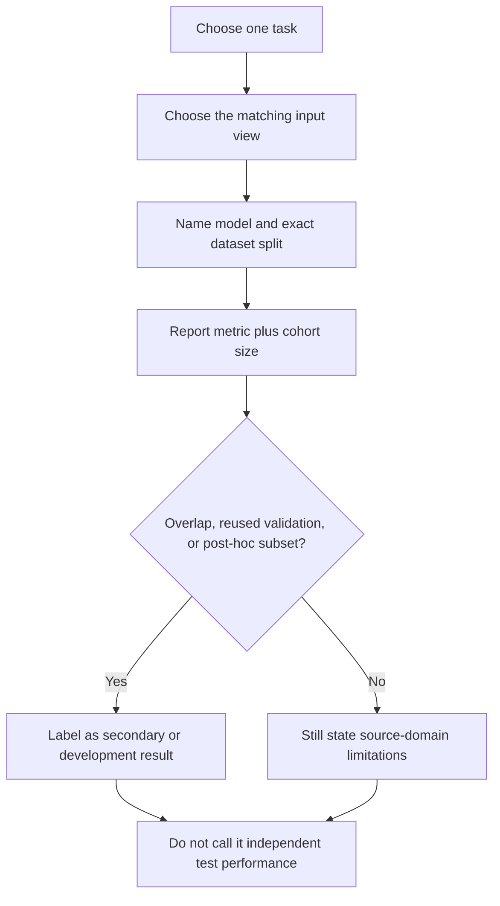

# Final Metric Selection Across DentalSelfie Labels

**Evidence cutoff:** 24 November 2026. This document selects the strongest already-collected result per task while preserving the dataset, view, evaluator and validation limitations. A score is never detached from its evaluation cohort.

## Decision summary

| Task / label | Selected headline | Secondary high result | Reporting decision |
|---|---|---|---|
| Caries detection | YOLO26n: **94.12% mAP50 / 73.01% mAP50-95** | YOLOv8n: 93.54% / 72.73% | Use YOLO26n on the 327-image source validation. Call this source-validation performance, not phone or clinical accuracy. |
| Gingival-region detection | YOLOv8n: **95.45% / 55.78%** | YOLOv8s: 95.19% / **56.33%** | Use YOLOv8n if selecting on mAP50; mention v8s has slightly higher stricter mAP50-95. Validation contains no fully negative images. |
| Calculus detection | Close-up crop model YOLO26s extra-COCO: **81.11% / 33.80%** on 127 crop images | YOLO26s extra-transfer: 79.83% / **35.39%** on the same crop view | Present as a close-up crop result only. Do not claim 81.11% on full-mouth photos. See full-image scores and limitations below. |
| Crowding detection | YOLO26s + screened FIPDZ train add-on: **69.76% / 32.76%** on all 1,357 GigiKita validation images | OCCLSAL YOLO11n: **70.01% / 32.89%**, but only 38 images (6 diastema and 36 crowding boxes) | Headline for the main crowding task is 69.76% on full GigiKita. Report 70.01% only as a small, occlusal source-specific result. Do not headline FIPDZ 72.57% because of cross-split overlap. |
| Spacing / diastema detection | YOLO26s + CIoU-NWD reference: **60.68% / 24.29%**, recall 59.53%, primary 477-image view | Context-crop candidate: **62.29% / 24.75%**, recall 57.67%, same view | Keep the reference as selected model. Report the higher candidate as not promoted because recall fell 1.86 pp beyond the preset gate. |
| Gingival appearance ROI classification (three classes) | R2 raw-crop + class-balanced CE: **57.40% macro-F1**, 69.11% accuracy | R1 raw-crop CE: 57.26% macro-F1 | R2 is the highest observed macro-F1 by 0.14 pp, a near-tie on a reused validation set. Describe as exploratory and not a reliable clinical classifier. |

All detector pairs are shown as **mAP50 / mAP50-95**. Do not rank values across labels as if each label used the same dataset or evaluation design.

## Per-task evidence and caveats

### 1. Caries

- Best source-validation model: YOLO26n, **94.12% mAP50 / 73.01% mAP50-95**.
- Cohort: 327 validation images and 1,054 annotations; test images were not opened.
- At fixed confidence 0.25 and IoU 0.5 on clean images, YOLO26n precision/recall were 87.62%/85.96%; YOLOv8n was 78.71%/95.07%. AP alone does not choose the desired operating point.
- Synthetic blur, darkening and JPEG tests are robustness probes, not phone-domain validation. The annotation set has no small boxes under the audit definition.
- Evidence: [`FINDINGS_2026-10-22.md`](reports/post09/FINDINGS_2026-10-22.md), notebook `10.2_caries_full_image_audit.ipynb`.

### 2. Gingival-region detection

- Best mAP50: YOLOv8n, **95.45% mAP50 / 55.78% mAP50-95**; YOLOv8s reaches 95.19%/56.33%.
- Cohort: 160 images and 1,870 boxes; no fully annotation-negative images.
- Therefore the result measures localization on source-annotated regions. It does not establish image-level specificity on normal-mouth photos.
- Evidence: [`BASELINE_RESULTS.md`](reports/gingivitis_binary/BASELINE_RESULTS.md), Kaggle v4 for v8n and v3 for v8s.

### 3. Calculus

The calculus branch has materially different evaluation views, so show the input view next to the metric:

| Evaluation view | Strongest relevant result | Support | Interpretation |
|---|---|---:|---|
| Close-up crops | YOLO26s extra-COCO: 81.11% / 33.80%; YOLO26s extra-transfer: 79.83% / 35.39% | 127 crop images | Highest scores are crop-domain metrics. Checkpoint selection used the reused close-up validation. The two variants trade mAP50 against mAP50-95. |
| Small full-image view in dual-view study | YOLO26s mixed-dual: 54.50% / 24.60% | 26 images | Small support; checkpoint selection was on the close-up view, so this is a secondary view, not the primary selected validation. |
| Conservative grouped full-image benchmark | YOLOv8s: 49.33% / 22.15% | 239 images | Larger, duplicate-grouped source validation; best defensible general full-image reference in the written grouped report. |

The highest value to present is **81.11%**, but only with the explicit caption “close-up crop validation, 127 images.” For a whole-image claim, use the grouped 239-image score and disclose its limitations. The validation domains were reused in model development, may overlap one another, and patient independence is unverified. The historical 78.03% calculus score used confirmed repeated scenes across train/validation and a different training protocol; do not use it as the clean benchmark.

Evidence: [`calculus_grouped/RESULTS.md`](reports/calculus_grouped/RESULTS.md), `data/runs/calculus_extra-coco-26_v1/summary.json`, `data/runs/calculus_extra-transfer-26_v1/summary.json`, `data/runs/calculus_mixed_dual_yolo26s_v1/summary.json`.

### 4. Crowding

| Result | Metric | Cohort and decision |
|---|---|---|
| Main selected result | YOLO26s + screened FIPDZ add-on: **69.76% / 32.76%** | Full 1,357-image GigiKita validation; best single-model headline for the main task. |
| OCCLSAL source-specific result | YOLO11n: **70.01% / 32.89%** | Only 38 validation images, with 6 diastema and 36 crowding boxes; occlusal view. Report as secondary, small-support result. |
| FIPDZ source validation | YOLO11m: **72.57% / 39.97%** | 147 images; 78 were flagged as cross-split duplicate candidates against GigiKita training. Not an independent validation; never use as headline. The post-hoc remaining 69-image subset scored 71.93%/40.45%, also not a final estimate. |

The current matched COCO-evaluator re-run gives the FIPDZ single model 68.69%/32.87% and WBF 69.73%/31.31%. These values are internally comparable within that notebook but not numerically interchangeable with the historical Ultralytics 69.76%/32.76% result. If discussing WBF, use the common COCO table only.

Evidence: [`CROWDING_FIPDZ_ADDON_DUAL_VALIDATION_2026-11-21.md`](reports/alignment/CROWDING_FIPDZ_ADDON_DUAL_VALIDATION_2026-11-21.md), [`CROWDING_SPACING_DATA_AUDIT_2026-11-21.md`](reports/alignment/CROWDING_SPACING_DATA_AUDIT_2026-11-21.md), [`OCCLSAL_BASELINE_RESULTS.md`](reports/alignment/OCCLSAL_BASELINE_RESULTS.md), [`CROWDING_CURRENT_WBF_RESULTS_2026-11-22_V2.md`](reports/alignment/CROWDING_CURRENT_WBF_RESULTS_2026-11-22_V2.md).

### 5. Spacing / diastema

| Result | Precision | Recall | mAP50 | mAP50-95 | Decision |
|---|---:|---:|---:|---:|---|
| YOLO26s + CIoU-NWD | 66.34% | 59.53% | 60.68% | 24.29% | Current selected reference on fixed primary validation of 477 images. |
| Add train-only context crops | 70.82% | 57.67% | **62.29%** | **24.75%** | Highest AP candidate on the same primary view; not promoted because recall decreased by 1.86 percentage points, exceeding the predeclared 1.5 pp limit. |

Sensitivity view (473 images) is 60.33%/24.10% for the reference and 62.11%/24.67% for the crop arm; recall again falls by 1.87 pp. Neither view is an independent clinical test, and validation membership/labels remain frozen.

Evidence: [`SPACING_CIOU_NWD_RESULTS_2026-11-23.md`](reports/alignment/SPACING_CIOU_NWD_RESULTS_2026-11-23.md), [`SPACING_CONTEXT_CROP_ABLATION_RESULTS_2026-11-24.md`](reports/alignment/SPACING_CONTEXT_CROP_ABLATION_RESULTS_2026-11-24.md).

### 6. Gingival appearance classifier

- Best observed: R2 raw-crop ResNet18/class-balanced CE, **57.40% macro-F1**, 69.11% accuracy, 60.16% balanced accuracy.
- R1 raw-crop CE is nearly tied at 57.26% macro-F1; the +0.14 pp difference does not establish robust superiority.
- Three classes: no-visible, mild, marked. R2 recalls: 40.82% / 63.41% / 76.25%. Minority no-visible performance remains weak.
- These are ROI classification metrics and are not comparable to detector mAP. Extensive validation reuse and only 49 no-visible validation ROIs limit the conclusion.
- Evidence: [`ROI_09_COMBINED_FINDINGS_2026-10-22.md`](reports/training/ROI_09_COMBINED_FINDINGS_2026-10-22.md), notebook `09.3` valid version v3.

## Presentation wording

Use “best observed validation result” or “development-set result,” then name the dataset, view, image count and metric. Reserve “test performance,” “clinical accuracy,” “patient-independent” and “phone performance” for an untouched, appropriately labeled evaluation that supports those claims. Keep the negative results and the crowding overlap finding in the methods/limitations slides.



## Reproduction map: source data, Kaggle inputs, notebooks and result records

Use the **local executed notebook** as the readable experiment protocol and the version-pinned result record as the evidence. Kaggle dataset links below identify reusable inputs; original publisher data and licenses remain the provenance authority. Kaggle kernel versions are not all published in one receipt, so this table states exact kernel slugs only where the checked result record provides them. Do not guess missing versions: use the linked report, `docs/KAGGLE.md`, and the run receipt.

| Task / selected result | Data to attach or retrieve | Notebook(s) to follow | Exact output/evidence |
|---|---|---|---|
| Caries YOLO26n | Project-prepared data: [Kaggle `trihuynhviprovcl/dentalselfie-data-v1`, v1](https://www.kaggle.com/datasets/trihuynhviprovcl/dentalselfie-data-v1); original source D1, Zenodo 14827784 `Dataset.zip` | `notebooks/03_yolov8n_baseline.ipynb` (baseline), `notebooks/04_yolo26n_comparison.ipynb` (model comparison), `notebooks/10_2_caries_full_image_audit.ipynb` (selected checkpoint re-evaluation/stress audit) | `docs/reports/post09/FINDINGS_2026-10-22.md`; Kaggle output package [YOLO v4 results v1](https://www.kaggle.com/datasets/trihuynhviprovcl/dentalselfie-yolo-v4-results). Prepared-data publication receipt: `docs/reports/data_preparation/kaggle_upload_receipt.json`. |
| Gingival-region YOLOv8n | Same prepared data v1; original source D2, Mendeley 3253gj88rr v1 | `notebooks/gingivitis/15_1_binary_gingival_data.ipynb`, `15_2n_binary_gingival_yolov8n.ipynb`, `15_2s_binary_gingival_yolov8s.ipynb`, `15_3_binary_gingival_error_audit.ipynb` | `docs/reports/gingivitis_binary/BASELINE_RESULTS.md`; run folders `data/runs/gum_binary_v8n_v4/` and `data/runs/gum_binary_v8s_v3/`. Kaggle input dataset slug/version in `docs/reports/data_preparation/kaggle_upload_receipt.json`. |
| Calculus close-up YOLO26s extra-COCO | Original D3: [Kaggle `singh868/multi-class-oral-disease-detection-dataset`](https://www.kaggle.com/datasets/singh868/multi-class-oral-disease-detection-dataset); project source audit/preparation and crop/dual-view manifests are under `docs/reports/calculus_grouped/` | `notebooks/calculus/14_47_calculus_extra_coco_yolo26s.ipynb`; compare with `14_48_calculus_extra_transfer_yolo26s.ipynb` and dual-view methods `14_41`-`14_46` | `data/runs/calculus_extra-coco-26_v1/summary.json`, `data/runs/calculus_extra-transfer-26_v1/summary.json`, `data/runs/calculus_mixed_dual_yolo26s_v1/summary.json`; grouped full-image reference `docs/reports/calculus_grouped/RESULTS.md`. |
| Crowding YOLO26s + screened FIPDZ | GigiKita v1 plus FIPDZ v1 are source archives; prepared model inputs are recorded in `docs/reports/alignment/` manifests and Kaggle staging receipts. Do not attach frozen FIPDZ validation as a clean test. | `notebooks/alignment/16_33_crowding_yolo26s.ipynb` (base progression), `16_42_crowding_fipdz_addon_yolo26s.ipynb` (screened add-on), `16_44_crowding_dual_validation_final.ipynb` (selected run comparison); OCCLSAL secondary: `notebooks/alignment/16_26` onward only if inspecting its separate branch | `docs/reports/alignment/CROWDING_FIPDZ_ADDON_DUAL_VALIDATION_2026-11-21.md`; run `data/runs/crowding_fipdz_addon_yolo26s_20261121/`. OCCLSAL evidence: `docs/reports/alignment/OCCLSAL_BASELINE_RESULTS.md` (verify exact file spelling using `rg --files docs/reports/alignment | rg -i occlsal`). |
| Spacing YOLO26s + CIoU-NWD (selected) and context-crop candidate | Project fixed spacing data and locked validation; external GHQWDO v2 is train-only in the context experiment. The exact manifest/input hashes are printed in the reports and notebook cells. | `notebooks/alignment/16_64_spacing_ciou_nwd_ablation.ipynb` (selected reference), `16_70_spacing_context_crop_ablation.ipynb` (higher-AP candidate, not promoted); negative controls `16_67`, `16_72`, `16_73` | `docs/reports/alignment/SPACING_CIOU_NWD_RESULTS_2026-11-23.md`; `SPACING_CONTEXT_CROP_ABLATION_RESULTS_2026-11-24.md`; Kaggle run `hngphc73/ds-spacing-context-crop-ablation` v1. |
| Three-class gingival ROI classifier | [Paired ROI dataset `trihuynhviprovcl/dentalselfie-gum-roi-v1`, v1](https://www.kaggle.com/datasets/trihuynhviprovcl/dentalselfie-gum-roi-v1); raw-crop dataset [v1](https://www.kaggle.com/datasets/trihuynhviprovcl/dentalselfie-gum-raw-roi-v1) | `05_error_audit_and_roi_data.ipynb`, `dentalselfie-06-1-cnn.ipynb`, `dentalselfie-06-2-resnet18-scratch.ipynb`, `dentalselfie-06-3-resnet18-pretrained.ipynb`, then `09_1_resolution_control.ipynb`, `09_2_imbalance_ablation.ipynb`, `09_3_foundation_feature_probe.ipynb` | `docs/reports/training/ROI_09_COMBINED_FINDINGS_2026-10-22.md`; exact valid 09.3 run is version v3, not cancelled v4. Kaggle publication/versions: `docs/reports/training/roi_recovery_publication.json`. |

### Clone-to-reproduce checklist

1. Clone the public GitHub repository and read `README.md`, `docs/STATUS.md`, `docs/AGENT_HANDOFF.md`, `docs/KAGGLE.md`, this selection record, then the cited task report.
2. Set up Python 3.11 and Kaggle CLI as described in `docs/AGENT_HANDOFF.md`. Authenticate locally; never commit `kaggle.json`, API tokens or `.env` files.
3. Download only the published input dataset and version named in the report/receipt. For example:

   ```powershell
   kaggle datasets download -d trihuynhviprovcl/dentalselfie-data-v1 -p .venv/work/kaggle/data --unzip
   kaggle datasets download -d trihuynhviprovcl/dentalselfie-gum-roi-v1 -p .venv/work/kaggle/roi --unzip
   kaggle datasets download -d singh868/multi-class-oral-disease-detection-dataset -p .venv/work/kaggle/calculus --unzip
   ```

4. Verify manifest SHA-256, image/label counts, class order and archive/source checksums against that experiment's report before training. Do not substitute the latest dataset version for a pinned older version.
5. Open the exact notebook listed above. Read its Markdown cells, confirm Kaggle input paths and `data.yaml`, GPU/seed/config, and execute only the intended training cells. For final reproduction, use a fresh run directory and record the new Kaggle kernel slug/version; never overwrite the archived run.
6. Retrieve outputs with the **exact kernel version** from the report using `kaggle kernels output <owner>/<slug> -p .venv/work/kaggle/<run-output>`. Compare `summary.json`, checkpoint hash, manifest hash and metrics with the archived record. A different environment/evaluator can produce slightly different values; document it rather than silently substituting results.
7. Do not open source test partitions or use phone/pilot images in public packages. For spacing/crowding, preserve the project validation manifests exactly. For calculus, state whether inference input is a crop or full image.

The repository contains archived Kaggle output for some tracks but not a complete remote kernel URL/version receipt for every historical run. The notebooks and local run summaries remain the source of technical details; where the kernel slug/version is absent, the operator must locate the matching run in Kaggle account history from notebook title/date and then record the exact version before claiming bit-for-bit reproduction.

