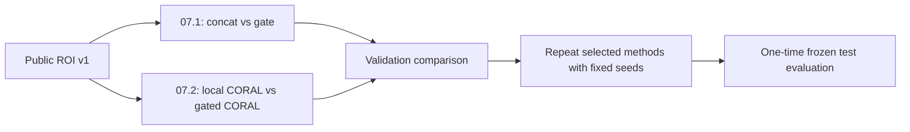

# Current recovery collection update - 22 October 2026

09.1 v1 and 09.2 v1 are collected. Valid 09.3 is v3 COMPLETE: frozen ResNet18 macro-F1 50.08%, DINOv3 47.83%. Latest v4 CANCEL_ACKNOWLEDGED has no output; earlier v2 had training disabled. Exact v3 output was retrieved through SDK version_label='v3', since CLI numeric version suffixes are ignored. Do not relaunch the missing branch: it has now been collected. See `docs/reports/training/ROI_09_COMBINED_FINDINGS_2026-10-22.md` and `roi_recovery_publication.json`. Historical handoff instructions below retain their original context.

# Kaggle Publication and Training Handoff

## Public multi-account handoff — latest user decision

The user explicitly requested public research artifacts. Current policy is `private: false` in `src/configs/kaggle.json`. Prepared source data and code are public; derived ROI views and collected v4 models/results are separately packaged for direct reuse. Credentials and personal/pilot photos remain excluded. Historical private-run records below describe their original visibility, not current access.

Verified ready handoff: data v1, code v13, ROI v1 and results v1. Public notebook 05 v1 is a local-execution review copy; use the code dataset for its full figures. Public baseline notebooks 6.1–6.3 are listed below in the training receipt. See `docs/reports/publication/PUBLIC_HANDOFF.json` for the verified dataset URLs, versions, visibility and inventory evidence. Baseline publication launched CPU preflights only, without GPU training.

| Public artifact | Kaggle slug | Use |
|---|---|---|
| Prepared source data | `trihuynhviprovcl/dentalselfie-data-v1` | Original locked detection inputs, including final held-out test files; do not tune on test |
| Code and notebooks | `trihuynhviprovcl/dentalselfie-code` | Shared implementation, config, executed notebooks and current guides |
| Paired gingival ROIs | `trihuynhviprovcl/dentalselfie-gum-roi-v1` | Materialized 224px train/validation crops and hashes; no test crops |
| Trained YOLO evidence | `trihuynhviprovcl/dentalselfie-yolo-v4-results` | Completed v4 weights, logs, curves and validation evidence |

Public notebook versions 5 of 03/04 are QUICK_SAVE visibility updates, not new training runs. Actual training results remain version 4 and are also exported in the results dataset. Assign each future CNN model/seed a unique track; users can run independent tracks on their authorized accounts using identical version-pinned public inputs. No extra account credentials need to be stored in this repository.

## Active recovery runs after collected 07.x

Raw-source ROI dataset [v1](https://www.kaggle.com/datasets/trihuynhviprovcl/dentalselfie-gum-raw-roi-v1) is public and READY. It contains local crops only and does not replace the old ROI-v1 control. Hash and expanded inventory verification are in `docs/reports/raw_roi_preparation/`.

| Kernel | Mode and current state |
|---|---|
| [09.1 Resolution Control](https://www.kaggle.com/code/trihuynhviprovcl/dentalselfie-09-1-resolution-control) | v1 complete; full results verified |
| [09.2 Imbalance Ablation](https://www.kaggle.com/code/trihuynhviprovcl/dentalselfie-09-2-imbalance-ablation) | v1 complete; full results verified |
| [09.3 Foundation Feature Probe](https://www.kaggle.com/code/trihuynhviprovcl/dentalselfie-09-3-foundation-feature-probe) | v1 QUICK_SAVE only; GPU execution disabled pending DINOv3 access |

Inputs are version-pinned. Separate process RNGs, automatic short smoke/checkpoint restore and per-epoch resumption are embedded in the visible notebook code. Notebook 09.2 does not duplicate R1's CE control in 09.1. Fixed raw-source inputs allow both to run independently. For 09.3, request the official [DINOv3 weights](https://huggingface.co/facebook/dinov3-vits16-pretrain-lvd1689m), enable the HF_TOKEN secret for the notebook or provide DINOV3_MODEL_DIR, select T4 x2 and set RUN_TRAINING=True. Never paste tokens or signed download URLs into public source. No backbone substitution is authorized implicitly.

See `docs/reports/training/roi_recovery_publication.json` for the actual state before any new submission. Remote RUNNING is not proof that smoke passed; inspect output evidence before making that claim.

## Collected method ablations 07.1 and 07.2

Notebooks 6.1-6.3 are complete and their validation evidence is collected. The next experiment is split into two independent, public Kaggle kernels pinned to `trihuynhviprovcl/dentalselfie-gum-roi-v1/1`; the manifest SHA-256 is `8ed4c05240a2d23e6c254ee74adf13af48ff45a4418f1e2024bd38498b02cab1`. Both completed on T4 x2 and outputs are collected. See `docs/reports/training/ROI_METHOD_FINDINGS_2026-10-21.md`.

| Kernel | Experiments | State |
|---|---|---|
| [07.1 Context Gated Fusion](https://www.kaggle.com/code/trihuynhviprovcl/dentalselfie-7-1-context-and-gated-fusion) | M1 concat + CE (GPU 0); M2 learned gate + CE (GPU 1) | Version 1 complete; collected |
| [07.2 Ordinal Combined Method](https://www.kaggle.com/code/trihuynhviprovcl/dentalselfie-7-2-ordinal-combined-method) | M3 local + CORAL (GPU 0); M4 gated context + CORAL (GPU 1) | Version 1 complete; collected |

Each worker uses ImageNet ResNet18, batch size 32, gradient accumulation 2, AMP, AdamW, up to 20 epochs, early stopping patience 5 and a 70-minute worker budget. Checkpoints and history are saved each epoch. Both notebooks train independently; neither consumes outputs from 6.x or the other method notebook. C2 from 6.3 is only a reference metric. Current Kaggle quota at submission was 5.75 GPU hours. See `docs/reports/training/roi_method_ablation_publication.json` for submission records.

The new notebook source is English and ASCII-clean. Every code cell has an explanatory Markdown cell before it. These are exploratory validation experiments; do not claim improvement until outputs are collected, and do not use the held-out test split for tuning.



## Private publication workflow

Run [notebook 02b](../notebooks/02b_upload_kaggle.ipynb). It revalidates every prepared output, creates an allowlisted ZIP, uploads it and verifies private visibility/readiness/version through the authenticated API.

| Artifact | Dataset |
|---|---|
| Two prepared YOLO datasets, locks and data card | `trihuynhviprovcl/dentalselfie-data-v1` |
| Matching source layout and executed data notebooks | `trihuynhviprovcl/dentalselfie-code` |

- Existing local authentication is reused. Credentials are never embedded in notebooks or packages.
- Staging and upload logs: `.venv/work/kaggle/`.
- Publication receipts: `docs/reports/data_preparation/kaggle_upload_receipt.json`.
- Remote file comparison: `docs/reports/data_preparation/kaggle_remote_inventory.csv` and `kaggle_remote_verification.json`. This checks filenames and sizes, not downloaded remote content hashes.
- Kaggle expands uploaded ZIPs into `prepared/` and `project/`. Training entry points accept expanded inputs or a single original ZIP.
- No `kernels push` or GPU run is used during publication.
- Caries and gingivitis remain separate tasks. Raw/quarantined and personal pilot photographs are excluded.

## GPU execution is now authorized

The user explicitly requested CLI dataset attachment, T4 x2 selection and execution. The first smoke runs use data v1/code v5; submitted metadata requests `machine_shape: NvidiaTeslaT4` and private visibility. `docs/reports/training/` records submissions, initial quota and collected evidence.

```powershell
kaggle quota --format json
kaggle kernels status trihuynhviprovcl/dentalselfie-03-baseline
kaggle kernels status trihuynhviprovcl/dentalselfie-04-yolo26
kaggle kernels logs trihuynhviprovcl/dentalselfie-03-baseline

# Collect each completed smoke before replacing its latest kernel version.
.\.venv\Scripts\python.exe -X utf8 src/scripts/collect_kaggle_run.py --experiment E0 --phase smoke --version 2
.\.venv\Scripts\python.exe -X utf8 src/scripts/collect_kaggle_run.py --experiment E1 --phase smoke --version 2

# Each command verifies successful smoke collection, measured throughput and quota.
.\.venv\Scripts\python.exe -X utf8 src/scripts/submit_kaggle_run.py --experiment E0 --phase full --smoke-version 2
.\.venv\Scripts\python.exe -X utf8 src/scripts/submit_kaggle_run.py --experiment E1 --phase full --smoke-version 2
```

Collect outputs under `data/runs/`; reports, raw source and logs go under `docs/reports/training/`. Some Kaggle CLI endpoints ignore a version suffix, while versioned source pulls can fail. The collector verifies the latest version number before downloading and refuses to label outputs as an older run. Never overwrite an active or uncollected run.

These commands are reference commands for YOLO tracks, not the future CNN training launcher. Both YOLO v4 runs were collected and their local monitor has exited. Inspect `EXECUTION.json` and live status before any later submission. Submitted Kaggle sessions run independently; a local collector requires this computer to stay awake.

## Measured training tracks

Use measured throughput to schedule model/task/seed tracks on T4 ×2, one bounded worker per GPU. Current corrected session cap is two hours. Detector experiments used batch 32; the classifier's batch size, workers and epoch budget must be benchmarked independently on its 8,969 training ROIs.

| Requirement | Planned implementation |
|---|---|
| Fast training | Benchmark batch size, AMP, image size and data-loader workers; use both GPUs for independent tasks |
| Experiment story | E0 YOLOv8n → E1 YOLO26n under the same locked data/configuration; later improvements require explicit ablations |
| Resume | Save last/best weights, epoch, optimizer/scheduler/scaler as applicable, RNG state, run config and split/checkpoint fingerprints |
| Session budget | Estimate from measured epoch times, stop/save before the cap, continue unfinished runs in a new session |
| Multiple provided accounts | Record owner/run and private input permissions; keep the same dataset version and avoid duplicate experiment assignment |
| Final repeatability | Screening seed 42, then the declared final seeds for selected comparisons |

## Checkpoints and recovery

Every epoch creates `weights/resume.pt` before Ultralytics can strip optimizer state from final `last.pt`. `resume_state.pt` holds scheduler and process RNG states; `resume_receipt.json` binds both with SHA-256. Resume also verifies task, experiment, seed, split/config hashes and Ultralytics version. Preserve the complete experiments directory, including each `.run.json` file. Worker/prefetch RNG state is not captured, so a resumed run is not bitwise identical.

For recovery on Kaggle, attach the previous outputs and pass their experiments directory to the existing `dentalselfie.run_pair` command via `--resume-root`. Keep the same config/data/model/seed and use a writable output directory. Both task checkpoints must exist; if only one task is unfinished, invoke `python -m dentalselfie.train` for that task with `--resume`.

Corrected YOLO full sessions request 7,200 seconds, with a 3,600-second worker training budget and a 600-second per-worker no-log-progress watchdog. Smoke sessions request 3,600 seconds with a 1,800-second worker budget. Classifier workers must preserve these process-level guards; epoch-boundary callbacks alone do not interrupt startup stalls.

## Scheduling the next classification experiments

1. Finish notebook 05 locally and verify paired examples and class counts.
2. Fork the public notebooks 6.1–6.3, attach the pinned ROI v1 input, enable GPU and set `RUN_TRAINING = True`.
3. Run a short T4 x2 smoke batch and collect it before scheduling longer runs. Record setup time, epoch time, memory and first-epoch overhead for each architecture.
4. Estimate each track from measured throughput and route it to an authorized account with capacity. The current account's remaining hours do not constrain the overall experiment matrix. Keep session limits, checkpoints and input-version provenance across accounts.
5. Run C0/C1/C2 as bounded independent jobs, with one experiment per GPU. Use a queue or waves when more than two tracks are pending. Do not reinterpret different kernels as multiple allowed workers on the same GPU.
6. Collect raw logs, initialization provenance, split/config fingerprints, curves, validation predictions, best/last/resume checkpoints and runtime evidence. Resume only with matching data/protocol.
7. Implement notebook 07 after selecting the shared baseline recipe. Repeat selected finalists only after screening; evaluate test after protocol freeze.

Train label counts are 210 / 3,829 / 4,930 and validation counts 49 / 932 / 939 for no-visible / mild / marked inflammation. Primary ROI selection is macro-F1, with all class recalls reported. Start with the declared common cross-entropy control; if class weighting is investigated, use train-derived weights and a separate controlled ablation rather than attributing the weighting gain to context or ordinal learning.

Do not interpret pending notebook templates as executed experiments. Report actual device/runtime and failures; do not promise an accuracy or speed improvement before measurement.
