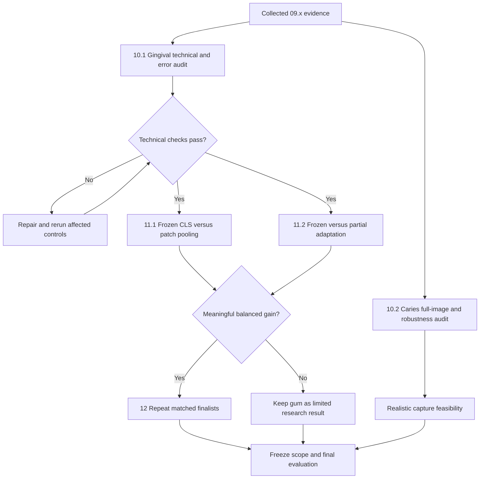

# Post-09 implementation plan

Latest stage update: the user authorized evidence consolidation and local phone-photo feasibility. Executed notebooks 12.1/12.2 now occupy the 12.x numbers; the earlier conditional finalist-repeat proposal below remains unimplemented and deferred. See `docs/PHONE_PHOTO_FEASIBILITY.md` and STATUS.

Execution update: notebooks 10.1 and 10.2 are complete. See [audit findings](reports/post09/FINDINGS_2026-10-22.md). Technical assertions passed; clinical review remains pending. Notebooks 11.1 and 11.2 are implemented, their smoke gates passed, and full v8 runs are complete and collected. Neither beats R1/R2; see [full findings](reports/training/dinov3_publication/FULL_FINDINGS_2026-10-22.md). Read STATUS for live execution state and the [runner repair report](reports/training/dinov3_publication/RUNNER_FIX_2026-10-22.md) before any new publication. The text below preserves the planned stages and controls.

Decision: 22 October 2026. Planning only; no new notebook or GPU run is created by this update. This supersedes unimplemented next actions in the earlier research plan. Preserve all completed experiments.

## Direction

Keep caries detection as the provisional demo anchor. Complete a bounded diagnostic and representation study for gingival grading before deciding whether it remains a demonstration feature or a research-only result. R1 is the simple reference; R2's 0.13-point macro-F1 advantage does not establish a winner. The best observed three-class macro-F1 is 57.40%; 75% remains an engineering aspiration, not a clinical threshold or promised outcome.

## Milestones and dependencies

| Proposed notebook | Work | Required outputs | Dependency / execution |
|---|---|---|---|
| 10.1 `10_1_gingival_failure_audit.ipynb` | Verify original class semantics, crop/tissue geometry, class counts by source group, preprocessing contracts and checkpoint selection. Join all saved predictions; stratify shared versus model-specific errors. Include every no-visible validation ROI, a seeded random mild/marked sample, and a separately marked hard-example gallery | Recomputed metrics; all-model agreement/error table; source-group support; quality/size strata; crop-plus-parent overlays; reviewer sheet with original labels unchanged; technical issue ledger | First; local, saved predictions; no training |
| 10.2 `10_2_caries_full_image_audit.ipynb` | Run existing YOLOv8n/YOLO26n checkpoints on all 327 validation full images. Count localization errors, duplicate predictions, misses and apparent false positives; inspect source annotation completeness. Report lesion-size strata and fixed blur/lighting/JPEG stress tests | Full-image galleries; precision/recall curves; mAP50 and mAP50-95; lesion-size definitions; complete-image robustness comparison; desktop inference cost | Independent of 10.1; reuse weights; local inference or bounded Kaggle inference if needed |
| 11.1 `11_1_dinov3_patch_probe.ipynb` | Controlled frozen DINOv3 comparison: CLS versus CLS concatenated with mean final-layer patch tokens. Same raw crops, 224 input, scaler and logistic-head grid as 09.3 | Feature shapes; pooling diagram/code; matched probe metrics, per-class errors, group bootstrap and feature/head cost | After 10.1 technical checks; no dependency on 11.2 |
| 11.2 `11_2_dinov3_partial_adaptation.ipynb` | Controlled domain-adaptation comparison: frozen DINOv3 plus linear CE head versus same head with final two transformer blocks and final normalization unfrozen. Use CLS in both arms | Trainable-parameter table; gradient checks; learning curves; confusion matrices; macro-F1; per-class recall; checkpoint evidence | After 10.1; can run alongside 11.1. This is a new hypothesis, not a rescue guarantee |
| 12 `12_finalist_repeats_and_pipeline.ipynb` | Repeat only an evidence-supported candidate and matched control at seeds 42/43/44; compare GT-crop versus predicted-box behavior where applicable | Mean/std; group uncertainty; all missed/unmatched detections retained; runtime/parameter accounting; explicit final scope decision | Conditional on a meaningful 11.x gain; freeze full protocol before final test |

Only create a notebook when implementing its stage. If 10.1 finds an objective implementation defect, document it and rerun affected matched controls before interpreting new methods. Do not automatically relabel or remove ambiguous validation examples. Clinical disagreements require a qualified reviewer; lack of review does not block the technical audit but limits its conclusions.

## What the two DINOv3 experiments test

The [official DINOv3 implementation](https://github.com/facebookresearch/dinov3) exposes dense visual representations. Using spatial patch features is therefore a concrete alternative to the CLS-only probe already measured. Mean pooling is a project adaptation, not a reproduced dental method or a gum segmentation mask. Exclude CLS/register tokens from the patch mean and assert the token layout from the pinned implementation.

| Comparison | Held fixed | Changed | Interpretation |
|---|---|---|---|
| 11.1 A versus B | Encoder weights, crop IDs, normalization, head family, C grid 0.01/0.1/1/10, seed | CLS 384 dimensions versus CLS + mean patch features 768 dimensions | Representation/readout study; increased feature dimension is part of the method and must be reported |
| 11.2 A versus B | Crop IDs, augmentation, CLS readout, linear head, CE, batch, epochs, selection | Frozen encoder versus final two blocks plus final norm trainable | Tests limited adaptation to the dental source domain |

11.2 proposed screening recipe: seed 42, batch 32, maximum 30 epochs, patience 8, AdamW, head LR 3e-4, encoder LR 1e-5, weight decay 5e-4, mild flip/rotation, no new color jitter, AMP and validation macro-F1 selection. Both arms use the same head initialization and head schedule. No simultaneous weighting, ordinal head or context fusion. Record exact trainable names and verify frozen parameters remain unchanged. 09.3 logistic regression remains historical evidence, not the matched control for this CE-trained head.

11.1 may reuse the exact verified P1 CLS cache/results only if all input, encoder and head-protocol fingerprints match; otherwise recompute both arms. Never reuse a fitted scaler from validation or a changed representation.

## Decision gates

| Evidence | Decision |
|---|---|
| Objective label-index, geometry, normalization or evaluation defect | Repair with provenance and rerun affected controls; preserve historical results |
| No defect; 11.x improves macro-F1 by at least 3 percentage points over its matched control without reducing no-visible recall | Screening signal only: repeat candidate/control; inspect all classes and grouped uncertainty before promotion |
| Improvement only in accuracy, or minority recall collapses | Reject as a solution to the three-class objective |
| Repeated candidate remains far below the 75% aspiration | Do not claim task success. Keep gingival grading as a limited research result; prioritize caries demo or propose a separately scoped expert-labelled data extension |
| Caries source-validation is strong but realistic capture fails | Resolve image-capture/data-domain feasibility before promising a mobile demo |

The 3-point rule is a predefined project screening rule, not statistical significance or a clinical criterion. The validation set has been reused extensively; all new comparisons remain exploratory. Keep the held-out test unopened until methods, endpoints, thresholds and selection rules are frozen. Do not change the method after reading final test outcomes.

No automatic binary regrouping: it changes the question and does not create missing no-visible examples. No distillation unless a stronger teacher is demonstrated. No unsupported self-labelled clinical corrections or deletion of difficult samples.

## Execution and notebook presentation

Each code cell has preceding English Markdown explaining purpose, assumptions and interpretation, then an informative table, image, diagram, progress record or check. Include real processing and model code visibly in the notebook. Keep inference and training separate. No artificial output from empty scaffold cells.

Kaggle: pin datasets/weights/code, one process per GPU, two independent workers on T4 x2, smoke and checkpoint-restore checks first. Estimate duration from measured smoke throughput before submission; do not extrapolate the roughly one-minute frozen-probe timer to fine-tuning. Use a 2-hour initial worker cap and a 3-hour kernel cap, epoch checkpoints and watchdogs. Mark budget-stopped runs as partial; resume with matching hashes rather than calling them converged. Read live version/status before submitting or collecting.

Personal phone photos are optional, local-only feasibility inputs once the inference notebook exists. They are not public training artifacts. Without independent reference labels, report capture/visibility and qualitative failure modes, not accuracy. User contribution at that stage: ordinary front/open-mouth/accessible-side views, with explicit consent for any other participant. No device setup or mobile code now.

Immediate next implementation: 10.1 and 10.2. Their outputs determine whether 11.x should proceed. Do not launch 11.x merely because its plan exists.
