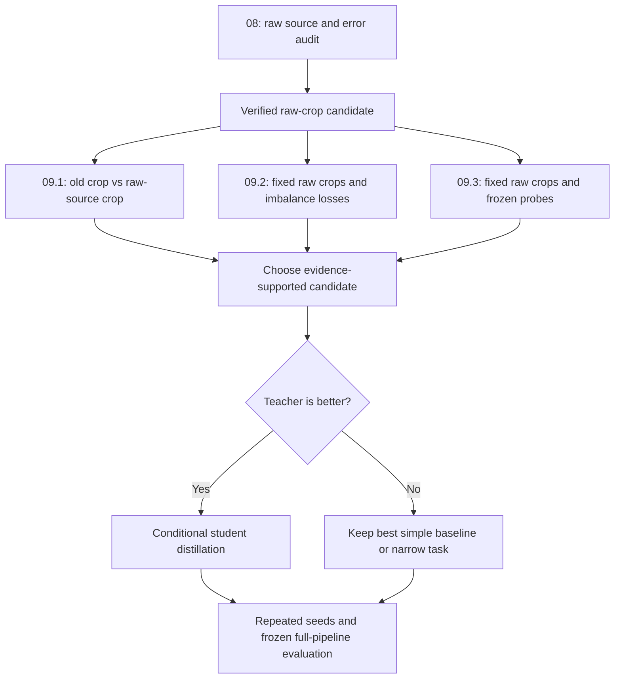

# Research next steps after notebook 07

Current planning authority after collection of all 09.x results: [Post-09 plan](POST_09_PLAN.md). The sequence below records the implemented 08/09 research cycle; its pending-access statements are historical. All three 09.x notebooks have valid collected results.

Decision date: 21 October 2026. This plan supersedes the unimplemented future stages in the earlier plan; completed experiments remain immutable evidence. Implementation started after the user approved this plan. Notebook 08 is executed; current 09.x publication/run state is in `docs/reports/training/roi_recovery_publication.json`. Mobile/export remain deferred.

## Decision and evidence

Keep caries detection as the provisional demo anchor, subject to full-image and phone-photo validation. Pursue one bounded gingival recovery study: preserve source detail, correct class imbalance, and test a modern frozen visual representation. Context gating and ordinal combinations are paused until a better controlled baseline exists.

Confirmed from local manifests and `src/dentalselfie/roi.py`:

| Observation | Evidence | Interpretation |
|---|---|---|
| ROI v1 is cropped after whole-image downsampling | Prepared gum images have maximum edge 1280 | The detection preparation recipe may discard detail useful for fine-grained grading |
| All 10,889 ROI boxes have width and height below 224 before final resize | Median train box: 100.2 x 102.4 px; validation: 99.5 x 101.7 px | Enlarging these to 224 cannot restore lost information |
| Source images retain more pixels | Median source dimensions across ROI rows: 7286 x 4863; median raw-coordinate-equivalent ROI: 569.2 x 582.1 px | Cropping before resizing is a concrete hypothesis; dimensions alone do not prove the original pixels are diagnostically informative |
| Classes are strongly imbalanced | Training counts 210 / 3829 / 4930 | Evaluate prior-aware objectives with identical inputs and training rules |
| CORAL and fusion did not surpass C2 | Best reference macro-F1 55.76%; M1-M4 53.60/53.99/51.46/49.48% | Preserve negative results; do not stack more modules without an ablation |

The target accuracy >=80% and macro-F1 >=75% is an engineering aspiration for the thesis, not a literature-established threshold of clinical usability or a promised outcome. Per-class recall, uncertainty, photo quality and end-to-end external behavior also matter.

## Selected literature and exactly how it will be used

| Source | Supported method or lesson | Project use and limitation |
|---|---|---|
| [Dataset paper, Data in Brief 2024](https://pmc.ncbi.nlm.nih.gov/articles/PMC11462013/) | Professional high-resolution frontal images; tooth-region MGI annotations and captions | Verify the original label mapping and source geometry. Do not treat diagnostic captions as user-provided input: they contain target information |
| [Cui et al., Class-Balanced Loss, CVPR 2019](https://openaccess.thecvf.com/content_CVPR_2019/html/Cui_Class-Balanced_Loss_Based_on_Effective_Number_of_Samples_CVPR_2019_paper.html) | Reweight loss using the effective number of class samples | Test class-balanced cross-entropy as a separate control; counts come only from train |
| [Ren et al., Balanced Meta-Softmax, NeurIPS 2020](https://papers.nips.cc/paper_files/paper/2020/hash/2ba61cc3a8f44143e1f2f13b2b729ab3-Abstract.html) | Balanced Softmax accounts for training class frequencies | Implement the Balanced Softmax component, not the full Meta Sampler; no simultaneous oversampling in this ablation |
| [Menon et al., Logit Adjustment, ICLR 2021](https://research.google/pubs/long-tail-learning-via-logit-adjustment/) | Training-time or post-hoc adjustment using label priors | Theoretical cross-reference. Training-time logit adjustment at tau=1 matches the count-adjusted softmax form; do not count these as independent innovations |
| [DINOv3, 2025 technical report](https://arxiv.org/abs/2508.10104) and [official implementation](https://github.com/facebookresearch/dinov3) | Self-supervised visual features and smaller distilled encoders | Use frozen ViT-S/16 features with a trainable linear classifier first; do not reproduce large-scale pretraining or assume dental superiority |
| [Medical DINOv3 benchmark, revised January 2026](https://arxiv.org/abs/2509.06467v3) | Evaluates frozen representations across medical tasks and reports domain-dependent limitations | Motivation for a controlled probe, not evidence that DINOv3 reaches a specific gingival score; this is a technical report |
| [Hinton et al., Knowledge Distillation, 2015](https://arxiv.org/abs/1503.02531) | Transfer teacher soft outputs to a smaller student | Conditional later experiment only if a teacher demonstrably outperforms the student; mobile implementation stays deferred |
| [GumAI external validation, 2025](https://pubmed.ncbi.nlm.nih.gov/39864975/) | Smartphone community pilot: accuracy 0.85 and reported F1 0.91 coexist with specificity 0.50 | Do not compare that reported F1 to our three-class macro-F1. Use its external-validation lesson, not its scores as a target guarantee |

## Ordered milestones

| Milestone / planned notebook | Work | Exit evidence |
|---|---|---|
| 08 `08_source_resolution_and_error_audit.ipynb` | Audit original-source provenance, labels, native crop size, blurry/occluded crops, class-specific errors and source-parent clustering. Show aligned raw-source vs ROI-v1 crops. Derive a separately versioned raw-crop candidate if geometry checks pass | Original and derived hashes, matching crop IDs/labels/groups/splits, before/after panels, exclusion log and verified train/val-only manifest |
| 09.1 `09_1_resolution_control.ipynb` | R0: ROI-v1 + ResNet18 CE. R1: original-source crop candidate + same ResNet18 CE. Same final 224 input and same augmentation | Isolate crop preparation from model/input-size changes; compare matched seeds and per-class metrics |
| 09.2 `09_2_imbalance_ablation.ipynb` | On the predetermined raw-source crop recipe: plain CE, class-balanced CE, Balanced Softmax. Reuse the matching CE result when protocol/seed hashes match | Isolate the objective; report class precision/recall/F1, prediction frequencies, confusion, MAE and macro-F1 |
| 09.3 `09_3_foundation_feature_probe.ipynb` | Frozen ResNet18 features vs frozen DINOv3 ViT-S/16 features; identical head-training/search budgets and class objective. Cache only fixed representations; any fitted feature transform uses train only | Determine whether a stronger representation improves separability without full-backbone overfitting. Compare these probes separately from end-to-end fine-tuning |
| Conditional follow-up | If a frozen teacher helps, compare a compact student with and without teacher supervision under the same recipe. Revisit context/ordinal methods only with a concrete error-based reason | A teacher-student ablation, parameter/runtime accounting, and repeat-seed evidence; no promised gain |
| Frozen evaluation | Repeat the selected control/candidate with seeds 42, 43, 44; freeze the pipeline and thresholds before final test | Mean/std, source-group bootstrap intervals, predicted-box evaluation and realistic photo-domain assessment |

Only create notebooks when implementing their stage. Each code cell has an explanatory English Markdown cell and an informative table, figure or printed check. Keep teaching implementation inside each training notebook as requested. Avoid copying diagnostic captions into inputs or labels inferred from predictions.

## Controls and operational rules

- Preserve ROI v1 and the original source archives. Crop directly from the verified original using normalized/source-matched coordinates; do not scale previously rounded integer crop bounds blindly. Verify EXIF orientation, retained annotation identity/order, class mapping, source hash and parent ID. Record any rounding difference. Preserve split locks and sample membership. Do not inspect test pixels in notebook 08.
- Never discard difficult validation cases to improve a score. For quality strata, report the full set and each stratum; any refusal/quality filter reports coverage and errors among accepted inputs.
- Do not relabel uncertain disease severity based on model predictions or image inspection by the agent. Separate objective file/geometry errors from clinical ambiguities requiring qualified review.
- Predeclare the matched screening recipe: ImageNet ResNet18, 224 input, one process per GPU, seed 42, AdamW lr 3e-4 / weight decay 5e-4, batch 32 without accumulation, maximum 30 epochs, patience 8 and validation macro-F1 selection. Use synchronized mild flip/rotation where applicable. Any augmentation or optimization change must apply to the whole comparison, including its new control. This is not an exact rerun of historical C2.
- CB-CE first setting: beta=0.999, normalized weights proportional to (1-beta)/(1-beta**n_class), using training counts. Balanced Softmax training: CE(logits + log(n_class), y), standard logits at inference. Do not apply the same prior correction twice or combine reweighting and resampling in the initial matrix. If a small hyperparameter grid is needed, declare it before seeing the comparison results and give controls comparable tuning budgets.
- Source groups/parents, not individual crops, are the unit for confidence-interval resampling. Group IDs are observable grouping constraints, not verified patient identities. Keep all ROIs from a resampled group together.
- Frozen probes use the same crop IDs and fixed preprocessing per encoder's official contract; record any unavoidable differences. Head regularization is selected on validation within a bounded declared grid. PCA/scalers, if used, fit train only. A foundation representation result is not solely an architectural comparison because pretraining also differs.
- Kaggle T4 x2 handles independent workers in isolated processes, not threads that reset global RNGs. Perform an actual short GPU smoke, verify initialization and checkpoint restore, and measure the first three epoch times before a full run. Save optimizer/scheduler/scaler and per-process RNG state, input/protocol hashes and an explicit external resume path. Use a process watchdog and a session cap comfortably below 12 hours. Record partial runs rather than reporting them as converged.
- DINOv3 official weights require the official access flow. Inspect existing access at implementation time; if acceptance needs the user's account, provide the official link then. Keep access tokens/signed URLs out of public notebooks and datasets. Pin code/weight versions and verify redistribution terms before any public packaging. Do not silently substitute another backbone.
- Distillation is trained with train images and a train-fitted teacher; validation remains for selection. Compare the same student and class objective with/without distillation, and report the teacher-student gap. A compact model is only a deployment candidate until device measurements are made later.

## Stop/go decisions and realistic demo path

The first decision is whether raw-source crops improve the matched reference, not whether a new architecture immediately reaches 80%. A repeated several-point macro-F1 improvement with acceptable per-class behavior justifies the next method stage. If the corrected data/loss/representation cycle remains well below the 75% aspiration, stop adding modules: examine label ambiguity and the information available in photographs, consider an explicitly reported binary task, or seek compatible expert-annotated training data as a separate approved extension. Binary grouping does not remove the scarcity of no-visible examples and its metrics are a different task.

Caries remains a promising demo anchor because its current validation detection mAP50 is 94.16% for YOLO26n, but those source-domain numbers do not establish performance on phone selfies. Before selecting a final pipeline, inspect full-image validation false positives/negatives and small-lesion performance, then conduct a consented local phone-image feasibility check. Personal pilot images stay local; without independent labels they support usability/domain inspection, not accuracy claims. A later labeled external evaluation is needed for quantitative generalization evidence.

The thesis story is: scratch baselines -> transfer learning -> unsuccessful fusion/ordinal screening -> identified preprocessing and imbalance limitations -> controlled data/loss/foundation-feature study -> compact model only if supported -> complete-pipeline evaluation. The contribution is a reproducible task-specific study; no globally novel method or guaranteed clinical performance is claimed.

## Parallel execution clarification

The user approved running 09.1-09.3 independently after 08. Raw-source crops are fixed a priori for 09.2/09.3; they do not wait for 09.1 to choose a crop recipe. R1 in 09.1 is the shared CE control for 09.2. No input dataset or checkpoint is changed in response to other concurrent results. The DINOv3 branch is pending official access; it has not trained.
