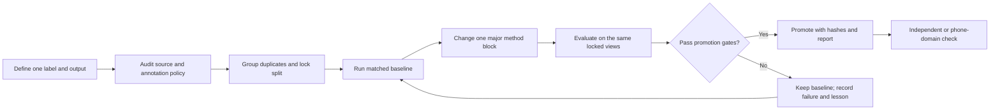

# DentalSelfie Model Training Playbook

**Purpose:** a reusable, evidence-based guide for preparing data, training, evaluating and promoting models across the project's current dental labels.

**Evidence cutoff:** 24 November 2026. This guide summarizes collected local/Kaggle evidence; it does not claim a new experiment or a clinical validation. Follow the linked result reports for exact commands, manifests, input versions, checkpoints and caveats.

## 1. Project-wide rule

The biggest gains and the biggest metric failures in this project have come from the data definition and evaluation protocol. Treat every experiment as a controlled comparison: keep the task, split, validation rows, evaluation code and most training settings fixed; change one meaningful block at a time. A higher number is not a better model if it was obtained by changing the validation cohort, removing difficult examples, or confusing a diagnostic subset with the primary evaluation.

## 2. Define the metric before training

| Task | Primary measures | What they answer | Do not substitute |
|---|---|---|---|
| Bounding-box detection | mAP50, mAP50-95; also precision and recall | Whether boxes are found and how well their locations agree at IoU thresholds | Classification accuracy, per-image accuracy, or a score from a different label/split |
| Multi-class image/ROI classification | Macro-F1, per-class precision/recall, confusion matrix | Whether minority and majority classes are recognized; macro-F1 weights classes equally | Overall accuracy alone |
| Tooth geometry/measurement | Agreement error, ICC/correlation, tolerance rate | Whether measurements agree with a reference measurement | Detection mAP or classification F1 |

For a detector, **mAP50** averages class AP at IoU 0.50. **mAP50-95** averages AP over IoU thresholds 0.50 through 0.95 in steps of 0.05, so it penalizes imprecise boxes more strongly. Precision and recall depend on a confidence operating point; AP integrates ranking across confidence thresholds. Report all of them when available. A model can raise precision while losing recall and mAP, as several spacing studies demonstrate.

For a classifier, report macro-F1 with per-class support and recall. If classes are ordinal, include the confusion matrix and a declared ordinal metric; do not hide errors in the class most important to the demo.

## 3. Data preparation that protects metric validity

1. **Freeze the task schema.** Record class names, visual inclusion/exclusion rules, box convention, image-level versus instance-level labels, and whether a missing annotation means unknown or truly negative. Missing cross-disease labels are not negatives.
2. **Preserve provenance.** Keep source archive, license, version, SHA-256, original class map and a machine-readable manifest. Normalize into a separate derived dataset; never silently edit the source.
3. **Audit the annotations.** Check image/label pairing, malformed rows, class IDs, box bounds, empty-label meaning, duplicate boxes, tiny/degenerate boxes, and visual overlays. Quarantine with a reason; do not silently clip or relabel.
4. **Group before splitting.** Join exact duplicates and plausible same-scene/session near duplicates using hashes and visual review. Split groups, not files. Claim patient independence only when verified patient IDs support it.
5. **Lock evaluation membership.** Save manifest hash, image/label hashes and split summary. Do not use test for training, model selection, threshold choice, pseudo-labeling, filtering or repeated inspection.
6. **Use a two-view evaluation only when predeclared.** A primary fixed validation and a sensitivity/quality-stratified view may both be reported, but neither is replaced after seeing the result. Show cohort size and positive/box support for each.
7. **Inspect representative errors.** Use prediction overlays and per-image summaries to diagnose label policy, scale, context, source domain and missed objects. Visual inspection after evaluation may guide a future train-only change, not validation relabeling.

### Safe interpretation of two validation cohorts

Use a **fixed primary cohort** for promotion and a **separately defined sensitivity cohort** to test robustness to a documented issue such as known cross-source overlap. A curated clean/quality subset can be a diagnostic slice, never the headline score. Report the full cohort first, then the slice with its selection rule, count and overlap caveat. Never construct a "good metric" validation set by dropping hard images or choosing examples after inspecting predictions.

## 4. Training protocol and experiment design

### Matched baseline

- Start with a stable, readily reproducible baseline for that task. Record architecture/weights, library version, input size, optimizer, learning rate, batch, epochs, early-stop policy, augmentation, random seed, GPU, data version and command.
- Establish that a repeated run can reproduce the baseline within expected seed variation before adding complexity.
- Keep all arms on the same locked validation and use identical evaluation settings. For method comparisons, retain a control arm in the same run when possible.

### Large method changes before small tuning

When a baseline is weak, investigate the evidence that could explain the ceiling and choose a meaningful block:

| Evidence from audit | Candidate block to test | Required control |
|---|---|---|
| Tiny boxes or low-resolution tooth detail | Higher-resolution input, P2/high-resolution head, or crop/sliced training | Same source rows and evaluator; report latency/memory if inference changes |
| Context helps distinguish target from normal anatomy | Context-aware crop or paired local/context features | Compare to full-frame/uncropped control; check recall as well as AP |
| External source hurts due to style/annotation shift | Train-only source screening, domain adaptation or anatomy transfer | Preserve source and project-only controls; deduplicate across splits |
| Many target-negative images may contain other dental findings | Auxiliary class/task to teach shared anatomy, or a carefully justified negative policy | Keep eligible target examples; compare with the same base model and fixed target metric |
| Class imbalance in classification | Weighted loss, Balanced Softmax, ordinal objective, or carefully sampled batches | Matched seed/split/augmentation and per-class recall |
| Similar-looking classes are confused | Better crop scale, source detail, representation or label definition | Error-based hypothesis and a matched ablation, not a model-name swap |

Change one interpretable block per comparison. If several changes are combined, call it a package comparison and do not attribute the gain to an individual component. Use at least two seeds for a final claim when feasible; otherwise label it single-seed evidence.

### Image preprocessing and augmentation

- Resize/letterbox consistently and preserve the mapping from source coordinates to model coordinates. Use the same evaluation transform across arms.
- For small lesions, inspect the **effective target size after resize**. If critical structure disappears, test higher resolution or crops; avoid assuming larger is better without a matched full-split experiment.
- Crop training examples around a target only using train annotations. Keep enough surrounding context to preserve anatomy and avoid crop artifacts. Do not crop validation differently to inflate AP.
- Use geometric/color augmentation only when it plausibly represents capture variation and preserves label semantics. Record exact probabilities and magnitudes. Strong mosaic/mixup can harm tiny dental targets or local context; ablate rather than assume.
- Test-time augmentation, SAHI/slicing and WBF are inference methods, not new trained models. Compare full validation, runtime and memory, and keep the single-model result beside the ensemble result.
- For phone-domain claims, use separately consented and labeled phone captures with a predeclared protocol. Synthetic blur/darkness/JPEG stress is useful for robustness checks but does not replace real capture validation.

## 5. Current label evidence and lessons

The table below separates collected metrics by task and source view. Values are **not directly comparable across different labels or datasets**. If a newer run is still active or has not been collected, it is not a result.

| Label / task | Verified reference in current reports | What the evidence says | Promotion / reporting note |
|---|---|---|---|
| Caries detection | YOLO26n source-validation audit: mAP50 94.12%, mAP50-95 73.01%; YOLOv8n 93.54% / 72.73% | Strong source-validation localization on the prepared cohort; synthetic stress shifts scores only modestly | Not phone accuracy or independent clinical validation. Report the validation source and that the test split was not used. See `docs/reports/post09/FINDINGS_2026-10-22.md`. |
| Gingival appearance / ROI classification | Best observed macro-F1 remains 57.40% (R2), near-tied with R1 57.26% | Context, ordinal loss and foundation features did not create a reliable high-performing three-class screen; partial DINOv3 adaptation missed all 49 no-visible validation crops | Do not describe this classifier as usable clinical screening. See `docs/reports/training/ROI_09_COMBINED_FINDINGS_2026-10-22.md` and `docs/reports/synthesis/FINDINGS.md`. |
| Gingival-region detection | YOLOv8n: mAP50 95.45%, mAP50-95 55.78%; YOLOv8s: 95.19% / 56.33% | High AP50 on 160 source validation images and 1,870 boxes, but no fully annotation-negative validation images | Region-localization metric does not measure image-level false alarms or phone performance. See `docs/reports/gingivitis_binary/BASELINE_RESULTS.md`. |
| Calculus detection | Conservative grouped full-image baseline: YOLOv8s 49.33% / 22.15% on 239 images. Highest recent full-image-view score in the dual-view crop studies: YOLO26s mixed dual, 54.50% / 24.60% on 26 images. Highest close-up score: YOLO26s extra-COCO, 81.11% / 33.80% on 127 crops; extra-transfer instead has the highest crop mAP50-95 at 35.39% (79.83% mAP50) | These are different views/support sizes. Crop checkpoint selection used the reused close-up view; validation views may overlap and patient independence is unverified. The 81.11% is not a whole-image score | Report the input view and cohort with every value. For a broad full-image reference, retain the 239-image grouped result; if presenting close-up inference, disclose the separately derived 127-crop validation. See `docs/reports/calculus_grouped/RESULTS.md` and `data/runs/calculus_{mixed_dual_yolo26s_v1,extra-coco-26_v1,extra-transfer-26_v1}/summary.json`. |
| Crowding detection | YOLO26s + screened FIPDZ train add-on single model: mAP50 69.76%, mAP50-95 32.76% on the full GigiKita validation | This is the strongest verified single-model Ultralytics headline. Re-evaluation of the same add-on checkpoint with the common COCO evaluator gives 68.69% / 32.87%; WBF gives 69.73% / 31.31%. Evaluator metrics should not be mixed as if they were one matched table | State the metric implementation. For the project's historical headline, cite 69.76% / 32.76%; when comparing ensemble and single model, use the common COCO table throughout. See `docs/reports/alignment/crowding_train_review_2026-11-22/REPORT.md` and `docs/reports/alignment/CROWDING_CURRENT_WBF_RESULTS_2026-11-22_V2.md`. |
| Spacing / diastema detection | Official YOLO26s + CIoU-NWD reference: 60.68% / 24.29%, recall 59.53%, on fixed primary 477-image view. Context-crop candidate: 62.29% / 24.75%, recall 57.67% | Context crops improved both AP measures on primary and sensitivity views, but recall dropped 1.86-1.87 percentage points and missed the declared promotion gate. Raw add-on, screened add-on and negative filtering reduced AP | Keep the project-only reference official. Treat context crop as a research candidate, not promoted model. Never alter the 477/473 image views. See the 16.70/16.67/16.72/16.73 result reports under `docs/reports/alignment/`. |

### Why some published/high historical numbers are not the current baseline

The historical calculus AP50 of 78.03% was obtained on a split with repeated scenes across train/validation and a larger training set. The later grouped split removes connected training images and fixes the optimizer/seed recipe. The later score is the more defensible estimate for that split; the difference is not a clean estimate of leakage alone because multiple protocol factors changed. Similarly, published paper metrics on different modalities, label taxonomies, box conventions or IoU definitions are method references, not directly comparable target scores.

## 6. Practical Kaggle T4 x2 execution

1. Preflight the exact dataset version, manifest SHA, expected counts, class map, notebook checksum, accelerator and output paths.
2. Run a short smoke to validate imports, data resolution, one batch, checkpoint writing and final metric serialization. A smoke is not a model result.
3. For two independent arms, assign one worker/process per GPU and log the selected device. Avoid two workers competing for the same GPU unless the notebook explicitly benchmarks that setup.
4. Budget below the 12-hour session limit. Save regular epoch checkpoints and a resumable state; make the output collector version-pinned. Reserve time for final validation and packaging.
5. Log epoch/heartbeat and use bounded timeouts. If a run fails, classify it as setup, data, runtime, quota or serialization failure before restarting; do not silently launch duplicate versions.
6. After completion, collect logs, history, best/last weights, metrics JSON, environment and hashes. Revalidate the saved best checkpoint on the same fixed view before reporting.
7. Keep one account/session available for a distinct, predeclared track; do not spend both GPUs repeating nearly identical configurations while a more informative controlled comparison remains.

## 7. Promotion gate and reproducibility record

A candidate replaces the reference only when all predeclared conditions are satisfied:

- Same task definition, fixed evaluation membership and evaluator as the reference.
- Data/weights/config versions and run completion are verified; saved checkpoint hash matches the report.
- The primary metric improves by a meaningful margin, without an unacceptable recall or per-class regression. Set the margin and trade-off gate before seeing results.
- Sensitivity views do not reveal a material failure, or the limitation is stated and accepted for the intended use.
- Runtime/size/latency is acceptable for the intended deployment; AP gain alone does not establish mobile feasibility.
- Single-seed results are labeled exploratory; repeat or report uncertainty before claiming robust superiority.

Save at minimum: source/license/version, source and derived hashes, manifest and split hashes, label schema, train/validation/test counts and positives, exclusions with reasons, code/notebook hash, package/model versions, seed, full config, logs, checkpoint hashes, metrics JSON, plots, error examples and a promotion decision.

## 8. Common failure modes and response

| Failure | Likely cause to investigate | Correct response |
|---|---|---|
| High AP50 but low AP50-95 | Boxes are found but localization is loose/inconsistent | Review box policy/overlays and localization errors; report both metrics |
| Precision rises while recall/AP fall | Model became conservative or train distribution changed | Keep the old reference; inspect thresholds and missed positives, but do not tune validation membership |
| External data lowers performance | Domain, target definition, class map, negative policy or image context mismatch | Run a matched train-only add-on/screening experiment; volume alone is not evidence |
| Large gains on a tiny/clean subset | Selection effect and small sample support | Keep the fixed full cohort headline; treat subset as descriptive diagnostic only |
| Baseline changes after split cleanup | Fewer training examples, less leakage, new optimizer or protocol | Document all changes; do not attribute the score change to one cause |
| Train loss improves but validation does not | Overfit, noisy labels, source shift, weak target support | Inspect train-only audit and fixed-view errors; test a new hypothesis, not random hyperparameter tweaks |
| Good source validation, weak phone demo | Capture domain differs in angle, focus, lighting, saliva/occlusion or framing | Gather a consented, labeled phone pilot; report failure/abstention behavior and do not imply clinical accuracy |

## 9. Resume checklist for the next agent/session

- Read `README.md`, `docs/STATUS.md`, this playbook and the label-specific result report.
- Check the exact Kaggle version/state only if the user resumes training work; follow the 20-minute polling cadence in the current status checkpoint.
- Collect any already-running output before deciding on more training. Never replace a collected result with an uncollected/latest-version assumption.
- Preserve fixed validation and test boundaries; check git status before editing or publishing.
- Update `docs/STATUS.md` only with observed evidence and the next executable action.

