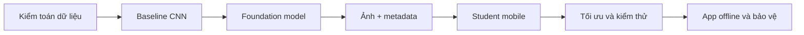
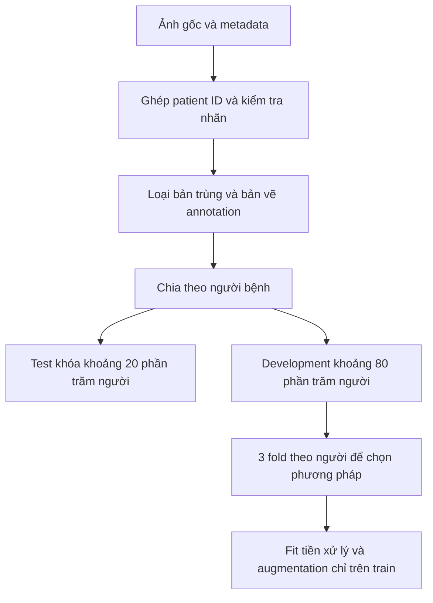
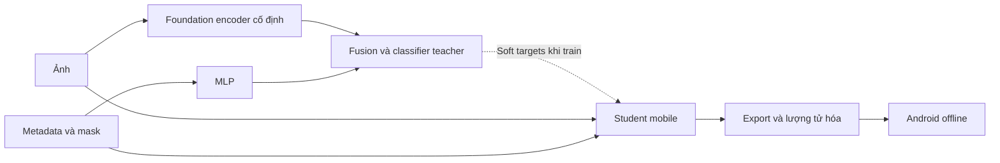
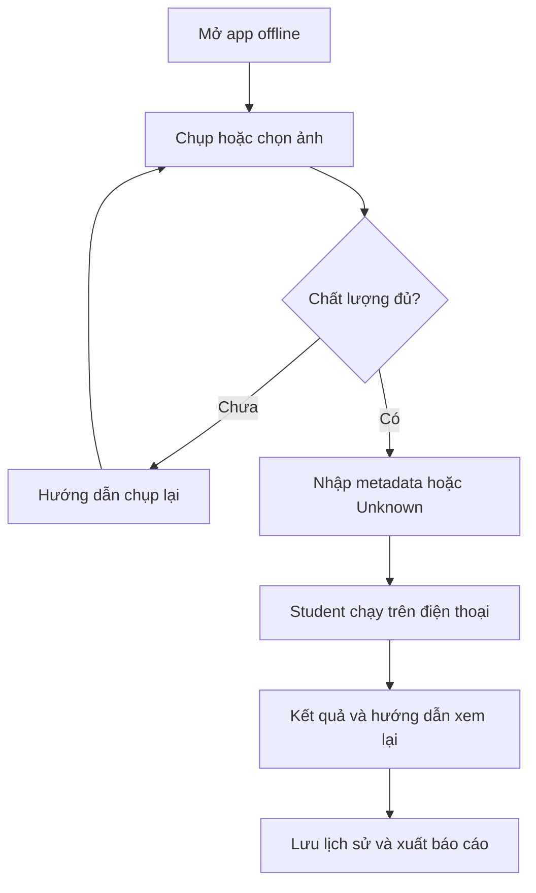

# OralGuard — Kế hoạch đồ án đã chốt

> Chốt phạm vi ngày 19/10/2026. Đây là kế hoạch triển khai; chưa tải toàn bộ dữ liệu, huấn luyện hay xác nhận mức cải thiện.

**Tên tiếng Anh:** *OralGuard: An Offline Mobile Application for Multimodal Oral Lesion Screening*.

**Câu chuyện chính:** Dữ liệu oral ít → thử CNN truyền thống → chuyển giao foundation model → bổ sung thông tin người bệnh → tối ưu mô hình nhỏ → chứng minh chạy offline trên điện thoại.

## 1. Quyết định phạm vi

| Hạng mục | Chốt thực hiện |
|---|---|
| Bài toán AI | Phân loại ảnh niêm mạc miệng thành 4 nhóm của SMART-OM |
| Điểm nhấn nghiên cứu | So sánh pretrained thông thường, foundation model tổng quát và chuyên miền; đánh giá lợi ích metadata |
| Cải tiến thực nghiệm | Fusion ảnh–metadata; xử lý metadata thiếu; distillation nếu có lợi |
| Thiết bị triển khai | Android, ưu tiên Kotlin + Jetpack Compose; suy luận và lưu hồ sơ trên máy |
| Huấn luyện | Kaggle T4 ×2; PyTorch, timm, Transformers; notebook đánh số |
| Ngôn ngữ | Kế hoạch tiếng Việt; giao diện, báo cáo và slide tiếng Anh |
| Người dùng demo | Người hỗ trợ sàng lọc; kết quả là hỗ trợ xem xét/chuyển khám |
| Sản phẩm | APK + notebook tái lập + kết quả thí nghiệm + báo cáo + video demo |

**Loại khỏi phạm vi:** chatbot/LLM, backend bệnh viện, portal bác sĩ, FINO, huấn luyện foundation model từ đầu, ảnh huỳnh quang, RNA, phân đoạn thành một bài toán riêng. Giữ một app hoàn chỉnh và một chuỗi nghiên cứu có đối chứng.



## 2. Chốt dữ liệu cụ thể

| Bộ dữ liệu | Quyết định | Nguồn và điều kiện |
|---|---|---|
| **SMART-OM v1** | **Dữ liệu chính bắt buộc:** train, validation, test nội bộ | [Figshare, DOI v1](https://doi.org/10.6084/m9.figshare.31341790.v1); 2.469 ảnh / 331 người theo mô tả; CC BY 4.0; file `SMART-OM.zip` khoảng 1 GB |
| **Dataset of Annotated Oral Cavity Images for Oral Cancer Detection, Zenodo v1** | **Tập đánh giá ngoài có điều kiện**, không dùng để tuning | [Zenodo 10664056](https://zenodo.org/records/10664056); 3.000 ảnh và metadata; truy cập hạn chế. Chỉ dùng khi được cấp quyền và làm rõ phạm vi xử lý/đánh giá được phép |
| Hugging Face `nsr51324/Oral_Diseases` và Kaggle `jhirshaikh/oral-image-dataset` | Không đưa vào thí nghiệm chính | Khác hệ nhãn; chưa xác minh patient ID, metadata ghép ca và tính độc lập giữa hai nguồn |
| MeMoSA | Không đưa vào phạm vi hiện tại | Không cần mở thêm một nhánh xin dữ liệu và chuẩn hóa nhãn |

**Điểm chốt:** đồ án hoàn thành được bằng SMART-OM. Nếu chưa tiếp cận được Zenodo, báo cáo rõ chưa có kiểm chứng ngoài; không thay bằng một bộ ảnh không rõ nguồn.

### Đầu vào và nhãn

| Thành phần | Nội dung |
|---|---|
| Ảnh `I` | Một ảnh RGB niêm mạc; dùng ảnh gốc không vẽ annotation |
| Metadata `M` | Tuổi, giới, hút thuốc, thuốc lá không khói, rượu, areca/trầu — chỉ giữ trường thực sự có, ghép đúng người và được chuẩn hóa sau audit |
| Mask `R` | Cho biết từng trường đã cung cấp hay chưa; “không biết” khác “không” |
| Nhãn `y` | `Normal`, `Variation from Normal`, `OPMD`, `Oral Cancer` theo nhãn nguồn |
| Trường bị loại khỏi input | Chẩn đoán, kết quả sinh thiết, tên thư mục chứa nhãn, patient ID và thông tin tiết lộ kết quả |

**OPMD là nhóm tổn thương có khả năng ác tính, không phải xác suất sẽ chuyển thành ung thư.** Audit phải kiểm tra nhãn áp dụng cho từng ảnh/vùng hay toàn người bệnh; không tự gán bệnh của người cho mọi ảnh của họ.

### Quy trình dữ liệu bắt buộc



- Kiểm tra phân bố từng lớp theo **người**, không chỉ số ảnh. Nếu lớp quá ít cho 3 fold, điều chỉnh cách chia và ghi lý do trước khi train.
- Các ảnh gần trùng và bản khác mức annotation của cùng ảnh phải ở cùng nhóm. Giữ manifest và hash để truy vết.
- Fit imputation, chuẩn hóa metadata, class weight và sampling trong train của từng fold.
- Zenodo chỉ đánh giá nhị phân sau khi kiểm tra tương thích: `OPMD/Oral Cancer` đối chiếu với phần còn lại. Đây là phép gộp nhãn nghiên cứu, không mặc định tương đương quyết định chuyển khám của bác sĩ.
- Không upload công khai dữ liệu hạn chế. Ghi attribution, phiên bản và nguồn dữ liệu trong báo cáo.

## 3. Model và phương pháp đã chọn

| Nhóm | Cấu hình | Cách chạy |
|---|---|---|
| CNN baseline | **ResNet18, EfficientNet-B0, MobileNetV3-Large** | Fine-tune pretrained ImageNet, cùng split và ngân sách tuning |
| Foundation tổng quát | **DINOv3 ViT-S/16** — `facebook/dinov3-vits16-pretrain-lvd1689m` | Đóng băng encoder, cache embedding, train MLP nhỏ |
| Chuyển miền da → miệng | **Google Derm Foundation** — `google/derm-foundation` | Đối chứng bám paper ISBI 2026; trích xuất embedding trong môi trường riêng nếu cần |
| Foundation y tế hiện đại | **MedSigLIP** — `google/medsiglip-448` | Chỉ dùng image encoder, đóng băng và cache embedding; không full fine-tune 400M tham số |
| Model triển khai chính | **MobileNetV4 Conv Small** — `timm/mobilenetv4_conv_small.e1200_r224_in1k` | Huấn luyện trực tiếp và thử distillation cùng kiến trúc |
| Dự phòng triển khai | **MobileNetV3-Large** | Dùng nếu V4 khó export hoặc không có lợi trên máy đích |

Chốt revision weights, phiên bản thư viện và quyền tải model ở notebook `00`. Không tự thay checkpoint khi thiếu quyền truy cập; ghi rõ cấu hình bị chặn. Đồ án vẫn tiếp tục với những model truy cập được.

**Giới hạn số nhánh:** sàng lọc trên một fold development cố định; chỉ đưa cấu hình tốt nhất mỗi nhóm vào kiểm chứng 3 fold. Foundation model dùng cùng loại head/ngân sách tìm kiếm nhưng giữ preprocessing gốc của từng model. Báo cáo đây là so sánh hệ thống pretrained, không khẳng định tách được hoàn toàn tác dụng kiến trúc và dữ liệu pretraining.

### Thứ tự cải tiến và đối chứng

| ID | Thí nghiệm | Câu hỏi / điều kiện giữ lại |
|---|---|---|
| E1 | CNN chỉ ảnh | Điểm xuất phát và lỗi theo từng lớp là gì? |
| E2 | Foundation chỉ ảnh | Biểu diễn tổng quát/chuyên miền có lợi trên cùng dữ liệu không? |
| E3 | Metadata-only MLP | Metadata có quá chi phối hoặc chứa leakage không? |
| E4 | Encoder tốt + metadata MLP + concatenation | Thêm thông tin người bệnh giúp gì so với E2 và E3? |
| E5 | E4 + missingness mask + che metadata khi train | Có bền hơn khi thiếu 0%, 25%, 50%, 100% trường quan sát được không? |
| E6 | MobileNetV4 + cùng head/mask, huấn luyện trực tiếp | Đối chứng mobile bắt buộc |
| E7 | E6 học thêm từ teacher tốt nhất | Distillation có giúp ở cùng kiến trúc và ngân sách không? |
| E8 | Bản float so với bản lượng tử hóa | Đánh đổi hiệu quả, RAM, kích thước và độ trễ thực tế |

Teacher và student nhận cùng loại input ở E7. Dùng loss nhãn thật + soft targets; chọn trọng số/temperature trên validation. Bắt đầu distillation logits; không thêm feature alignment, attention hay ensemble nếu chưa cần.

**Chỉ số chọn chính: macro-F1 trên validation.** Kèm recall từng lớp và độ ổn định. Không giữ cải tiến chỉ vì một seed tốt; không cam kết kết quả phải tăng theo từng bước.



## 4. Các mốc và notebook đánh số

> Bảng dưới là danh mục cần xây dựng, chưa phải notebook đã có. Notebook điều phối; logic dùng chung đặt trong `src/` để agent sửa một nơi và mọi thí nghiệm dùng cùng implementation.

| Mốc | Notebook / phần việc | Đầu ra | Hoàn thành khi |
|---|---|---|---|
| **M0 — Chạy xuyên suốt tối thiểu** | `00_setup_and_mobile_smoke.ipynb` + app khung | Environment lock, kiểm tra GPU/model access, model mẫu export | Một ảnh chạy được trên Android ở chế độ máy bay; chốt runtime export trước khi train dài |
| **M1 — Dữ liệu đáng tin** | `01_data_audit.ipynb` | Data card, thống kê lớp/người, báo cáo trùng và thiếu metadata | Ghép ảnh–người–nhãn đúng; có ví dụ trực quan để kiểm tra |
| **M2 — Khóa quy trình** | `02_patient_splits.ipynb` | Manifest test và 3 fold, label map, feature schema | Không giao người/ảnh trùng giữa train–val–test; khóa test |
| **M3 — Có baseline** | `03_cnn_baselines.ipynb` | Metrics, checkpoint, confusion matrix trên validation | Baseline train ổn; giải thích được lỗi chính |
| **M4 — Có bằng chứng chuyển giao** | `04_foundation_models.ipynb` | Embedding cache, kết quả các encoder | So sánh công bằng; chọn teacher theo validation |
| **M5 — Có kết quả multimodal** | `05_multimodal_ablation.ipynb` | E3–E5; bảng đầy đủ/thiếu metadata | Xác định metadata và cơ chế xử lý thiếu có giúp không |
| **M6 — Chọn student** | `06_mobile_student.ipynb` | E6–E7; teacher/student checkpoints | Chọn trực tiếp hoặc distillation bằng kết quả, có đối chứng cùng kiến trúc |
| **M7 — Model triển khai đúng** | `07_export_quantization.ipynb` | Model export, preprocessing spec, golden inputs/outputs | Python và runtime mobile nhất quán trong sai số định trước; chọn quantization trên validation |
| **M8 — Đánh giá cuối** | `08_final_evaluation.ipynb` | Test predictions, khoảng tin cậy, robustness, external test nếu có | Chạy các cấu hình đã khóa; không tuning lại theo test |
| **M9 — Demo và báo cáo** | App + `09_results_and_thesis.ipynb` | APK, benchmark CSV, hình/bảng, báo cáo, video | Hoàn thành hành trình demo; mọi số trên slide truy được về artifact |

M0 chạy song song việc kiểm toán dữ liệu. Sau M2, agent có thể phát triển app bằng schema đã chốt trong khi các notebook nghiên cứu tiếp tục.

## 5. Cách tận dụng Kaggle T4 ×2 và agent

| Việc | Cách thực hiện |
|---|---|
| Hai GPU | Mỗi GPU có bộ nhớ riêng; không coi T4 ×2 là một GPU 32 GB. Mặc định hai process độc lập cho hai model/fold, nếu RAM/CPU cho phép |
| Độ chính xác số | CNN dùng AMP FP16 + GradScaler; foundation extraction kiểm tra FP16 với FP32 trên mẫu nhỏ. Không mặc định BF16 |
| Foundation model | Batch nhỏ tự điều chỉnh; encoder frozen, lưu embedding một lần theo model revision + image hash + preprocessing |
| Distillation | Teacher frozen; cache logits cho input cố định hoặc chạy teacher online trên cùng ảnh đã augment. Không ghép logits của ảnh gốc với augmentation tùy ý |
| Multi-GPU training | Chỉ thêm DDP qua script khi đo thấy có lợi; không cần để hoàn thành đồ án |
| Tiếp tục phiên Kaggle | Lưu `best`, `last`, optimizer/scaler, seed, config và manifest version; bật resume |
| Artifact | Input ở `/kaggle/input`; output ở `/kaggle/working`; lưu phiên bản output sau mỗi mốc |
| Agent hỗ trợ code | Dựng loader, training, export, app và sinh biểu đồ từ kết quả đã lưu |
| Agent hỗ trợ review | Kiểm tra leakage, schema, metric, test preprocessing và tính nhất quán giữa báo cáo với log |
| Người thực hiện | Xác nhận nhãn, đọc ca sai, quyết định thí nghiệm và hiểu kết quả để bảo vệ |

Mỗi run lưu tối thiểu: `config.json`, `metrics.json`, `predictions.csv`, `checkpoint`, `environment.txt`. Đặt tên dạng `E05_model_fold0_seed42`. Chạy sàng lọc một seed; lặp ba seed cho cặp baseline–cải tiến cuối để kiểm tra ổn định.

## 6. App vừa đủ hoàn chỉnh

| Module | Chức năng chốt |
|---|---|
| Thu ảnh | Camera/gallery, hướng dẫn vị trí chụp, kiểm tra nhòe/tối đơn giản; báo lý do chụp lại |
| Thông tin người bệnh | Đúng các trường đã train; cho phép “Unknown”; cùng mapping với Python |
| Kết quả | Nhóm dự đoán, trạng thái cần xem lại và mô tả phạm vi; không hiển thị điểm model như xác suất ung thư đã xác thực |
| Hỗ trợ quyết định | Quy tắc minh bạch, có nguồn và được rà soát chuyên môn; chưa được rà soát thì chỉ ghi “cần chuyên gia xem lại”, không tự kê đơn hay định mức khẩn cấp |
| Theo dõi | Lưu lần chụp, ghi chú, ảnh đặt cạnh nhau, nhắc lịch do người dùng đặt; không suy diễn tốc độ tiến triển bệnh |
| Bảo vệ dữ liệu | Lưu riêng trong app, bảo vệ dữ liệu nhạy cảm bằng khóa hệ điều hành, xóa hồ sơ, xuất báo cáo theo thao tác người dùng |



Chốt **LiteRT làm runtime ưu tiên**, xác nhận đường export ở M0. Nếu graph không tương thích, thử ONNX Runtime Mobile; vẫn giữ CPU fallback và đo trên thiết bị thật. Không dùng kết quả GPU Kaggle làm số đo mobile.

## 7. Đánh giá và bằng chứng bảo vệ

| Nội dung | Bằng chứng cần có |
|---|---|
| Chất lượng AI | Macro-F1, balanced accuracy, precision/recall từng lớp, confusion matrix |
| Độ tin cậy | Calibration; nếu có cơ chế từ chối thì báo cả tỷ lệ từ chối và chất lượng trên ca được chấp nhận |
| Độ chắc của kết quả | Kết quả các fold/seed; bootstrap theo người bệnh trên test, không coi mọi ảnh là độc lập |
| Thiếu metadata | Cùng tập ảnh và mask cho các cấu hình; trường vốn thiếu vẫn giữ thiếu; nêu rõ đây là mô phỏng |
| Ảnh thực tế | Tập nhiễu/nhòe/ánh sáng mô phỏng riêng; không gọi là xác thực lâm sàng |
| Mobile | Kích thước model/APK, RAM, độ trễ p50/p95; tách khởi tạo và suy luận sau warm-up; ghi model máy, OS, backend và số lần đo |
| End-to-end | Camera → preprocessing → inference → lưu/xóa/xuất hồ sơ; chạy được khi không có mạng |
| Giới hạn | Số người ít, nhãn nguồn, thiếu dữ liệu Việt Nam và thiếu external test nếu chưa được cấp dữ liệu |

Ngưỡng, calibration và tập đại diện cho quantization đều lấy từ development phù hợp; test chỉ dùng đánh giá cuối. Nếu xem test rồi sửa model, phải ghi là phân tích hậu nghiệm và không tiếp tục gọi đó là test độc lập.

### Trình tự slide / demo

| Bước kể chuyện | Nội dung trực quan |
|---|---|
| 1. Bài toán | Một ca ảnh và thông tin đầu vào; vì sao cần mobile offline |
| 2. Dữ liệu | Phân bố theo người/lớp, ví dụ trùng/thiếu; sơ đồ split |
| 3. Baseline | Bảng CNN và confusion matrix |
| 4. Chuyển giao | CNN so với foundation model; một số ca đúng/sai tiêu biểu |
| 5. Kết hợp | Ablation ảnh, metadata và thiếu thông tin |
| 6. Tối ưu | Biểu đồ macro-F1–độ trễ–kích thước; trực tiếp so với distillation |
| 7. Demo | Chế độ máy bay → chụp ảnh → kết quả → lịch sử → xuất báo cáo |
| 8. Kết luận | Điều đã chứng minh, điều không cải thiện, giới hạn và hướng tiếp theo |

Ca bệnh demo lấy từ dữ liệu có quyền sử dụng, ghi rõ là ca mẫu. Không trình bày ảnh healthy chụp trực tiếp như bằng chứng model đã được xác thực lâm sàng.

## 8. Cấu trúc dự kiến và tiêu chí hoàn tất

```text
oral-disease/
├── KE_HOACH_DO_AN.md
├── notebooks/            # 00_...ipynb đến 09_...ipynb
├── src/                  # data, models, train, evaluate, export
├── configs/              # cấu hình thí nghiệm; không chứa token
├── manifests/            # patient splits, schema, nhãn, hash
├── artifacts/            # checkpoint, metrics, predictions, export
├── mobile/               # ứng dụng Android
└── reports/              # bảng/hình, data card, model card, luận văn
```

- [ ] Audit và khóa split theo người; xác nhận schema thực tế.
- [ ] Hoàn thành baseline và so sánh foundation model.
- [ ] Có ablation ảnh–metadata–thiếu thông tin.
- [ ] So student trực tiếp với distillation; giữ phương án có bằng chứng.
- [ ] Export đúng; đánh giá cuối tái lập được; đo trên điện thoại thật.
- [ ] App hoàn chỉnh luồng sàng lọc, theo dõi và quản lý dữ liệu offline.
- [ ] Báo cáo tiếng Anh, nguồn trích dẫn, APK và video demo khớp artifact.

**Đóng góp được trình bày:** tái lập và đánh giá phương pháp đã công bố trên dữ liệu đã chọn, kiểm chứng fusion/thiếu metadata, tối ưu và triển khai hệ thống offline. Không nhận phát minh thuật toán hay khẳng định cải thiện trước khi có kết quả.

## 9. Nguồn bám theo

| Nguồn | Sử dụng trong đồ án |
|---|---|
| [SMART-OM paper và code tác giả](https://github.com/Anwesh2000/SMART_OM_Dataset_Technical_Validation) | Hiểu dữ liệu, baseline; tự kiểm tra split theo người |
| [Multimodal Deep CNN Pipeline, IEEE Access 2024](https://ieeexplore.ieee.org/abstract/document/10664507) | Cơ sở fusion ảnh–metadata; áp dụng trên SMART-OM là adaptation, không tái lập đúng con số gốc |
| [Skin foundation → oral, ISBI 2026](https://discovery.ucl.ac.uk/id/eprint/10227129/) | Căn cứ cho đối chứng Derm Foundation |
| [DINOv3 code và weights](https://github.com/facebookresearch/dinov3) | Foundation tổng quát; lưu model revision/license |
| [MedSigLIP model card](https://developers.google.com/health-ai-developer-foundations/medsiglip/model-card) | Foundation y tế; kiểm tra điều kiện dùng và preprocessing |
| [Robust Lightweight Models for Oral Screening, 2026](https://arxiv.org/abs/2608.21583) | Cơ sở so model nhỏ trực tiếp và distillation; không so số liệu khác dataset như cùng benchmark |
| [MobileNetV4 Conv Small checkpoint](https://huggingface.co/timm/mobilenetv4_conv_small.e1200_r224_in1k) | Student triển khai |
| [NVIDIA T4](https://www.nvidia.com/content/dam/en-zz/Solutions/Data-Center/tesla-t4/t4-tensor-core-datasheet-951643.pdf) | Giới hạn bộ nhớ và precision của môi trường huấn luyện |

