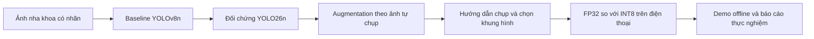
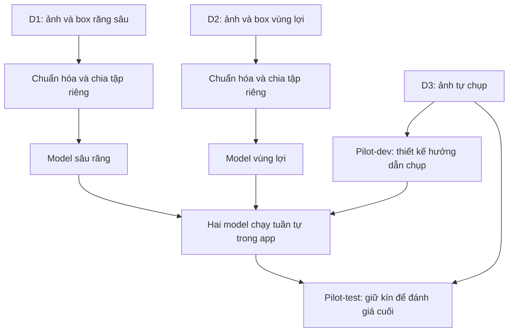
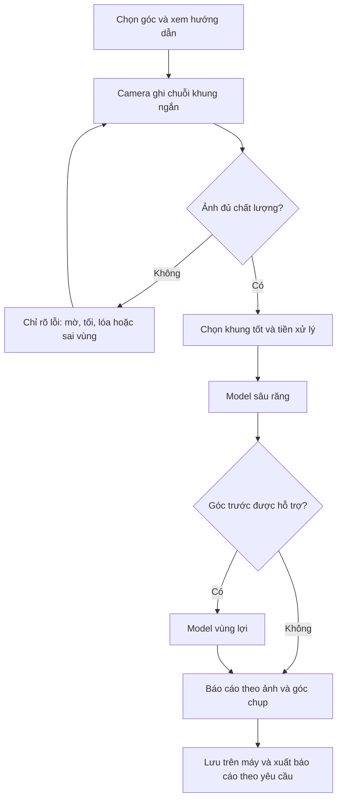
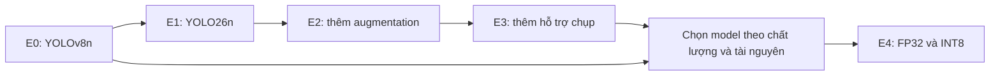

# DentalSelfie — Kế hoạch đồ án đã chốt

> Cập nhật 20/10/2026. Đây là kế hoạch nghiên cứu và triển khai, chưa phải kết quả thực nghiệm. Chốt nguồn dữ liệu công khai; kiểm tra toàn bộ file và nhãn là mốc đầu tiên trước khi train.

> **Phạm vi triển khai hiện tại:** chỉ dữ liệu và train Kaggle, notebook 01–04. Mobile, export và pilot để giai đoạn sau; chưa tạo thư mục hoặc notebook mẫu cho các mốc đó.

**Tên đề tài tiếng Anh:** *DentalSelfie: An Offline Mobile Application for Camera-Guided Screening of Visible Dental Caries and Gingival Inflammation*.

**Mục tiêu:** người dùng chụp răng–lợi bằng điện thoại, ứng dụng chọn ảnh đủ chất lượng, khoanh vùng dấu hiệu sâu răng nhìn thấy và viêm lợi, lưu lịch sử và xuất báo cáo. Toàn bộ suy luận chạy trên điện thoại, dùng được khi bật chế độ máy bay.

## 1. Chốt phạm vi và câu chuyện nghiên cứu

| Quyết định | Phạm vi thực hiện |
|---|---|
| Hai bài toán AI | Phát hiện **răng có tổn thương sâu nhìn thấy**; phát hiện **vùng lợi có dấu hiệu viêm** |
| Đầu vào chính | Ảnh màu camera thường: mặt trước, bên trái, bên phải; mặt nhai là góc bổ sung nếu chụp được |
| Giới hạn theo góc | Mô hình lợi ưu tiên vùng răng trước theo dữ liệu huấn luyện; góc sâu phía trong không phải yêu cầu demo |
| Đầu ra | Bounding box, loại dấu hiệu, độ tin cậy mô hình, chất lượng ảnh và vùng chưa quan sát được |
| Mobile | Android trước: Kotlin, Jetpack Compose, CameraX; LiteRT cho suy luận offline |
| Theo dõi sức khỏe | Lịch sử ảnh/kết quả, ghi nhận đau hoặc chảy máu do người dùng nhập; chưa kết luận bệnh tiến triển từ hai ảnh khác góc |
| Hỗ trợ quyết định | Báo cáo để nha sĩ xem; hướng dẫn bước tiếp theo bằng quy tắc có nguồn và được rà soát. Không kê đơn |
| Ngôn ngữ | Kế hoạch này tiếng Việt; giao diện, báo cáo demo và nội dung học thuật cuối cùng tiếng Anh |
| Loại khỏi phần bắt buộc | Ung thư, RNA, X-quang, cao răng, chatbot/LLM, phân đoạn từng răng, định danh số răng, cổng bệnh viện, iOS |

**Điểm nhấn:** mô hình đạt kết quả tốt trên ảnh nha khoa chưa chắc dùng tốt với ảnh người dùng tự chụp. Đồ án tái lập baseline, thử mô hình mới, xử lý khác biệt chất lượng ảnh, rồi đo mức đánh đổi khi đưa lên điện thoại.



Không cam kết mô hình mới luôn tốt hơn. Đóng góp nằm ở **thực nghiệm có đối chứng + quy trình chụp + triển khai đo được**, không cần tuyên bố phát minh kiến trúc mới.

## 2. Chốt bộ dữ liệu cụ thể

| Vai trò | Bộ dữ liệu / phiên bản | Nội dung dùng | Quyết định |
|---|---|---|---|
| **D1 — sâu răng** | [Annotated intraoral image dataset for dental caries detection — Zenodo 14827784](https://zenodo.org/records/14827784), DOI `10.5281/zenodo.14827784` | 6.313 ảnh, bounding box; ảnh chụp bằng Samsung Galaxy A23, nhiều góc | Tải `Dataset.zip` khoảng 1,6 GB làm bản gốc. Giấy phép bản ghi: CC BY 4.0 |
| **D2 — viêm lợi** | [A dental intraoral image dataset of gingivitis for image captioning — Mendeley v1](https://data.mendeley.com/datasets/3253gj88rr/1), DOI `10.17632/3253gj88rr.1` | 1.096 ảnh, bounding box và mức MGI, kèm caption; Đại học Y Hà Nội | Dùng ảnh và nhãn vùng lợi; bỏ caption khỏi đầu vào. Khoảng 6,1 GB; CC BY 4.0 |
| **D3 — kiểm tra thực tế** | `DentalSelfie-Pilot v1` — **tự thu thập, chưa tồn tại** | Ảnh camera điện thoại tự chụp, nhãn góc chụp/chất lượng; nhãn bệnh chỉ khi nha sĩ xác nhận | Dùng phát triển quy trình chụp và kiểm tra khoảng cách với dữ liệu công khai |

**Các điểm phải hiểu đúng về dữ liệu:**

| Dữ liệu | Hạn chế và cách xử lý |
|---|---|
| D1 | Nhãn bao quanh **răng sâu**, không phải đường viền chính xác của lỗ sâu. Có nhãn `d/D` cho răng sữa/răng vĩnh viễn: gộp thành `visible_caries` để train, giữ nhãn gốc để truy vết |
| D1 | Ảnh do người được hướng dẫn chuyên môn thu thập; có dụng cụ hỗ trợ trong quy trình. Không coi đây là tập ảnh selfie thực tế |
| D1 | `Benchmarking Dataset.zip` là bản đóng gói benchmark; không cộng với `Dataset.zip` như hai tập độc lập |
| D2 | Ảnh Nikon D810, tập trung vùng răng trước. Khác camera tự chụp; không suy rộng kết quả sang toàn bộ khoang miệng |
| D2 | Bài mô tả có điểm không thống nhất về mã lớp và thứ tự kích thước box. Phải đọc nhãn thật, vẽ overlay và kiểm tra trước khi chuyển sang YOLO |
| Cả hai | Không mặc định có đủ ảnh âm tính được xác nhận, mã bệnh nhân hoặc tập chia độc lập theo bệnh nhân. Kiểm kê rồi công bố đúng mức độc lập đã xác minh |

**Kết quả kiểm tra ngày 20/10:** `Dataset.zip` đã tải xong và khớp MD5; inventory có 6.265 JPG và 2.245 TXT/XML mỗi định dạng, khác mô tả 6.313 ảnh của nguồn. Một nhãn mẫu vượt biên ảnh thật. Xem [bằng chứng audit](docs/reports/data_audit/caries_remote/FINDINGS.md); chỉ chốt số ảnh train sau xử lý nhãn lỗi và xác minh ảnh thiếu nhãn.

**Nhãn D2 chốt để thử nghiệm:** giữ MGI 0–4 trong manifest; ánh xạ vùng lợi thành `no_visible_inflammation` = MGI 0, `mild_inflammation` = MGI 1–2, `marked_inflammation` = MGI 3–4. Đây là nhóm nghiên cứu từ nhãn gốc, không phải chẩn đoán mức độ bệnh của cả người dùng. Loại box chỉ vùng hàm khỏi nhãn bệnh; xác nhận ánh xạ bằng overlay trước train.

**Không dùng làm dữ liệu chính:** [Oral_Diseases trên Hugging Face](https://huggingface.co/datasets/nsr51324/Oral_Diseases) và [Oral Image Dataset trên Kaggle](https://www.kaggle.com/datasets/jhirshaikh/oral-image-dataset). Chưa đủ cơ sở để chốt nguồn gốc, nhãn và độ độc lập bệnh nhân cho thiết kế này; không cần thêm một nhánh thực nghiệm gây loãng.



**Không trộn D1 và D2 rồi coi nhãn thiếu là âm tính.** Ảnh D1 có thể có viêm lợi chưa gán nhãn; ảnh D2 có thể có sâu răng chưa gán nhãn. Hai model riêng giúp tránh lỗi này và dễ kiểm chứng.

## 3. Đầu vào, đầu ra và quy trình sử dụng

| Thành phần | Thiết kế tối thiểu |
|---|---|
| `X_image` | Một ảnh hoặc chuỗi khung hình ngắn từ camera; tự động chọn khung rõ, ít lóa, đúng vùng |
| `X_view` | Góc chụp do người dùng chọn theo hướng dẫn: trước/trái/phải/mặt nhai bổ sung |
| `X_symptom` | Đau, chảy máu và ghi chú do người dùng nhập; phục vụ báo cáo/quy tắc, **không giả làm dữ liệu đa phương thức đã được train** |
| `Y_caries` | Các box răng nghi có sâu nhìn thấy và điểm tin cậy |
| `Y_gum` | Các box vùng lợi và nhóm biểu hiện MGI đã ánh xạ; chỉ chạy trong góc được hỗ trợ |
| `Y_report` | Kết quả từng ảnh, ảnh chưa đạt, vùng chưa chụp, triệu chứng tự khai, thông tin phiên bản model |



Điểm tin cậy không hiển thị như “xác suất bạn mắc bệnh”. Không phát hiện được dấu hiệu không đồng nghĩa răng khỏe; đầu ra cần phân biệt **không thấy dấu hiệu**, **ảnh không đủ chất lượng** và **vùng chưa được quan sát**.

## 4. Các mốc hoàn thành và notebook

Notebook dùng tiền tố hai chữ số, chạy độc lập từ artifact của mốc trước. Mỗi notebook có phần mục tiêu, cấu hình, kết quả và kết luận ngắn để đưa vào luận văn.

| Mốc | Notebook / công việc | Điều kiện xong việc | Bằng chứng để thuyết trình |
|---|---|---|---|
| **M1 — Hiểu dữ liệu** | `01_data_audit.ipynb`: tải D1/D2, kiểm kê lớp, nhãn, ảnh trùng, nguồn và giấy phép | Có bảng thống kê, overlay nhãn đúng, danh sách vấn đề và nhãn ánh xạ được xác nhận | Data card, ảnh minh họa nhãn, thống kê mất cân bằng |
| **M2 — Chốt đánh giá** | `02_prepare_splits.ipynb`: chuẩn hóa và chia tập | Manifest có đường dẫn, nguồn, lớp, split, group nếu biết; test được khóa | Sơ đồ chia tập và báo cáo chống rò rỉ |
| **M3 — Baseline cũ** | `03_yolov8n_baseline.ipynb`: train riêng caries/gum | Hai checkpoint và metrics tái lập được; phân tích lỗi tiêu biểu | Kết quả baseline và gallery lỗi |
| **M4 — Model mới** | `04_yolo26n_comparison.ipynb`: cùng protocol với M3 | Có so sánh công bằng chất lượng/kích thước; không đổi test | Bảng cũ–mới, ví dụ cải thiện và thất bại |
| **M5 — Cải thiện có lý do** | `05_selfie_robustness.ipynb`: augmentation theo pilot-dev và chọn khung hình | Hoàn thành ablation, đánh giá riêng phần model và quy trình chụp | Bảng đóng góp từng thành phần; tỷ lệ ảnh dùng được |
| **M6 — Tối ưu local** | `06_export_quantization.ipynb`: FP32/INT8 và kiểm tra tương đương đầu ra | Chốt model tốt nhất theo chất lượng và khả năng chạy máy thật | Pareto chất lượng–độ trễ–dung lượng |
| **M7 — Hoàn thiện app** | Camera hướng dẫn, suy luận, lịch sử, triệu chứng, xuất báo cáo | Luồng sử dụng hoàn chỉnh không cần mạng; dữ liệu có thể xóa | APK, video demo offline, báo cáo mẫu |
| **M8 — Đánh giá và bảo vệ** | `07_final_evaluation.ipynb`: tổng hợp test khóa, log điện thoại, pilot và lỗi | Có số liệu cuối, giới hạn, hướng phát triển, luận văn và slide | Bảng kết quả thống nhất, demo trực tiếp và kịch bản dự phòng |

Hiện chỉ triển khai M1–M4. M5–M8 là kế hoạch sau, notebook 05–07 chưa tạo. Khi bắt đầu mobile, kiểm tra runtime bằng model thử trước khi tích hợp model nha khoa. Chỉ chọn model cuối sau M6.

## 5. Thiết kế thực nghiệm: cũ → mới → cải thiện → triển khai

| Mã | Cấu hình | Câu hỏi cần trả lời |
|---|---|---|
| E0 | YOLOv8n + augmentation cơ bản | Baseline phổ biến đạt đến đâu? |
| E1 | YOLO26n + cùng chính sách augmentation | Kiến trúc mới có lợi trên đúng dữ liệu này không? |
| E2 | YOLO26n + augmentation mô phỏng ảnh tự chụp | Độ bền với mờ nhẹ, ánh sáng, nén và thay đổi khoảng cách có tăng không? |
| E3 | E2 + hướng dẫn chụp/chọn khung hình | Quy trình thu ảnh có làm tăng tỷ lệ phiên chụp dùng được không? |
| E4 | Model được chọn: FP32 so với INT8 | Giảm dung lượng và độ trễ bao nhiêu, mất chất lượng bao nhiêu? |

Nếu YOLO26n không thắng, giữ YOLOv8n để triển khai và thử augmentation trên baseline đó. Kết luận dựa trên số liệu, không sửa câu chuyện để ép model mới thắng.



| Nguyên tắc | Cách thực hiện |
|---|---|
| Chia tập | Mục tiêu train/val/test 70/15/15 theo bệnh nhân nếu có ID. Nếu không, nhóm ảnh trùng/gần trùng và phiên chụp xác minh được; công bố rằng chưa đảm bảo độc lập bệnh nhân |
| So sánh công bằng | Cùng split, kích thước đầu vào khởi điểm 640, ngân sách train và chính sách chọn checkpoint; lưu phiên bản thư viện, cấu hình và seed |
| Lặp lại | Sàng lọc bằng một seed; chạy ba seed cho baseline và cấu hình cuối để báo cáo trung bình/độ lệch chuẩn |
| Tuning | Chọn confidence threshold và hyperparameter trên validation. Không dùng test để chọn cấu hình |
| Augmentation | Mức biến đổi lấy từ pilot-dev; không đổi màu quá mạnh làm sai biểu hiện lợi. Báo cáo riêng ảnh gốc, ảnh biến đổi nhân tạo và ảnh tự chụp thật |
| Lượng tử hóa | Representative data lấy từ train; kiểm tra lại metrics và box trên cùng test sau export |
| Tính trung thực | Không bỏ ảnh khó khỏi mẫu số. Báo cáo tỷ lệ từ chối ảnh bên cạnh chất lượng trên ảnh được chấp nhận |

**Chỉ số cần báo cáo:**

| Lớp đánh giá | Chỉ số chính |
|---|---|
| Hai model | mAP50–95, mAP50, precision/recall từng lớp ở ngưỡng đã chốt, lỗi bỏ sót/nhầm vùng; bảng riêng cho từng dataset |
| Quy trình chụp | Tỷ lệ ảnh/phiên dùng được, tỷ lệ từ chối, số lần chụp lại; so sánh chụp thường và chụp có hướng dẫn trên cùng người |
| Điện thoại | Dung lượng model, RAM, độ trễ p50/p95 và độ trễ toàn luồng; đo warm/cold, ghi rõ thiết bị/runtime/CPU hoặc delegate |
| Prototype | Hoàn thành tác vụ, chạy chế độ máy bay, lưu/xóa/xuất báo cáo, lỗi khi ảnh không đạt |

## 6. Pilot: chứng minh app dùng được với camera người dùng

| Hạng mục | Chốt cách làm |
|---|---|
| Tuyển mẫu | Mục tiêu ban đầu khoảng 20 người trưởng thành tự nguyện; đây là pilot khả dụng, không phải cỡ mẫu xác nhận hiệu quả lâm sàng |
| Chụp | Mặt trước, trái, phải; chụp thường và chụp có hướng dẫn; không yêu cầu banh miệng chuyên dụng |
| Tách dữ liệu | Tách người giữa pilot-dev và pilot-test ngay từ đầu; chỉ dùng pilot-dev để điều chỉnh chất lượng ảnh/augmentation |
| Gán nhãn | Chất lượng/góc chụp được kiểm tra thủ công. Nhãn sâu răng/viêm lợi dùng đánh giá bệnh phải được nha sĩ xác nhận |
| Nếu chưa có nha sĩ | Vẫn đánh giá khả dụng, độ trễ và chất lượng thu ảnh; không báo cáo accuracy bệnh trên pilot |
| Quyền riêng tư | Đồng ý tham gia, mã hóa định danh, hạn chế khuôn mặt, không đưa dữ liệu người tham gia lên Kaggle công khai; tuân thủ yêu cầu của trường trước thu thập |

Không dùng một người có răng khỏe để “chứng minh phát hiện bệnh”. Demo trực tiếp chứng minh quy trình chụp và chạy local; ca dương tính dùng ảnh test có nhãn, hiển thị rõ là ảnh từ bộ dữ liệu.

## 7. Kaggle T4 ×2 và quy trình làm việc với agent

| Thành phần | Cách làm gọn |
|---|---|
| Lưu dữ liệu | Tạo Kaggle Dataset riêng cho dữ liệu đã chuẩn hóa, ghi nguồn/giấy phép; `/kaggle/input` chỉ đọc, output vào `/kaggle/working` |
| Hai GPU | Chạy hai job độc lập, caries trên GPU 0 và gum trên GPU 1. Đóng gói lệnh train thành script do notebook gọi; không mặc định T4 ×2 làm một job nhanh gấp đôi |
| Giới hạn tài nguyên | Chọn batch theo smoke run, dùng AMP, checkpoint định kỳ; tiếp tục từ checkpoint nếu phiên bị ngắt |
| Artifact mỗi run | `config.yaml`, manifest hash, metrics, checkpoint, biểu đồ, ảnh dự đoán và phiên bản môi trường |
| Agent hỗ trợ | Sinh/kiểm tra code notebook, script chuyển nhãn, unit test phần chuyển đổi, tổng hợp log, viết bảng kết quả và tài liệu từ artifact thật |
| Người thực hiện | Kiểm tra overlay, xác nhận thiết kế đánh giá, chạy thí nghiệm, phân tích lỗi, làm việc với nha sĩ và quyết định kết luận |
| Quy tắc học thuật | Ghi nguồn phương pháp; agent không tạo số liệu, không tự gán chẩn đoán và không đổi split để làm đẹp kết quả |

```text
oral-disease/
├── KE_HOACH_DO_AN.md
├── notebooks/             # 01 → 04 hiện tại; thêm notebook sau khi triển khai mốc mới
├── data/                  # dữ liệu gốc; tạo manifest/processed khi cần
├── src/                   # code, configs, scripts và tests
└── docs/                  # trạng thái, hướng dẫn, reports và archive
```

Cấu trúc và công cụ chuẩn bị đã bắt đầu được tạo theo yêu cầu triển khai tiếp theo. Xem [README](README.md) và [trạng thái thực tế](docs/STATUS.md); chưa có kết quả huấn luyện hay app hoàn chỉnh.

## 8. App tối thiểu và tiêu chí nghiệm thu

| Module | Xong khi |
|---|---|
| Capture | Có hướng dẫn từng góc, chọn khung và phản hồi lỗi chất lượng cụ thể |
| AI local | Giai đoạn sau: kiểm tra runtime trước tích hợp, chạy hai model tuần tự và vẽ box đúng tọa độ. LiteRT là lựa chọn đầu; ONNX Runtime Mobile là phương án dự phòng nếu export không ổn |
| Report | Phân biệt kết quả model/triệu chứng tự khai/vùng chưa đánh giá; lưu phiên bản model và ngày chụp |
| History | Lưu cục bộ trong vùng dữ liệu riêng của app, xem lại và xóa được; không tự động tải ảnh lên mạng |
| Decision support | Có quy tắc minh bạch và nguồn tham khảo; được rà soát trước demo, không sinh khuyến nghị điều trị tự do |
| Export | Người dùng chủ động xuất báo cáo để nha sĩ xem; không cần xây tài khoản hoặc backend |
| Verification | Có kiểm tra orientation/crop/resize/box sau export, camera lỗi, ảnh xấu, chạy offline và quyền camera/lưu trữ |

**Bộ sản phẩm bảo vệ dự kiến:** APK + notebook 01–07 + model FP32/INT8 + data/model card + bảng ablation + log điện thoại + báo cáo pilot + slide/video demo. Hiện chỉ tạo notebook 01–04; các thành phần còn lại làm theo mốc. Không hứa trước accuracy; tiêu chí là đánh giá đầy đủ và tái lập được.

## 9. Tài liệu bám theo và cách kể khi bảo vệ

| Nguồn | Dùng để làm gì |
|---|---|
| [Caries dataset paper, Scientific Data 2025](https://www.nature.com/articles/s41597-025-05647-9) | Hiểu cách thu ảnh, nhãn và baseline của D1 |
| [Gingivitis dataset paper, Data in Brief 2024](https://pmc.ncbi.nlm.nih.gov/articles/PMC11462013/) | Hiểu MGI, cách gán nhãn và giới hạn ảnh D2 |
| [YOLO26 — tài liệu chính thức](https://docs.ultralytics.com/models/yolo26/) | Cấu hình mô hình mới và khả năng triển khai |
| [Ultralytics Export](https://docs.ultralytics.com/modes/export/) | Tham khảo cho giai đoạn export/mobile sau này |
| [ArchCaries-YOLO26, Frontiers 13/10/2026](https://www.frontiersin.org/journals/medicine/articles/10.3389/fmed.2026.1955589/full) | Related work mới về sâu răng. Chạy YOLO26n tiêu chuẩn **không có nghĩa tái lập ArchCaries-YOLO26**; không nhận đã triển khai các module riêng của bài |

| Nhịp thuyết trình | Bằng chứng tương ứng |
|---|---|
| 1. Bài toán có ích nhưng ảnh tự chụp khó | Ví dụ góc chụp, lóa/mờ, khác biệt D1/D2 với pilot |
| 2. Bắt đầu từ baseline có thể tái lập | Dataset audit, split, YOLOv8n và lỗi thực tế |
| 3. Thử hướng mới và kiểm chứng | YOLO26n, augmentation, ablation; nêu cả thử nghiệm không cải thiện |
| 4. Cải thiện cả đầu vào lẫn model | So sánh chụp thường với chụp có hướng dẫn; công bố tỷ lệ từ chối |
| 5. Đưa nghiên cứu lên điện thoại | FP32/INT8, tốc độ máy thật, demo chế độ máy bay |
| 6. Hoàn chỉnh một prototype y tế có giới hạn rõ | Lịch sử, báo cáo, bảo mật dữ liệu, thiếu vùng quan sát và nhu cầu xác nhận của nha sĩ |

**Câu chốt đề tài:** “Tôi nghiên cứu và triển khai quy trình sàng lọc dấu hiệu sâu răng và viêm lợi từ ảnh điện thoại, kết hợp mô hình gọn với hỗ trợ thu ảnh, rồi đánh giá cả chất lượng dự đoán lẫn khả năng vận hành hoàn toàn offline.”
