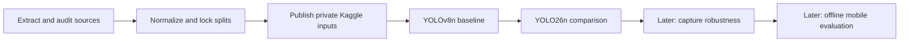

# DentalSelfie — Project Plan

Updated 20 October 2026. Active documentation and notebook content are in English. Original Vietnamese planning documents are preserved in `docs/archive/`.

**Proposed title:** *DentalSelfie: An Offline Mobile Application for Camera-Guided Screening of Visible Dental Caries and Gingival Inflammation*.

**Current implementation scope:** prepare and publish datasets, then benchmark and train models on Kaggle. Mobile development, export and a phone-selfie pilot are deferred.

## 1. Research story

Clinical photographs do not automatically establish performance on self-captured phone images. Build a reproducible detection baseline, compare a newer model fairly, later study capture robustness, and measure on-device deployment trade-offs.

The contribution is a documented research and deployment process. A newer model is allowed to lose; no algorithmic novelty or improvement is assumed in advance.

## 2. Fixed data decisions

| Task | Original source | Measured source images | Prepared images |
|---|---|---:|---:|
| Visible caries | [Zenodo 14827784](https://zenodo.org/records/14827784) | 6,265 | 2,175 |
| Gingival appearance | [Mendeley 3253gj88rr v1](https://data.mendeley.com/datasets/3253gj88rr/1) | 1,096 | 1,067 |

Use two independent detectors. Missing cross-disease annotations are not negatives. Sources are retained unchanged, and every exclusion has a recorded reason. See the [executed data card](docs/reports/data_preparation/DATA_CARD.md).

Caries uses named D/d rectangles merged into `visible_caries`. Gingivitis uses three research groups: MGI 0, MGI 1–2, and MGI 3–4. Jaw ROI boxes are excluded. These are local appearance labels, not a complete patient diagnosis.

## 3. Milestones and evidence

| Milestone | Notebook/artifact | Completion evidence |
|---|---|---|
| Extract and audit | `01_data_audit.ipynb` | Archive fingerprints, actual counts, caption checks, geometry overlays, duplicate and exclusion reports |
| Normalize and lock | `02_prepare_splits.ipynb` | Two YOLO datasets, source/output hashes, same-split constraints, class coverage and fixed splits |
| Publish inputs | `02b_upload_kaggle.ipynb` | Private remote datasets, ready status, versions and SHA-256 receipts |
| Old baseline | `03_yolov8n_baseline.ipynb` | Smoke benchmark, training logs, checkpoints and validation metrics |
| Newer model | `04_yolo26n_comparison.ipynb` | Same split/input/budget comparison, error examples and actual resource measurements |
| Later improvements | Create only when implemented | Pilot-informed augmentation and capture ablations |
| Later deployment | Create only when implemented | FP32/INT8 parity, real phone latency/RAM and offline Android demo |

## 4. Experimental controls

| Control | Rule |
|---|---|
| Source isolation | Never pool missing labels from the two datasets as negative annotations |
| Splits | Approximately 70/15/15 under observed filename/hash/visual groups, seed 42 |
| Independence | Do not claim certified patient-disjointness without independently verifiable patient IDs |
| Model comparison | Same dataset version, split, input size, declared training budget and checkpoint selection rule |
| Screening/repeats | One seed for screening; three declared seeds for the selected final comparisons |
| Model selection | Use validation only; never tune on test |
| Metrics | Per-task/per-class mAP50–95, mAP50, precision/recall at declared thresholds, and error analysis |
| Honesty | Retain failed or non-improving experiments; no manufactured metrics or custom-paper reproduction claims |

## 5. Kaggle execution plan

Local processing handles extraction, auditing, normalization, packaging and analysis. Expensive training runs on Kaggle T4 ×2 with independent bounded tasks.

- Benchmark actual batch/worker/AMP throughput before scheduling long runs.
- Divide work into model/task/seed tracks, preserving the same input version and protocol.
- Keep a margin below the requested 12-hour session cap and persist checkpoints before interruption.
- Resume unfinished runs with optimizer/scheduler/scaler state where available, RNG state, epoch and configuration provenance.
- Record owner/run if user-provided accounts are used; avoid duplicate experiment allocation.

## 6. Later application scope

The planned app accepts ordinary phone camera views of visible teeth/gums, assists capture, shows localized findings and stores/export reports locally. OnePlus Ace 5 is the planned demo device. Camera quality rejection and unobserved regions must be distinguished from a negative model result.

No cancer/RNA/X-ray branch, LLM chatbot, hospital backend or full tooth-numbering system is required. Personal pilot data stays out of the public-source training package. Clinical claims on future pilot images require clinician-confirmed reference labels.

## 7. Final academic evidence

Executed notebooks, data/model cards, source and split provenance, experiment tables, error galleries, training checkpoints, measured runtime logs and a final prototype demo. Model improvements are conclusions to be measured, not promises.
