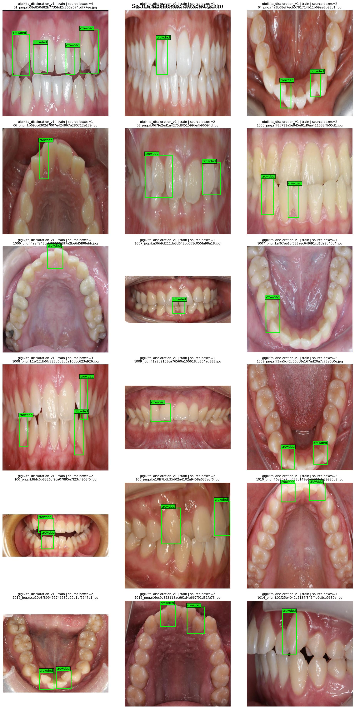
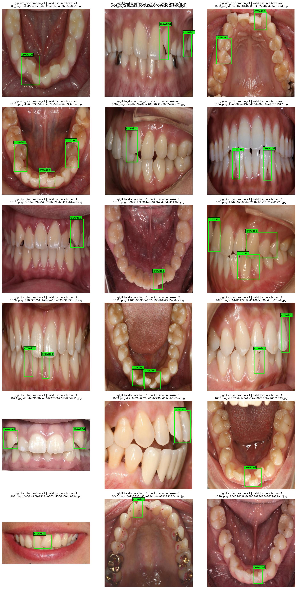
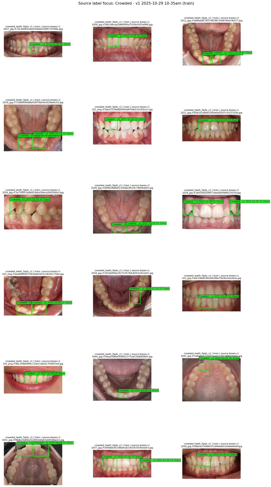
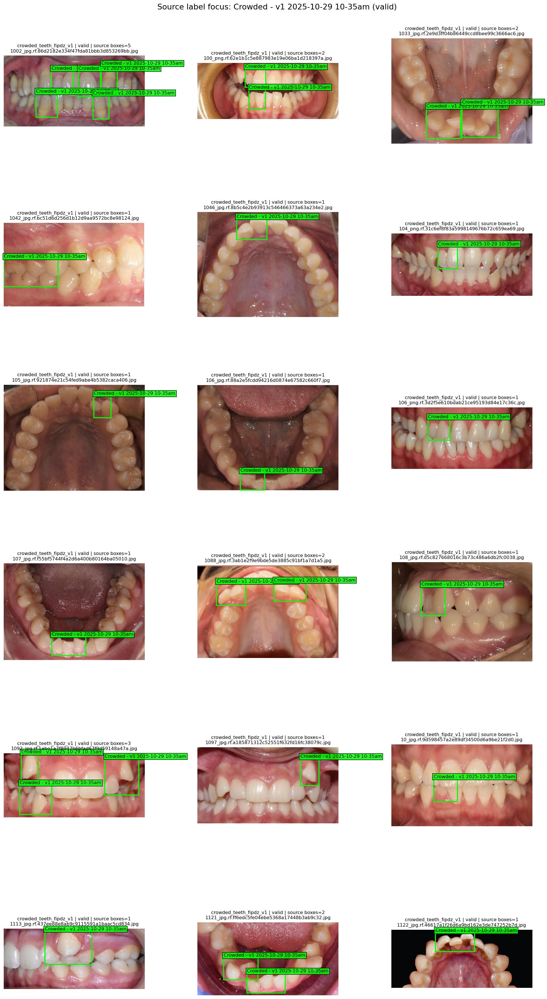
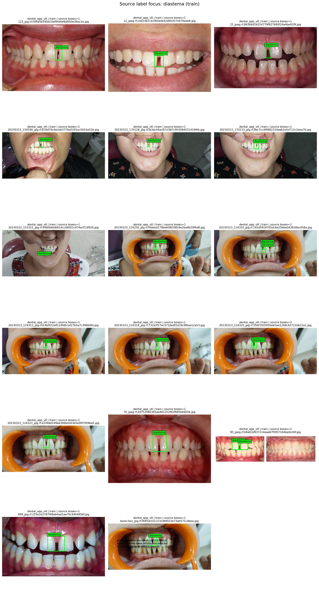
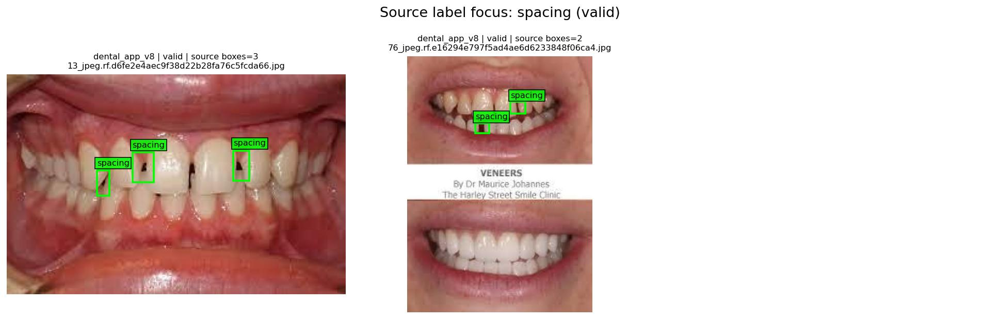
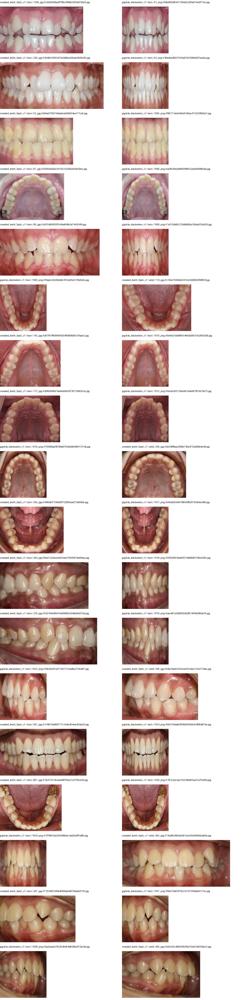
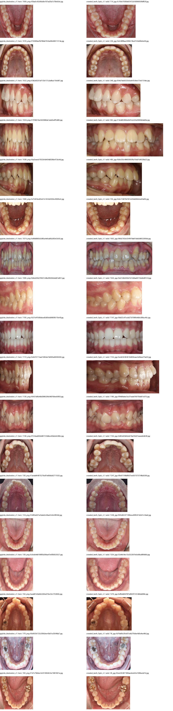

# External alignment dataset audit

**Status:** local train/validation audit complete; no model was trained and no candidate test content was opened.

## Decision in one minute

| Source | Train / validation images | Relevant source labels and boxes | Current decision |
|---|---:|---|---|
| GigiKita `discloration and 6 cases` v1 | 5,559 / 1,584 | `crowded`: 4,045 / 1,239 boxes | Largest source candidate, but **do not use its frozen validation score**: many visually repeated scenes occur across source splits and it overlaps `crowded-teeth-fipdz`. |
| Dental App v8 | 117 / 30 | `diastema`: 20 / 2 boxes; `spacing`: 77 / 5 | Keep as a separate small exploratory source. Validation support is too small for a meaningful comparison; some images contain text/watermarks and source captures repeat. |
| Dental Examination `crowded-teeth-fipdz` v1 | 801 / 147 | `Crowded - v1 2025-10-29 10-35am`: 1,332 / 231 boxes | Best bounded single-source crowding candidate for a later source-specific baseline. Still lacks provenance/patient IDs and has a train/validation near-duplicate candidate. |

**Do not merge these three archives or train on their original validation splits yet.** The first two crowding sources overlap heavily: 625 groups have identical 64-bit difference hashes across GigiKita and FIPDZ; 203 groups contain at least one train and one validation item across the two archives. SHA-256 found no byte-identical files, so these are perceptual-review candidates rather than confirmed exact duplicates. Manual review of the contact sheet showed repeated or near-identical scenes among the sampled cross-source pairs. A separate 81 groups have identical dHash across train/validation within the same source (79 GigiKita, 1 Dental App, 1 FIPDZ); the review sheet shows repeated scenes. Thus combining source splits as if independent would risk validation leakage.

## Input archives and provenance

The owner supplied the ZIPs from Downloads. They were **moved** (not copied) into immutable raw-source folders. SHA-256 was calculated before and after the move and matched.

| Source archive | Raw path | SHA-256 | License declared by `data.yaml` |
|---|---|---|---|
| GigiKita v1 | `data/raw/alignment_external/gigikita_discloration_v1/original.zip` | `3cfa9499e0fe563b487a4db6a357668da75068ea3726e1f384fc6dedf74049d3` | CC BY 4.0 |
| Dental App v8 | `data/raw/alignment_external/dental_app_v8/original.zip` | `d820a29cf7802ba8bc9c34b6270f3dcacb9625c3c945b7f4002210821302e42f` | CC BY 4.0 |
| FIPDZ v1 | `data/raw/alignment_external/crowded_teeth_fipdz_v1/original.zip` | `81506f74f33086e680cc37b45d9bd726be0de27f569f5ae1aa6bdc5cb23213df` | CC BY 4.0 |

The license is the declaration embedded in each export, not an independent verification of image ownership. The exports provide no reliable patient IDs, image-acquisition protocol, or annotation guide. Dataset links: [GigiKita](https://universe.roboflow.com/gigikita/discloration-and-6-cases-yaubs/dataset/1), [Dental App v8](https://universe.roboflow.com/dental-app/dental-app/dataset/8), [FIPDZ](https://universe.roboflow.com/dental-examination/crowded-teeth-fipdz-o7tqa/dataset/1).

## Method

1. Verified archive checksums and inventoried split paths from ZIP central-directory metadata. Test image and label bytes were not read.
2. Extracted only `train/` and `valid/` to ignored temporary work under `.venv/work/alignment_external_audit/`.
3. Parsed the exact class vocabulary in each `data.yaml`; no classes were merged or clinically reinterpreted.
4. Checked image/label pairing, image decoding, class indices, finite coordinates, normalized bounds, empty labels, and box geometry. YOLO box rows and YOLO segmentation polygons were counted separately. Polygon min/max coordinates were used only to draw a bounding-box audit overlay; original annotation files were not rewritten.
5. Computed image SHA-256 and 64-bit dHash for train/validation images. Compared candidate archives with one another and with the existing visible-alignment train/validation manifest. Equal dHash is a review signal, not proof of a duplicate.
6. Visually inspected source-class overlays and duplicate-candidate contact sheets. This is an engineering audit, not clinical relabeling.

Implementation: [audit script](../../../src/scripts/audit_external_alignment_candidates.py), [focused overlay renderer](../../../src/scripts/render_external_alignment_focus.py), [executed notebook](../../../notebooks/alignment/16_20_external_candidate_audit.ipynb).

## Structural and label audit

All train/validation images decoded, every image had a matching label file, there were no orphan labels, and there were **zero invalid class indices or geometries after correctly parsing both YOLO formats**.

The processed audit manifest contains 8,238 rows: 7,143 GigiKita, 147 Dental App, and 948 FIPDZ train/validation images.

| Source | Split | Images | Images with boxes | Empty label files | Boxes by source class (count) |
|---|---|---:|---:|---:|---|
| GigiKita v1 | train | 5,559 | 5,559 | 0 | calculus 874; caries 2,231; crowded 4,045; discoloration 737; gingivitis 3,520; hypodontia 1,624; openbite 456 |
| GigiKita v1 | valid | 1,584 | 1,584 | 0 | calculus 299; caries 640; crowded 1,239; discoloration 185; gingivitis 833; hypodontia 467; openbite 115 |
| Dental App v8 | train | 117 | 115 | 2 | calculus 101; caries 39; cavity 36; diastema 20; spacing 77; stains 220 |
| Dental App v8 | valid | 30 | 28 | 2 | calculus 21; caries 19; cavity 9; diastema 2; spacing 5; stains 71 |
| FIPDZ v1 | train | 801 | 801 | 0 | Crowded 1,332 |
| FIPDZ v1 | valid | 147 | 147 | 0 | Crowded 231 |

Parsed train/validation label rows: GigiKita 17,256 box rows + 9 polygon rows; Dental App 616 box rows + 4 polygon rows; FIPDZ 1,563 box rows. No malformed rows remained after polygon-aware parsing.

## Visual audit

These sheets show source annotations, not ground-truth clinical adjudication. Their main finding is label/view heterogeneity: boxes are commonly placed around individual teeth; some images are frontal, others occlusal or side views. That may fit a broad tooth-level detection label, but it is not automatically the same protocol as “box the whole crowded region.”

### Source target labels

| GigiKita `crowded` train | GigiKita `crowded` validation |
|---|---|
|  |  |

| FIPDZ crowded train | FIPDZ crowded validation |
|---|---|
|  |  |

| Dental App `diastema` train | Dental App `spacing` validation |
|---|---|
|  |  |

### Duplicate candidates

The next sheet specifically selects pairs from different sources where one copy is in train and the other is in validation:

## Data disposition

| Artifact | Location | Purpose |
|---|---|---|
| Immutable original archives | `data/raw/alignment_external/<source>/original.zip` | Preserve exact inputs and provenance |
| Train/validation-only extracted work | `.venv/work/alignment_external_audit/<source>/` | Temporary local audit; ignored by Git |
| Machine-readable summary | `docs/reports/alignment/external_candidates_2026-11-18/audit_summary.json` | Counts, hashes, geometry errors, duplicate candidates, test-access assertion |
| Per-image train/validation manifest | `docs/reports/alignment/external_candidates_2026-11-18/train_valid_image_manifest.csv` | Image SHA/dHash, dimensions, split, box counts and parser status |
| Source and target overlay sheets | `docs/reports/alignment/external_candidates_2026-11-18/*overlay.jpg`, `*focus.jpg` | Visual schema and quality review |

## Next executable step

1. Keep GigiKita and FIPDZ as separate alternatives until an image-group deduplication pass resolves their cross-source repeated scenes and split conflicts. Do not add the two raw validation splits together.
2. For a crowding-only pilot, prefer FIPDZ as the smaller single-source comparison and retain GigiKita as the larger alternative. Before any training, freeze a duplicate-aware train/validation manifest and retain the original source validation results only as descriptive audit data.
3. Keep Dental App `diastema` and `spacing` separate. Do not call its 2 validation diastema boxes or 5 spacing boxes a stable benchmark. The current archive has no `crowded` class.
4. Confirm the intended detector box unit with the project protocol (individual affected tooth versus entire malaligned region). If the target differs, these source labels need reviewed conversion or remain excluded.
5. Only after data grouping/schema/attribution are approved should a later stage build a derivative and publish it to Kaggle. No Kaggle upload, GPU run, test access, model score, or clinical claim was produced by this audit.
