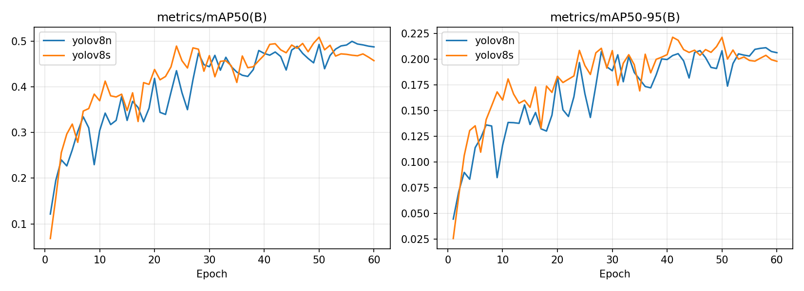

# Grouped calculus baseline results

Both version-1 runs completed 60 epochs. Latest YOLOv8s version 2 is cancelled; its empty outputs must not replace the collected v1 results. The version-label SDK output endpoint retrieved v1 explicitly. Source image/label verification succeeded during both runs. Downloaded manifests match the locked SHA-256 and best checkpoints match their saved summary checksums. Logs confirm two visible Tesla T4 devices, one worker per run, 350 training and 239 validation images, and AdamW lr=0.001.

| Model | Precision | Recall | mAP50 | mAP50-95 | Best epoch |
|---|---:|---:|---:|---:|---:|
| YOLOv8n | 54.82% | 50.73% | 49.25% | 21.08% | 58 |
| YOLOv8s | 55.11% | 49.73% | 49.33% | 22.15% | 41 |

These are final best-checkpoint revalidation metrics from summary.json. Training CSV and checkpoint metadata retain the epoch-validation values, which differ slightly because final validation uses the saved checkpoint and final validation settings. For v8n the selected epoch reports 49.215% /21.096%; v8s 49.329% /22.116%. Do not mix these values in the comparison. Both checkpoints were hash verified.

YOLOv8s gains only 0.088 percentage points mAP50 and 1.064 points mAP50-95 over nano. A single-seed result does not establish a robust advantage. The historical 78.03% v8s mAP50 used 846 training images and a split with confirmed repeated scenes across train/validation. The new split excludes 496 connected training images and uses an explicit AdamW recipe instead of automatic optimizer selection. The observed decline therefore combines training support, split and optimizer changes. It cannot quantify leakage inflation alone.

The current positive-only validation, residual repetitions within validation and unverified patient identity limit conclusions. Source-image grouping uses conservative similarity candidates and may exclude genuinely distinct scenes. No test data or private photos were accessed.

## Next executable action

Run saved-weight validation with per-image predictions on the locked validation set and measure recall by letterboxed lesion size, matching detections one-to-one at IoU >=0.5 with a declared confidence threshold. Inspect missed and poorly localized regions alongside annotation coverage. Review whether conservative exclusions remove disproportionate source subsets. Only then select a P2 head experiment if small-region misses support that hypothesis. Keep current split frozen while making comparisons. Negative-image evaluation and independent phone captures still require reviewed labels.
