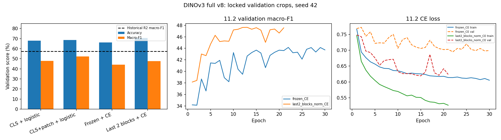

# DINOv3 full-run findings

Both full v8 experiments completed and were collected on 22 October 2026. All values below are exploratory validation results, not held-out test scores. Mobile implementation remains deferred.

## Results

| Experiment | Method | Accuracy | Macro-F1 | No-visible recall |
|---|---|---:|---:|---:|
| 11.1 A | Frozen DINOv3 CLS, scaled logistic regression | 67.97% | 47.83% | 2/49 (4.08%) |
| 11.1 B | Frozen CLS concatenated with mean spatial patches, scaled logistic regression | 68.54% | 52.21% | 6/49 (12.24%) |
| 11.2 A | Frozen DINOv3 CLS, CE-trained linear head | 66.04% | 44.16% | 0/49 (0.00%) |
| 11.2 B | Final two transformer blocks and final norm adapted, same CE head | 70.57% | 47.64% | 0/49 (0.00%) |
| Historical R1 | Raw-crop ResNet18, CE | 68.70% | 57.26% | 18/49 (36.73%) |
| Historical R2 | Raw-crop ResNet18, class-balanced CE | 69.11% | 57.40% | 20/49 (40.82%) |

Only compare A/B within each experiment as a matched intervention. Logistic regression and the CE-trained head have different optimization and selection protocols. Historical ResNet18 rows provide project context rather than isolating encoder architecture alone. The no-visible label describes source annotation semantics; it is not a verified healthy diagnosis.

## What changed and what did not

11.1 patch pooling improved macro-F1 by **4.38 percentage points** over its matched CLS control. The input feature dimension increased from 384 to 768. Six no-visible cases were detected instead of two, but 43 of 49 were still missed. This is evidence that the spatial readout matters on these crops, not evidence that DINOv3 solves the task.

11.2 partial adaptation improved macro-F1 by **3.48 points** and accuracy by **4.53 points** over its frozen CE control. Mild recall increased from 53.86% to 67.17%; marked recall decreased from 81.58% to 77.64%. No-visible recall remained zero. The accuracy gain is therefore insufficient for the three-class objective.

A paired 2,000-draw bootstrap over the 160 observable validation source groups gave a 95% percentile interval of **+2.07 to +4.97 macro-F1 points** for 11.2 B minus A. This reflects group sampling uncertainty for this one seed and extensively reused validation set. It does not establish patient-level generalization, independent confirmation or training-seed stability.

The adapted model's training loss continued falling while validation macro-F1 stayed near 47-48%. More epochs alone have no supporting evidence here. This pattern is consistent with limited generalization, but does not identify a unique cause. Class scarcity, annotation ambiguity and domain mismatch remain hypotheses from the earlier audit, not proven explanations.

## Execution and verification

| Item | 11.1 | 11.2 |
|---|---|---|
| Exact version | v8, script 361137081 | v8, script 361136686 |
| Total Kaggle runtime | 783.2 s (13 min 3 s) | 2054.6 s (34 min 15 s) |
| Epochs | Frozen feature extraction and eight head fits | Frozen: 30, selected 22; adapted: 21, selected 13 |
| Stopping | Completed head grid | Frozen: epoch cap; adapted: patience-8 early stopping |
| Trainable parameters | Logistic heads; fixed encoder | Frozen: 1,155; adapted: 3,551,619 of 21,597,699 total |
| Validation | Exactly 1,920 crops per arm | Exactly 1,920 crops per arm |

11.2 spent 682.5 seconds verifying all 10,889 crop hashes before worker launch. This silent preparation interval was slow input checking, not a training hang. Both workers then trained successfully; gradient-routing assertions passed. Neither worker reached its one-hour budget.

Collection checks verified unique crop IDs, exact locked validation membership and truth labels, probability range/sums/argmax, confusion matrices, every saved metric, history length and selected epoch. Model revision and manifest hash match the pinned protocol. The executed 11.2 notebook has 13 executed code cells and no error outputs. Test images were not opened.

Actual executed notebooks and archives are preserved under `data/runs/ROI_11_1_full_v8/` and `data/runs/ROI_11_2_full_v8/`. Small evidence tables and verification receipts are in `11_1_full_v8/` and `11_2_full_v8/` beside this report. Recompute 11.2 verification, uncertainty and the figure with `python src/scripts/verify_dinov3_full_results.py` from the project environment.

Artifact limitation: the 11.2 output archive contains logs, histories, predictions and config, but no trained weights. Best/resume checkpoints were written to `/kaggle/temp`, outside committed outputs. Its metrics are verified, but this collected artifact cannot directly supply an inference model or cross-session resume. Any future authorized rerun must preserve permitted adaptation/head state in committed outputs without publishing restricted base weights. Do not claim a deployable 11.2 checkpoint exists.

## Decision and next executable milestone

The 11.x study establishes two controlled improvements over weak matched controls, but neither surpasses R1/R2 or reaches the project's 75% macro-F1 aspiration. Do not promote DINOv3, start distillation, or automatically spend another GPU run repeating these candidates. Partial adaptation fails the minority-class objective despite its accuracy gain. Patch pooling passes the exploratory gain screen, but remains a secondary research finding below the existing reference.

Next, freeze the present experiment matrix and consolidate the thesis comparison and failure evidence. Keep R1/R2 as reference methods without calling their near tie a reliable winner. Resolve the no-visible/mild annotation review using the existing 10.1 reviewer sheet with a qualified reviewer before proposing an expert-labelled data extension. Preserve all original labels and locked splits. No automatic relabelling, removal of difficult examples or binary regrouping.

For the practical demo direction, retain caries as the provisional anchor and verify ordinary-phone-photo capture/domain feasibility locally when such images are available. Source-validation AP alone cannot establish that. Do not publish personal images or report accuracy without reference labels. No new mobile implementation or GPU experiment is started by this report.
