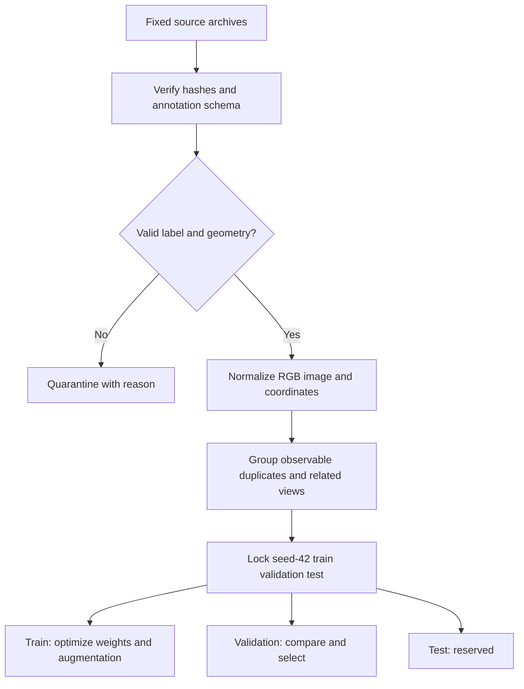
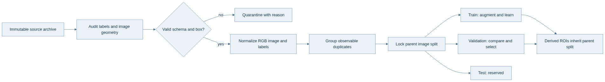
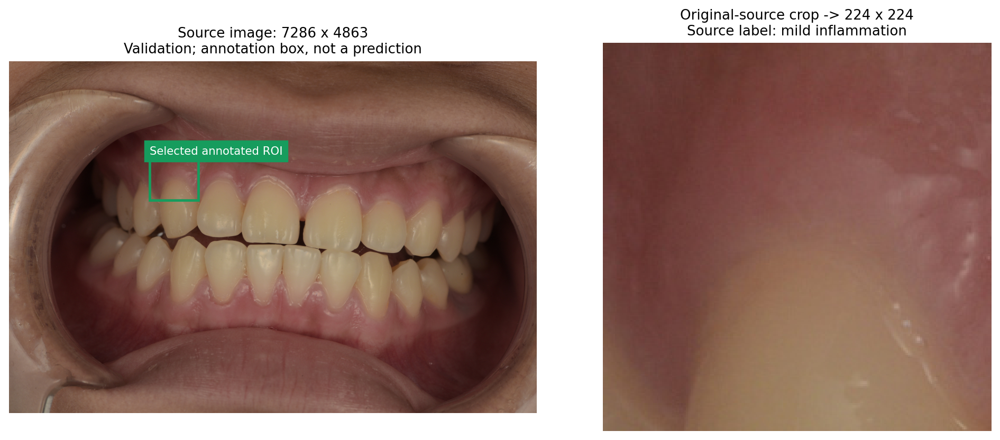
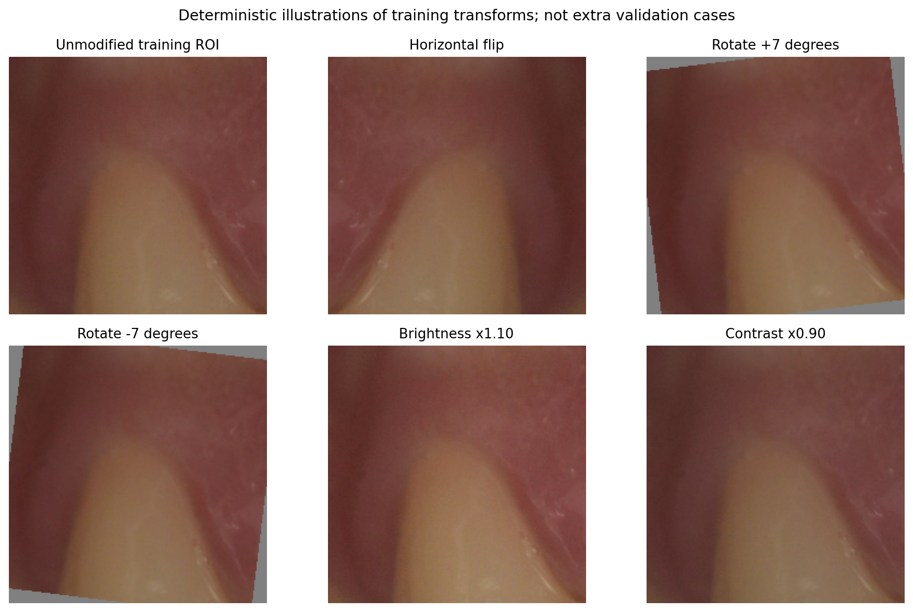
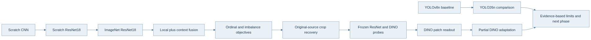
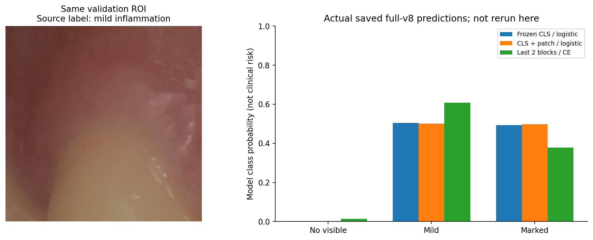
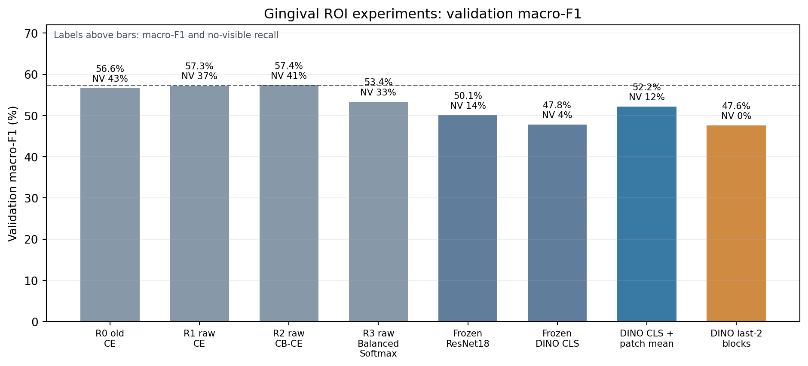
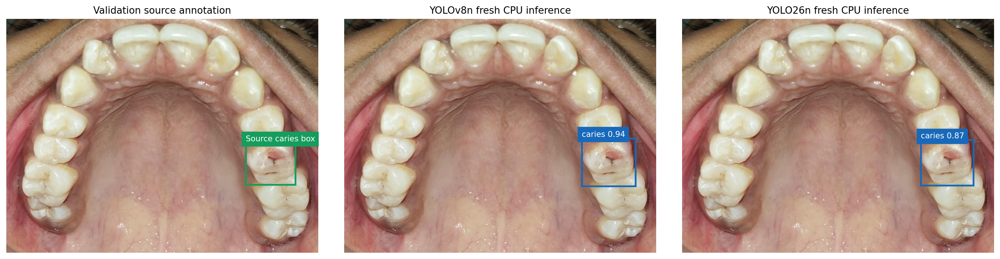
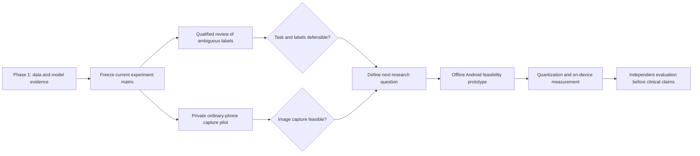
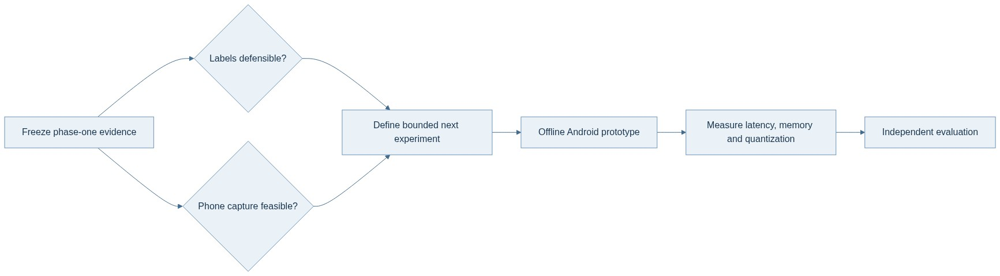

# FIRST-PHASE PROGRESS REPORT
## Graduation Thesis

**Research topic:** Development of an AI-integrated mobile application for oral disease screening and health monitoring through intraoral images  
**Research prototype:** DentalSelfie  
**Academic supervisor:** Nguyen Minh Tuan, Ph.D.  
**Student team:** Huynh Huu Tri (N22DCCN188), Nguyen Viet Anh (N22DCAT004), Dinh Tri Tai (N22DCDK078)  
**Class:** E22CQCN02-N | **Major:** Information Technology  
**Reporting date:** 25 October 2026 | Ho Chi Minh City

> **Reporting scope.** This is a first-phase research progress report. It records the implemented dataset pipeline, full-image detection baselines, gingival region-of-interest experiments, foundation-model comparisons and evidence collected to date. The term “mobile application” describes the intended thesis direction; the Android implementation and ordinary-phone validation have not yet been completed.

## ACKNOWLEDGEMENTS

We respectfully thank our academic supervisor, Nguyen Minh Tuan, for guidance on the research direction and project development. We also acknowledge the dataset creators and the open-source research communities whose data, papers and software enabled this experimental work. All performance statements in this report refer to the cited research datasets and locked validation partitions; they should not be interpreted as clinical diagnoses.

## LIST OF FIGURES AND DIAGRAMS

1. Figure 1.1. DentalSelfie research pipeline and current scope  
2. Figure 2.1. Group-aware data preparation and partitioning  
3. Figure 2.2. Source image, annotated gingival bounding box and extracted crop  
4. Figure 2.3. Training image augmentation examples  
5. Figure 3.1. Progression of model and method experiments  
6. Figure 3.2. DINOv3 adaptation and actual validation prediction example  
7. Figure 4.1. Gingival ROI macro-F1 and minority-class recall  
8. Figure 4.2. Fresh full-image caries inference with YOLOv8n and YOLO26n  
9. Figure 5.1. Proposed next-phase milestones

## LIST OF TABLES

1. Table P.1. Team-level work plan  
2. Table 1.1. Research scope and evidence boundaries  
3. Table 2.1. Data sources and retained images  
4. Table 2.2. Gingival class mapping  
5. Table 2.3. Locked image partitions  
6. Table 3.1. Model families and experimental questions  
7. Table 4.1. Gingival ROI validation results  
8. Table 4.2. Caries detector validation results  
9. Table 4.3. Completed notebook register

## ABBREVIATIONS

| Abbreviation | Meaning |
|---|---|
| AI | Artificial Intelligence |
| CNN | Convolutional Neural Network |
| CE | Cross-Entropy |
| DINOv3 | Third-generation DINO visual representation model |
| F1 | Harmonic mean of precision and recall |
| IoU | Intersection over Union |
| mAP | Mean Average Precision |
| ROI | Region of Interest |
| T4 | NVIDIA Tesla T4 GPU |
| ViT | Vision Transformer |

## TEAM WORK PLAN

The available project records describe implementation as a team activity and do not assign completed code or experiments to individual members. The table therefore records team-level progress without inventing personal contribution percentages.

**Table P.1. Team-level work plan.**

| No. | Work package | Responsible | Progress at this report |
|---:|---|---|---|
| 1 | Define oral-image research scope and collect fixed research datasets | Project team | Completed |
| 2 | Audit annotations, normalize images and lock grouped splits | Project team | Completed |
| 3 | Train YOLOv8n and compare YOLO26n on T4 x2 | Project team | Completed; results collected |
| 4 | Build source-verified gingival crops and scratch/pretrained ROI baselines | Project team | Completed |
| 5 | Compare context fusion, ordinal losses, resolution and imbalance methods | Project team | Completed; mixed results documented |
| 6 | Probe DINOv3 features and partially adapt the final transformer blocks | Project team | Completed; weights not retained for inference |
| 7 | Complete phone-image capture and offline Android implementation | Project team | Deferred; no phone capture set yet |

# INTRODUCTION

Intraoral photographs are practical inputs for an assistive screening concept because a user can capture visible teeth and gingiva with a phone camera. Their appearance changes with lighting, camera distance, blur, mouth opening, saliva, reflections and anatomical viewpoint. A research model trained on curated images therefore needs more than a high aggregate score: its localization, class-specific errors, data split and image-processing steps must be understood before any real-world claim is made.

DentalSelfie studies two related but separately annotated tasks. The first detects visible caries in full images. The second uses annotated gingival regions to study a three-class appearance label. The model-development story moves from detector baselines and scratch CNNs to transfer learning, contextual inputs, ordinal targets, imbalance-aware objectives and DINOv3 representation experiments. This sequence tests whether each added method addresses a measured limitation. Several methods did not improve the strongest observed classifier, and those outcomes are retained.

This report covers work completed through the local feasibility pipeline. It presents the actual datasets, transformations, model methods, validation outcomes, technical limitations and next milestones. Test partitions remain reserved. The system is a research prototype, not a clinically validated diagnostic product.

## 1. RESEARCH OVERVIEW AND SCOPE

### 1.1 Research problem

The project asks whether modern computer-vision methods can identify labelled oral-image regions and classify gingival appearance from data suitable for a future offline mobile workflow. The practical target is an assistive prototype: capture an intraoral image, assess whether the image is usable, identify a visible region, display a model result and retain a transparent research trail. The current experiments establish individual model components; they do not yet validate the entire phone-to-result pipeline.

### 1.2 Objectives for phase one

1. Audit and prepare the two fixed datasets while preserving source provenance.
2. Establish caries and gingival detector baselines using YOLOv8n and compare YOLO26n.
3. Create source-verified gingival ROIs and measure scratch and pretrained classifier baselines.
4. Test context, ordinal learning, source-resolution recovery, class-imbalance objectives and DINOv3 features through controlled comparisons.
5. Record reproducible outputs, failure analysis and an evidence-based plan for the next phase.

### 1.3 Scope and boundaries

**Table 1.1. Research scope and evidence boundaries.**

| In scope and completed | Not established in phase one |
|---|---|
| Dataset audit, normalization, source checks and split locks | Verified patient-independent generalization |
| Full-image detector training and validation audit | Reliable performance on everyday phone photographs |
| Annotation-derived ROI classification experiments | End-to-end gingival localization plus grading |
| Local crop, context view, augmentation and tensor pipeline | Clinical diagnosis or treatment recommendations |
| DINOv3 feature extraction and partial adaptation runs | Reusable adapted DINO checkpoint or on-device inference |
| Local feasibility code and one-image detector demonstration | Android/iOS application implementation |

**Figure 1.1.** Current research stages and the still-pending phone-capture validation path.

## 2. DATASETS AND IMAGE PREPARATION

### 2.1 Fixed data sources

The project keeps the selected public data sources fixed to protect reproducibility and avoid silent dataset substitution.

**Table 2.1. Fixed data sources and audit counts.**

| Dataset | Fixed source | Task | Original images | Retained | Excluded |
|---|---|---|---:|---:|---:|
| D1 | [Zenodo record 14827784, Dataset.zip](https://zenodo.org/records/14827784) | Caries detection | 6,265 | 2,175 | 4,090 |
| D2 | [Mendeley Data 3253gj88rr, version 1](https://data.mendeley.com/datasets/3253gj88rr/1) | Gingival detection and ROI grading | 1,096 | 1,067 | 29 |

The large D1 exclusion count primarily reflects missing or unsupported annotation records, not a model-driven removal of difficult images. Invalid boxes, unknown labels and orientation ambiguity are quarantined with recorded reasons. In D2, conflicting and invalid annotations are excluded. Original archives and provenance are retained. Annotation exclusions are image-level counts; overlapping reason categories must not be added as disjoint totals.

### 2.2 Annotation interpretation and class mapping

Caries labels are decoded from the source's named LabelMe rectangles. For the gum data, source IDs 0 and 1 describe jaw-level regions and are excluded from the target severity mapping. IDs 2, 3/4 and 5/6 map to the three project classes below. This is an explicit project mapping verified against source conventions and overlays, not a new clinical diagnostic standard.

**Table 2.2. Gingival annotation mapping used in this project.**

| Source IDs | Project class | Name used in experiments |
|---|---:|---|
| 2 | 0 | No visible inflammation |
| 3, 4 | 1 | Mild inflammation |
| 5, 6 | 2 | Marked inflammation |

The source label “no visible inflammation” is not a verified diagnosis of healthy gingiva. Missing annotation in one dataset is never used as a negative label for the other disease task.

### 2.3 Image normalization and split policy

Images are normalized to RGB, capped at a maximum edge of 1,280 pixels without upscaling, and saved as JPEG at quality 95 with chroma subsampling disabled. Annotation coordinates are checked against image dimensions before conversion. Exact duplicates and observable filename/visual groups inform a seed-42, approximately 70/15/15 train/validation/test partition. Available group evidence is not equivalent to verified patient identity.

**Table 2.3. Locked image-level partitions.**

| Task | Train | Validation | Test | Split use |
|---|---:|---:|---:|---|
| Caries | 1,522 | 327 | 326 | Test held for final evaluation |
| Gingival | 747 | 160 | 160 | Test held for final evaluation |

Every ROI inherits the partition and group of its parent image. This avoids placing neighboring crops from one photograph in both training and validation. Training augmentation is stochastic and training-only. Validation is transformed deterministically for comparison and checkpoint selection. The validation set has been reused across research choices, so its scores are exploratory and may be optimistic.

**Figure 2.1.** Source validation precedes normalization and split locking; all derived ROIs follow their parent split.

### 2.4 Bounding boxes, crop extraction and contextual views

A bounding box localizes the annotated area. The gum manifest stores normalized center-size coordinates; the preprocessing code converts these into pixel bounds using image width and height. Invalid annotation geometry is rejected rather than silently clipped. The project uses two views from a verified gum box:

1. **Local crop:** the tight annotation rectangle, retaining the target region.
2. **Context crop:** a centered window expanded to 1.5 times the local width and height, adding nearby anatomy.

Both are resized to 224 x 224 using bilinear interpolation. For a context window crossing the source boundary, the available pixels are pasted onto an RGB `(128, 128, 128)` canvas while preserving the requested center and extent. Resizing a rectangular crop to a square can alter its aspect ratio; the same preprocessing is applied consistently within an experiment.

**Figure 2.2.** First locked validation ROI selected by manifest order, before viewing predictions. Green rectangle is the source annotation; the extracted image is the classifier input.

The paired dataset contains 10,889 ROI records for train and validation, corresponding to 21,778 local/context image views. The split contains 8,969 training ROIs and 1,920 validation ROIs. It is an annotation-derived crop dataset: classification metrics assume a correct region has already been provided.

### 2.5 Training augmentation and tensor normalization

For classifier baselines, the 224-pixel ROI can be horizontally flipped with probability 0.5 and rotated by up to 7 degrees. Some baseline recipes apply mild brightness, contrast, saturation and hue jitter. These transformations are intended to reduce sensitivity to orientation and camera appearance, while preserving the source class. Validation receives no random augmentation. The same transforms must be applied to detector boxes if used on full images; moving pixels without transforming the boxes would corrupt detector labels.

An RGB image of shape `224 x 224 x 3` is converted to a floating-point tensor of shape `3 x 224 x 224`, scaled to `[0,1]`, then normalized with ImageNet channel statistics:

`x_c = (I_c / 255 - μ_c) / σ_c`, where `μ = (0.485, 0.456, 0.406)` and `σ = (0.229, 0.224, 0.225)`.

Normalization aligns input scale with the pretrained ResNet and DINO conventions. Negative normalized values are expected; they indicate pixels below the channel reference mean. They do not mean the original image contains negative intensities.

**Figure 2.3.** Actual training ROI with deterministic flip, rotation and appearance-transform examples for explanation. Training samples randomized values; these are not additional data records.

## 3. MODELS AND EXPERIMENTAL METHOD

### 3.1 Full-image object detection

**Figure 3.1.** Research sequence from detector and classifier baselines to foundation features. The sequence records tested hypotheses; it does not imply each method improved the result.

YOLO predicts bounding boxes and class scores from a full image in one detector pipeline. YOLOv8n is the established baseline; YOLO26n is a newer architecture comparison. The `n` variants are compact versions. Training was performed on Kaggle T4 x2 with bounded experiments and saved checkpoints. Evaluation preserves each detector's native preprocessing and postprocessing.

For a predicted box `B_p` and source box `B_g`, Intersection over Union is:

`IoU(B_p, B_g) = area(B_p ∩ B_g) / area(B_p ∪ B_g)`.

Average Precision summarizes precision-recall behavior across confidence thresholds and specified IoU criteria. It is not the same as classification accuracy or a clinical probability.

**Table 3.1. Model families and the experimental questions.**

| Stage | Method family | Question tested |
|---|---|---|
| Full-image detection | YOLOv8n, YOLO26n | Can compact detectors localize caries from the full photograph? |
| Supervised ROI baseline | Custom CNN; ResNet18 from scratch and ImageNet initialization | What does architecture and transfer initialization contribute? |
| Controlled method comparisons | Local/context fusion; ordinal objective; source-resolution crops; class-balanced CE; Balanced Softmax | Do context, severity order, resolution or imbalance handling improve the three-class trade-off? |
| Foundation features | Frozen DINOv3 CLS and patch features; partial adaptation | Do newer self-supervised visual representations transfer better to this dataset? |

### 3.2 Classification baselines: from scratch to transfer learning

The custom CNN baseline uses four convolution blocks, each containing convolution, batch normalization, ReLU and max pooling. Global average pooling produces 256 features, followed by dropout and a three-class linear head. All weights start randomly.

ResNet18 adds identity or projection shortcuts around residual blocks. If a block computes a transformation `F(x)`, its output is `ReLU(F(x) + x)` when dimensions match. The shortcut supports gradient flow through deeper networks. Notebook 6.2 manually builds this ResNet18 with random initialization; notebook 6.3 uses the same structure initialized with ImageNet weights and replaces the 1,000-class head with a three-class head.

Training minimizes cross-entropy between class logits and source labels. The optimizer updates trainable weights using gradients from training batches. Validation runs without gradient updates; the selected checkpoint is based on validation macro-F1. Mixed precision (AMP) is used where appropriate to reduce GPU memory and accelerate T4 execution. The reported training process uses reproducible seeds and saved histories/checkpoints.

### 3.3 Context fusion and ordinal targets

Notebook 07.1 passes local and context views through a shared ResNet18 encoder, yielding two 512-dimensional vectors. Concatenation gives a 1,024-dimensional input to a learned head. Gated fusion learns a feature-wise weight:

`g = sigmoid(MLP(concat(f_local, f_context)))`

`f_fused = g * f_local + (1 - g) * f_context`.

This is a learned mixture of feature vectors, not a clinical explanation. Notebook 07.2 uses an ordinal formulation because the labels are ordered. It predicts cumulative thresholds `P(y>0)` and `P(y>1)` with a positive gap between their logits, then recovers three class probabilities. The ordered structure constrains the outputs but does not guarantee better class balance.

### 3.4 Source-resolution and class-imbalance experiments

The prepared parent images are capped at 1,280 pixels. Notebook 08 verifies source coordinates and regenerates crops from original-resolution images. Notebook 09.1 compares old and original-source crops under a matched ResNet18 recipe; this preserves details otherwise lost during image normalization, rather than synthesizing new image detail.

Notebook 09.2 compares ordinary cross-entropy with two training objectives for class imbalance. Class-balanced cross-entropy weights classes using effective sample counts; the tested `beta` is 0.999. Balanced Softmax adjusts logits based on training class frequencies. Frequencies are computed from training labels only. These objectives can change the precision/recall trade-off and do not create additional minority examples.

### 3.5 DINOv3 patch features and partial adaptation

DINOv3 ViT-S/16 maps a 224 x 224 image into a 14 x 14 grid of 16 x 16 patches. Each spatial token has 384 features. The model also uses CLS and register tokens; the notebook reads their count from the pinned model configuration. Transformer attention mixes information across tokens. This project uses pretrained weights and supervised labels for the downstream task; it did not train DINOv3's original self-supervised representation from scratch.

Notebook 11.1 compares a frozen CLS vector with CLS concatenated to the mean of 196 spatial patch vectors, using a standardized logistic regression head. Notebook 11.2 compares a frozen encoder with partial adaptation of the last two transformer blocks and final normalization. The frozen arm learns only a three-class head (1,155 trainable parameters); the adapted arm trains 3,551,619 of 21,597,699 total parameters, with encoder learning rate `1e-5` and head learning rate `3e-4`. Early stopping and best-validation-macro-F1 checkpoint selection control the run. This is partial supervised fine-tuning, not full pretraining or distillation.

**Figure 3.2.** Three outputs from the same saved full-v8 validation crop. These predictions were retrieved from collected Kaggle outputs rather than freshly inferred locally. They are probabilities over dataset classes, not patient disease probabilities.

## 4. PROGRESS AND PRELIMINARY RESULTS

### 4.1 Gingival ROI classification results

The following results are from the locked 1,920-ROI validation set, from 09.1 / 09.2 / 09.3, 6.1-6.3 and 11.1 / 11.2. Macro-F1 averages the F1 score equally over the three classes, so a large class cannot fully hide poor performance on the minority class.

**Table 4.1. Gingival ROI validation results.**

| Experiment | Method | Accuracy | Macro-F1 | No-visible recall |
|---|---|---:|---:|---:|
| C0 | Custom CNN from scratch | 71.61% | 48.32% | 0.00% |
| C1 | ResNet18 from scratch | 69.79% | 55.42% | 20.41% |
| C2 | ImageNet-pretrained ResNet18 | 69.58% | 55.76% | 22.45% |
| M1 | Local/context concatenation | 69.53% | 53.60% | 18.37% |
| M2 | Local/context gated fusion | 67.03% | 53.99% | 42.86% |
| M3 | Local ordinal objective | 63.28% | 51.46% | 65.31% |
| M4 | Gated fusion plus ordinal objective | 63.65% | 49.48% | 40.82% |
| R0 | Older prepared crop, ResNet18 CE | 68.07% | 56.61% | 42.86% |
| R1 | Original-resolution crop, ResNet18 CE | 68.70% | 57.26% | 36.73% |
| R2 | Original crop, class-balanced CE | 69.11% | **57.40%** | 40.82% |
| R3 | Original crop, Balanced Softmax | 67.03% | 53.36% | 32.65% |
| P0 | Frozen ResNet18 feature probe | 66.67% | 50.08% | 14.29% |
| P1 | Frozen DINOv3 CLS probe | 67.97% | 47.83% | 4.08% |
| 11.1 | DINOv3 CLS plus mean patch features | 68.54% | 52.21% | 12.24% |
| 11.2 | DINOv3 last-two-block adaptation | 70.57% | 47.64% | 0.00% |

R2 is the highest observed macro-F1, near-tied with R1. Their difference is 0.14 percentage points in this run and paired grouped-bootstrap uncertainty includes zero; we do not claim a robust winner. The best accuracy result in the table is not a useful selection rule by itself. The minority no-visible class has 49 validation ROIs across 23 observable groups; R2 correctly identifies 20. Both 11.2 DINO arms recover 0/49, so the accuracy gain from partial adaptation does not meet the three-class objective.

**Figure 4.1.** Selected method progression. Higher macro-F1 does not ensure adequate recall for every class.

### 4.2 Full-image caries detector results

The clean validation audit uses 327 full images and 1,054 source boxes. AP values below were recomputed from existing weights in the local audit; they differ slightly from earlier Kaggle training summaries because the evaluation pass and implementation context differ. Fixed-threshold precision and recall use confidence 0.25 and one-to-one matching at IoU 0.5.

**Table 4.2. Caries detector validation results.**

| Detector | mAP50 | mAP50-95 | Precision at fixed point | Recall at fixed point |
|---|---:|---:|---:|---:|
| YOLOv8n | 93.54% | 72.73% | 78.71% | 95.07% |
| YOLO26n | 94.12% | 73.01% | 87.62% | 85.96% |

YOLO26n has slightly higher AP and precision at the fixed point, while YOLOv8n has higher recall there. Operating-point choice depends on the intended use and requires separate validation. Synthetic blur, dimming and JPEG stress tests remain variations of the same validation images; they do not substitute for independent phone photographs.

**Figure 4.2.** Fresh local CPU predictions for both existing checkpoints on the first sorted caries validation image. This is a single-image demonstration, not a new metric estimate. It uses native model postprocessing and is not a phone-speed benchmark.

### 4.3 Interpretation of the research progression

The work began with reproducible data and basic architectural controls. The manual ResNet18 substantially outperformed the custom CNN on macro-F1, while ImageNet initialization gave a small change under one baseline recipe. Adding context and ordinal targets altered class trade-offs but did not exceed the later raw-crop reference. Returning to verified source resolution yielded a small descriptive gain. Class-balanced CE was the best measured macro-F1, yet the uncertainty interval overlaps the ordinary CE control.

DINOv3 is newer and larger in pretraining scope, but its frozen CLS probe was below frozen ResNet18 and below the best fine-tuned ResNet18 results. Mean patch readout improved the matched DINO control by 4.38 points, and partial adaptation improved its own frozen CE control by 3.48 points; neither surpassed R2. These are useful method findings, not a claim of a new globally better algorithm. The retained narrative is a sequence of tested hypotheses and evidence-based decisions.

### 4.4 Executed notebook record

**Table 4.3. Notebook roles and collected status.**

| Notebook(s) | Role | Collected status |
|---|---|---|
| 01, 02, 02b | Audit, normalize, lock splits and publish approved research artifacts | Executed; manifests and output receipts saved |
| 03, 04 | YOLOv8n baseline and YOLO26n comparison | v4 training completed; checkpoints and results collected |
| 05, 08 | ROI derivation, error audit and source-resolution crop validation | Executed; 10,889 paired ROIs and raw crop set prepared |
| 6.1, 6.2, 6.3 | Scratch CNN, scratch ResNet18 and ImageNet ResNet18 | Completed; corrected 6.2 v3 is valid run |
| 07.1, 07.2 | Context fusion and ordinal classification | v1 results collected |
| 09.1, 09.2, 09.3 | Resolution, imbalance and frozen foundation-feature comparisons | Completed; valid 09.3 result is v3; v4 cancelled |
| 10.1, 10.2 | Gingival error audit and caries full-image evaluation | Executed; annotation review remains pending |
| 11.1, 11.2 | DINOv3 patch readout and partial adaptation | Full v8 results collected; 11.2 inference weights not exported |
| 12.1, 12.2 | Evidence synthesis and local phone-photo pipeline readiness | Executed locally; 12.2 awaits actual phone captures |

## 5. CONCLUSION, LIMITATIONS AND NEXT PHASE

### 5.1 Work completed

Phase one established an auditable data-preparation pipeline, fixed manifests and group-aware partitions; trained and compared full-image detectors; generated source-verified gingival regions; and completed baseline, context, ordinal, resolution, imbalance and DINOv3 experiments. The experiment matrix shows that the strongest observed gingival classifier is ResNet18 with class-balanced CE at 57.40% macro-F1, close to ordinary CE at 57.26%. The caries detector shows strong in-dataset validation AP. Actual inference examples, source annotations and processing figures are available for presentation.

### 5.2 Limitations and risks

1. **Class support and error:** no-visible gingival support is only 49 validation crops; best observed recall is 40.82%. DINO 11.2 recall is zero.
2. **Validation reuse:** the same validation set was used repeatedly for model and method choices. Scores are exploratory and can be optimistic.
3. **Grouping:** observable group constraints do not certify patient-disjoint evaluation.
4. **ROI assumption:** crop classifiers are tested with source-provided boxes, so their results exclude predicted localization errors.
5. **Annotation meaning:** source severity labels have not completed qualified clinical review. They are not diagnoses or treatment guidance.
6. **Phone domain:** no user phone images have been collected; resolution, glare, framing, blur and device variation remain untested.
7. **DINO artifact:** full-v8 predictions and histories were collected, but the adapted checkpoint stayed in Kaggle temporary storage and cannot currently be reused for inference.
8. **Deployment:** there is no Android/iOS implementation, quantized model, phone latency or power measurement yet.

### 5.3 Next milestones

1. Freeze the current comparison as a first-phase evidence snapshot; preserve the locked splits and report all validation reuse.
2. Complete qualified review of the existing gingival ambiguity sheet before proposing any label change. Keep original labels immutable.
3. Collect a small consented set of ordinary phone photographs for local feasibility review; keep personal captures private and separate from public research data.
4. Use full-image caries detection as a provisional demonstration anchor while testing photo quality and domain shift. Do not infer phone performance from public validation AP.
5. If capture feasibility is acceptable, specify the smallest offline Android prototype, inference runtime and model compression experiment. Begin mobile implementation only as a later approved stage.
6. Revisit gingival classification only if expert review and a clear endpoint support a defensible next experiment; avoid adding model complexity without a testable hypothesis.

**Figure 5.1.** Proposed next phase is gated by annotation review and real capture feasibility.

### 5.4 Closing statement

The first phase demonstrates a complete research workflow from annotation audit through controlled model comparison and failure analysis. Results do not yet support a clinically usable three-class gingival system or a phone deployment claim. The defensible next step is to resolve label and capture feasibility before committing effort to mobile optimization.

## REFERENCES

1. DentalSelfie team. *Data audit, preparation and split manifests.* Project notebooks 01–02 and data reports, 2026.
2. DentalSelfie team. *YOLOv8n and YOLO26n baseline and validation audit.* Notebooks 03–04, 10.2 and collected run receipts, 2026.
3. DentalSelfie team. *ROI baseline, recovery, foundation-feature and DINOv3 experiments.* Notebooks 05, 6.1–6.3, 07.1–07.2, 08, 09.1–09.3 and 11.1–11.2, 2026.
4. DentalSelfie team. *Technical Walkthrough: From an Oral Photograph to a Measured Prediction.* Project technical report, 2026.
5. He, K., Zhang, X., Ren, S., and Sun, J. “Deep Residual Learning for Image Recognition.” *Proceedings of the IEEE Conference on Computer Vision and Pattern Recognition*, 2016.
6. Cao, W., Mirjalili, V., and Raschka, S. “Rank Consistent Ordinal Regression for Neural Networks with Application to Age Estimation.” *Pattern Recognition Letters*, 140, 2020.
7. Cui, Y. et al. “Class-Balanced Loss Based on Effective Number of Samples.” *Proceedings of the IEEE/CVF Conference on Computer Vision and Pattern Recognition*, 2019.
8. Ren, J. et al. “Balanced Meta-Softmax for Long-Tailed Visual Recognition.” *Advances in Neural Information Processing Systems*, 2020.
9. DINOv3 paper, arXiv:2508.10104, 2025.
10. Zenodo. *Oral disease dataset record 14827784.* https://zenodo.org/records/14827784.
11. Mendeley Data. *Dataset 3253gj88rr, version 1.* https://data.mendeley.com/datasets/3253gj88rr/1.

---

**Evidence note.** All model metrics above come from completed project validation runs and audit reports. The final test partition remains unopened for the experiments reported here. DINO prediction values shown in figures come from saved full-v8 outputs. One-image caries predictions were freshly generated from verified local weights. No clinical annotation review, ordinary-phone evaluation or device benchmark is claimed as complete.
