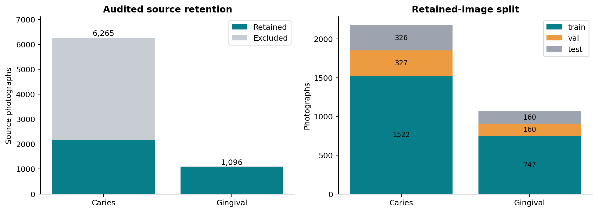
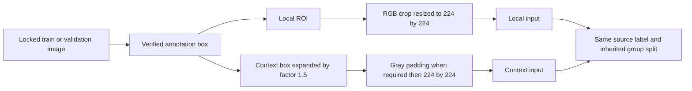
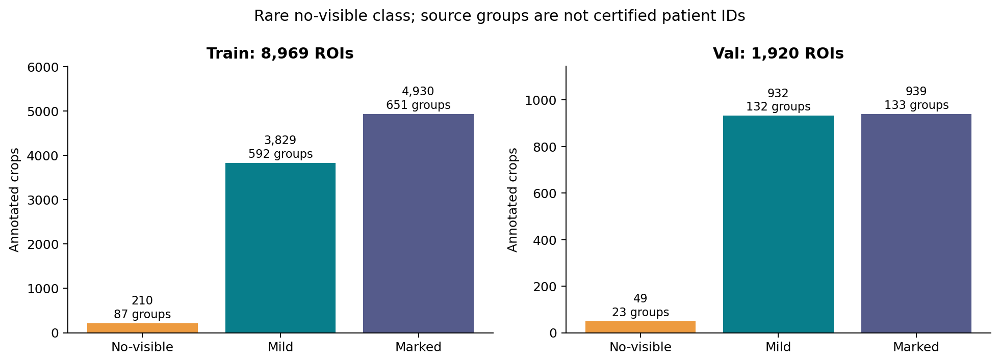

# 1. Data and Problem Formulation

## 1.1 Intended application and implemented research tasks

The intended input is an ordinary phone photograph of visible teeth and accessible oral surfaces. The research currently separates **caries localization** from **gingival appearance grading**. The datasets do not provide complete cross-disease annotations, so an image from one source must not be treated as a negative for the other disease.

| Task | Input used in experiments | Output | Evaluation |
|---|---|---|---|
| Caries detection | Complete source photograph | Boxes for visible_caries | mAP50, mAP50-95 and annotation-relative precision/recall |
| Gingival detection | Complete source photograph | Boxes with three appearance groups | Detection AP; localization and classification jointly matter |
| Gingival ROI classification | Annotation-defined local crop; sometimes paired context | No-visible, mild or marked appearance | Accuracy, macro-F1, per-class recall and ordinal diagnostics |
| Phone feasibility | Future ordinary local captures | Candidate boxes and qualitative review | No accuracy without independent reference annotations |

An annotation-provided crop removes the need to find the region. Consequently crop-classification accuracy cannot be compared directly with detector AP or interpreted as end-to-end application performance.

## 1.2 Fixed sources and provenance

| Source | Role | Provenance |
|---|---|---|
| D1: [Zenodo 14827784](https://doi.org/10.5281/zenodo.14827784), `Dataset.zip` | Caries images and rectangle annotations | Publisher MD5 verified; immutable original archive retained |
| D2: [Mendeley 3253gj88rr v1](https://doi.org/10.17632/3253gj88rr.1), *A dental intraoral image dataset of gingivitis for image captioning* | Gingival photographs and region annotations | User-downloaded original RAR; local SHA-256 recorded; no publisher checksum available in project metadata |

The recorded source metadata declares CC BY 4.0. Attribution is retained in derived datasets. Alternative oral datasets discussed initially were not silently substituted into these experiments. Sources contain supported clinical photography and have not been established as a phone-selfie population.

## 1.3 Audit, exclusions and normalization

| task | source_images | retained_candidates | excluded_images |
| --- | --- | --- | --- |
| caries | 6265 | 2175 | 4090 |
| gum | 1096 | 1067 | 29 |

**Figure 1.** Counts come from the completed audit and split summary. Test counts describe the locked partition; they do not imply test evaluation.

| Audit operation | Reason and implementation |
|---|---|
| Archive verification | Preserve immutable source bytes and checksum provenance |
| Annotation schema and overlays | Check class meanings, coordinate conventions, actual geometry and representative overlays before remapping |
| Missing annotations | Quarantine; do not invent healthy labels |
| Unknown shapes/classes and invalid geometry | Record reasons; do not silently clip or guess semantics |
| Exact and near duplicates | Inspect conflicts and observable source constraints before split assignment |
| RGB preparation | JPEG quality 95, 4:4:4, maximum edge 1280; no upsampling or augmentation during normalization |
| Orientation | Retain supported stored orientation after checks; quarantine unresolved nonstandard EXIF rotations |

Recorded exclusion reasons:

| task | reasons | images |
| --- | --- | --- |
| caries | invalid_box_geometry | 14 |
| caries | missing_annotation_not_a_negative | 4038 |
| caries | nonstandard_exif_orientation_requires_review | 5 |
| caries | unknown_caries_shape_or_class | 38 |
| gum | exact_duplicate_annotation_conflict | 28 |
| gum | invalid_box_geometry | 1 |

Reasons can overlap on one image. In particular, caries reason counts must not be summed as if they were mutually exclusive. The authoritative excluded-image total is 4,090. The 28 gingival exact-duplicate annotation conflicts were excluded in their entirety.

## 1.4 Label mapping

| Source annotation | Prepared label | Interpretation |
|---|---|---|
| Caries D/d rectangle | visible_caries | Positive annotated region; missing boxes do not establish absence |
| Gingival source 0/1 | Excluded from grading | Jaw ROIs rather than target appearance classes |
| Gingival source 2 | 0: no_visible_inflammation | Source-defined visible appearance, not a verified healthy diagnosis |
| Gingival source 3/4 | 1: mild_inflammation | Merged source appearance group |
| Gingival source 5/6 | 2: marked_inflammation | Merged source appearance group |

The ordering motivates an ordinal-learning hypothesis. It does not imply equally spaced clinical severity measurements or complete periodontal diagnosis.

## 1.5 Locked splits and observation units

| task | split | images | groups | boxes |
| --- | --- | --- | --- | --- |
| caries | test | 326 | 188 | 952 |
| caries | train | 1522 | 887 | 4651 |
| caries | val | 327 | 189 | 1054 |
| gum | test | 160 | 160 | 1920 |
| gum | train | 747 | 747 | 8969 |
| gum | val | 160 | 160 | 1920 |

Approximately 70/15/15 splits were constructed with seed 42 and observable grouping constraints. They differ from the source providers' original splits. Source filenames, original split names, raw/prepared hashes and annotation provenance remain traceable. Original-source directory names such as `Test` do not alone identify membership in the project's held-out test partition; the locked manifest does.

Grouping uses available filenames, hashes and conservative visual constraints. Verified patient IDs are unavailable: **patient independence is not claimed**. Multiple gingival crops from one photograph are correlated observations.

## 1.6 From whole images to paired ROI views

Notebook 05 generated **10,889 train/validation ROI pairs and 21,778 views**: 8,969 training ROIs and 1,920 validation ROIs. The held-out test was not used for this ROI derivation. Context is auxiliary; the label belongs to the central ROI.

| split | class_name | crops | groups |
| --- | --- | --- | --- |
| train | no_visible_inflammation | 210 | 87 |
| train | mild_inflammation | 3829 | 592 |
| train | marked_inflammation | 4930 | 651 |
| val | no_visible_inflammation | 49 | 23 |
| val | mild_inflammation | 932 | 132 |
| val | marked_inflammation | 939 | 133 |

**Figure 2.** Only 210 training and 49 validation ROIs have the no-visible label. Their source-group support is 87 and 23, respectively. A group can contain several classes, so class-specific group counts must not be summed to obtain unique groups.

The initial pipeline cropped after whole-image preparation at maximum edge 1280. The later audit found median training ROI dimensions of about 100 by 102 pixels at that stage versus 569 by 582 pixels in original-source coordinates. Notebook 08 therefore extracted raw-source crops before resizing to 224. Crop identities, labels and split membership were held fixed; the raw-source dataset contains 10,889 local crops.

## 1.7 Training and evaluation contract

Training augmentation is applied only to training inputs; validation uses deterministic preprocessing. ROI models use RGB tensors and ImageNet normalization. Exact recipes vary by experiment and are recorded in notebooks: early comparisons should not be described as perfectly controlled where augmentation, seed or stopping settings differ.

Macro-F1 gives each of the three classes equal weight; accuracy weights each crop equally and is dominated by the two common classes. Balanced accuracy is mean class recall. AP evaluates detection across confidence thresholds and overlap criteria. A fixed-confidence precision/recall table answers a different question from AP.

Detailed sources: [data card](../docs/reports/data_preparation/DATA_CARD.md), [source config](../src/configs/sources.json), [label mapping](../src/configs/label_mappings.json), [ROI config](../src/configs/roi.json).
