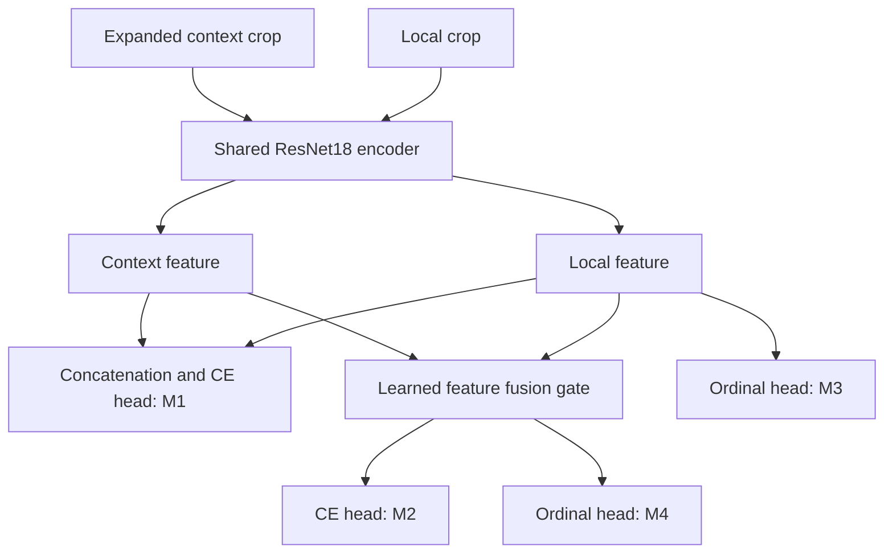
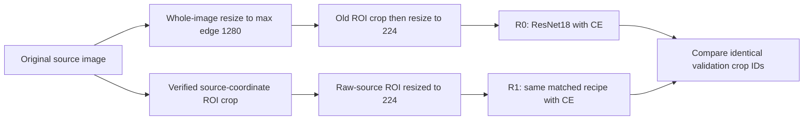
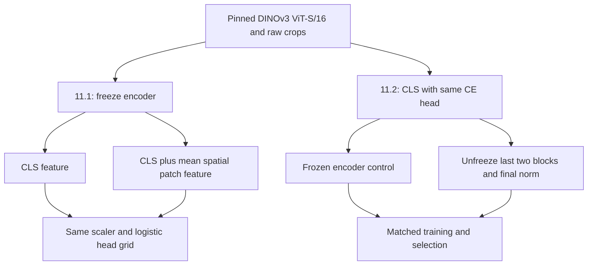

# 2. The Research Journey: Questions, Choices and Evidence

## 2.1 Initial choice: an image that a user can plausibly capture

The original ambition combined mobile AI, image analysis and health support. The scope was narrowed to visible oral photographs because they can plausibly be acquired with a phone. Deep cancer diagnosis or an additional RNA modality would require inputs beyond this intended capture workflow. Offline Android remains the eventual deployment target; the current work establishes the data and modeling evidence first.

Two annotated sources were selected rather than inventing a joint disease label space. Caries and gingival models were trained separately. This made missing cross-disease labels an explicit constraint of the design.

## 2.2 Establish a full-image reference before adding complexity

**Question:** Can compact existing detectors localize the annotated regions?

Notebooks 03/04 trained YOLOv8n and YOLO26n separately for caries and gingival appearance. Successful full-v4 artifacts are the valid baseline evidence. The caries results were promising within the source domain; gingival detection remained much weaker, with mAP50-95 near 29%. This motivated a separate grading study using known ROIs, without assuming that all detector errors were classification errors.

**Decision:** retain detection as the full-image reference and study gingival classification as a clearly labelled subproblem. The research chronology starts with YOLO; the later CNN study must not be presented as having preceded those runs.

## 2.3 Build and understand the baseline models

| Model | Construction | What the comparison asks |
|---|---|---|
| C0 | Custom CNN trained from random weights | Can a compact learned visual hierarchy establish a baseline? |
| C1 | Manually implemented ResNet18 trained from random weights | Does residual learning provide a useful architecture? |
| C2 | The same ResNet18 implementation with checked ImageNet initialization | What changes when initialization transfers prior visual features? |

The baseline notebooks expose data inspection, resize and augmentation, tensor conversion, normalization, model layers, training loops and evaluation. This supports explaining implementation rather than showing only a library fine-tuning call.

C0 achieved 71.61% accuracy but 48.32% macro-F1 and zero no-visible recall. C1/C2 reached 55.42%/55.76% macro-F1. The first lesson was that overall accuracy concealed poor class balance. C1 was close to C2; the experiment did not show an overwhelming pretrained advantage.

## 2.4 First method hypothesis: combine local detail, context and ordered labels

**Motivation:** a tight crop may omit neighboring tissue; the three appearance labels have an order. These observations motivated explicit components that could be tested separately.

| Component | Practical role | Evidence |
|---|---|---|
| Concatenation | Expose both feature vectors to a classifier | M1 macro-F1 53.60% |
| Learned gating | Learn how the two views contribute to a fused representation | M2 macro-F1 53.99% |
| CORAL-style ordinal head | Learn ordered cumulative decisions rather than three unrelated class scores | M3 macro-F1 51.46%; no-visible recall improved but mild recall fell |
| Gating plus ordinal head | Test the proposed combination | M4 macro-F1 49.48%; the combination did not win |

These are literature-inspired, task-specific implementations, not claims of globally novel modules or exact paper reproduction. In particular, the ordinal implementation is a monotone shared-score adaptation and contains a redundant unused output in the historical v1 code. The research plan records the reference basis.

**Decision:** do not select M4 just because it is more elaborate. Keep the failures and inspect the pipeline. The 07.x screening has seed/RNG, augmentation, stopping and training-layout confounders, so differences from C2 cannot isolate each component causally. The report preserves this limitation rather than rewriting history as a clean factorial study.

## 2.5 Second hypothesis: perhaps preprocessing removed useful detail

Notebook 08 compared crop geometry before and after whole-image downscaling. It showed a substantial reduction in available source pixels. The next experiment changed crop extraction while retaining the same ROI IDs, labels, splits and downstream input size.

R1 improved macro-F1 from 56.61% to 57.26%, a 0.66-point change. The group-bootstrap interval crossed zero and no-visible recall decreased. Detail preservation was a justified engineering correction to investigate, but it did not solve the grading problem.

## 2.6 Third hypothesis: the training objective may underweight the rare class

Notebook 09.2 compared raw-crop CE with two train-count-derived objectives. Class-balanced CE uses effective-number weights, proportional to `(1 - beta) / (1 - beta^n_c)`, with beta 0.999 in the implementation. Balanced Softmax adjusts training logits using class counts. Neither invents new examples or changes validation labels.

R2 class-balanced CE reached 57.40% macro-F1, only 0.13 points above R1. R3 Balanced Softmax reached 53.36%. **Decision:** retain R1/R2 as close references; do not claim a reliable winner from the small R2 advantage.

## 2.7 Fourth hypothesis: stronger pretrained representations may separate the classes

Notebook 09.3 compared frozen ResNet18 and frozen DINOv3 features with a scaled logistic classifier. Freezing the encoder was a bounded way to test representation quality before expensive adaptation. Valid version 3 gave macro-F1 50.08% and 47.83%, respectively. The newer foundation encoder was not automatically better on this task.

Notebook 10.1 then verified prediction identities, source mappings, crop hashes and errors. Ten model tables shared 99 wrong ROIs, including 79 unanimous wrong predictions. This motivated a review set of 114 cases, but agreement among models does not establish that source labels are wrong. Clinical review remains pending.

## 2.8 Refine the foundation-model question rather than change many factors at once

11.1 increased feature dimensions from 384 to 768 and improved macro-F1 from 47.83% to 52.21%. Mean patch pooling excludes CLS and register tokens; it is not a learned tissue segmentation mask. This supports a readout effect on this validation population, but performance remained below R1/R2.

11.2 held the CLS readout and CE head fixed while adapting the final two transformer blocks and final normalization. Trainable parameters increased from 1,155 to 3,551,619. Macro-F1 rose from 44.16% to 47.64%, but both arms recognized 0 of 49 no-visible cases. The adapted branch early-stopped at epoch 21 and selected epoch 13. More training of the same recipe has no demonstrated solution to that failure.

**Decision:** retain the controlled findings, do not promote DINOv3 as a successful teacher and do not start distillation without a stronger teacher. The completed 11.2 result archive has predictions and logs but no exported adapted weights; checkpoints were written to temporary Kaggle storage.

## 2.9 Return to the intended input and practical scope

Notebook 10.2 evaluated the existing caries detectors on full validation images and fixed corruptions. Notebook 12.1 consolidated the evidence. Notebook 12.2 implemented local photo inspection, existing-weight inference and qualitative review. It passed a three-image source-validation plumbing check with both detectors; actual phone captures are still pending at the report cutoff.

**Current conclusion:** caries remains a provisional demo direction. Gingival grading provides a substantial research study with measured limitations. Neither a source-data AP score nor an ROI accuracy score establishes successful ordinary-phone deployment. The next decision should be informed by capture feasibility and annotation review.

Evidence: [original plan and reference basis](../KE_HOACH_DO_AN.md), [07.x protocol audit](../docs/reports/training/ROI_METHOD_FINDINGS_2026-10-21.md), [09.x findings](../docs/reports/training/ROI_09_COMBINED_FINDINGS_2026-10-22.md), [11.x full findings](../docs/reports/training/dinov3_publication/FULL_FINDINGS_2026-10-22.md).
