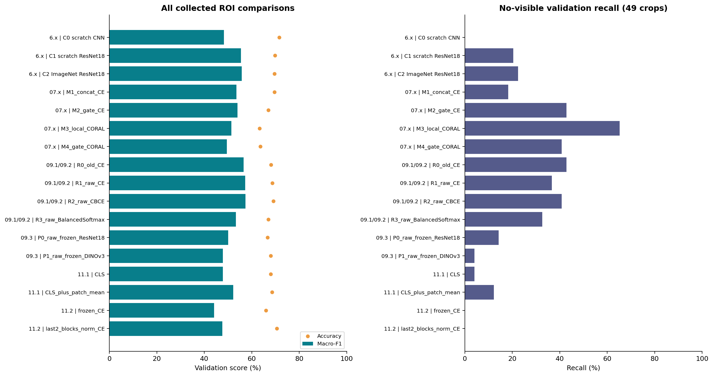
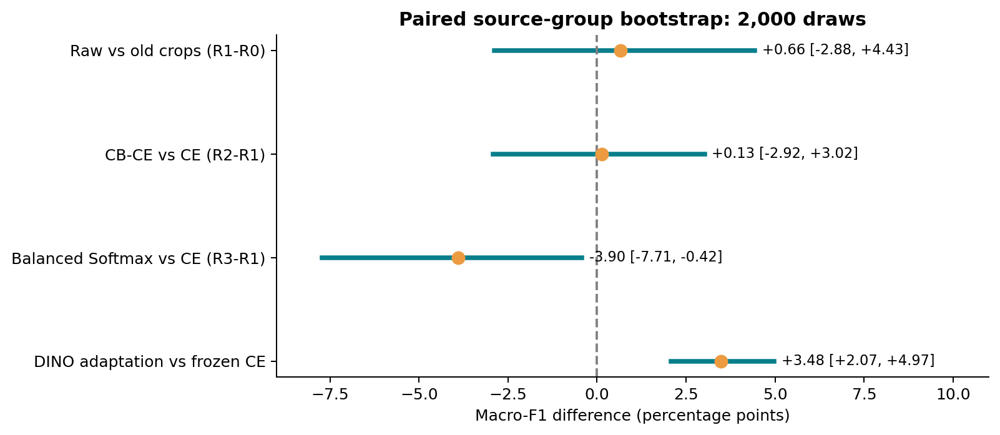
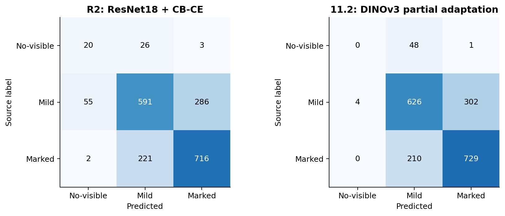
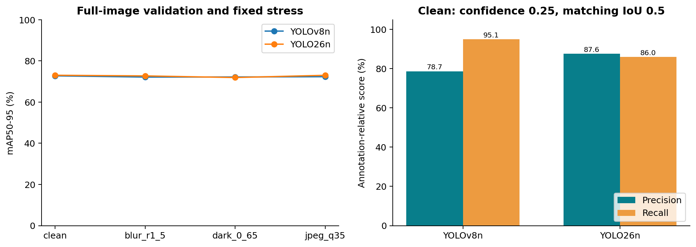

# 3. Results, Interpretation and Validity

## 3.1 Full-image detector baselines: original Kaggle v4

| Model | Task | Completed epochs | mAP50 | mAP50-95 |
| --- | --- | --- | --- | --- |
| YOLOv8n | caries | 21 | 93.55% | 72.85% |
| YOLOv8n | gum | 22 | 53.52% | 29.29% |
| YOLO26n | caries | 21 | 94.16% | 73.20% |
| YOLO26n | gum | 19 | 54.37% | 28.70% |

These are original successful GPU-run metrics. The later full-image audit re-evaluated the existing weights on CPU; its small numerical differences are retained rather than merged with the original results. Native AP precision/recall values also differ from the explicitly fixed-confidence matching analysis below.

## 3.2 Gingival ROI comparison

| Stage | Experiment | Accuracy | Macro-F1 | No-visible recall |
| --- | --- | --- | --- | --- |
| 6.x | C0 scratch CNN | 71.61% | 48.32% | 0.00% |
| 6.x | C1 scratch ResNet18 | 69.79% | 55.42% | 20.41% |
| 6.x | C2 ImageNet ResNet18 | 69.58% | 55.76% | 22.45% |
| 07.x | M1_concat_CE | 69.53% | 53.60% | 18.37% |
| 07.x | M2_gate_CE | 67.03% | 53.99% | 42.86% |
| 07.x | M3_local_CORAL | 63.28% | 51.46% | 65.31% |
| 07.x | M4_gate_CORAL | 63.65% | 49.48% | 40.82% |
| 09.1/09.2 | R0_old_CE | 68.07% | 56.61% | 42.86% |
| 09.1/09.2 | R1_raw_CE | 68.70% | 57.26% | 36.73% |
| 09.1/09.2 | R2_raw_CBCE | 69.11% | 57.40% | 40.82% |
| 09.1/09.2 | R3_raw_BalancedSoftmax | 67.03% | 53.36% | 32.65% |
| 09.3 | P0_raw_frozen_ResNet18 | 66.67% | 50.08% | 14.29% |
| 09.3 | P1_raw_frozen_DINOv3 | 67.97% | 47.83% | 4.08% |
| 11.1 | CLS | 67.97% | 47.83% | 4.08% |
| 11.1 | CLS_plus_patch_mean | 68.54% | 52.21% | 12.24% |
| 11.2 | frozen_CE | 66.04% | 44.16% | 0.00% |
| 11.2 | last2_blocks_norm_CE | 70.57% | 47.64% | 0.00% |

**Figure 3.** Every classifier row refers to the same 1,920 validation crop identities, but crop preparation, heads and training protocols vary. The 09.3 DINO CLS and 11.1 CLS rows repeat the same representation/control question; they are not independent evidence of generalization. Most runs use one seed; 07.x declared seeds and shared-thread RNG handling introduce additional confounding.

The highest accuracy belongs to the scratch CNN (71.61%), yet it misses every no-visible crop. R2 has the highest observed macro-F1 (57.40%), while R1 is close (57.26%). These differences demonstrate why selecting solely by accuracy would misrepresent the three-class objective.

## 3.3 What the matched comparisons support

**Figure 4.** Points are observed macro-F1 differences; intervals are paired source-group bootstrap percentile intervals with 2,000 draws. Groups are observable source constraints, not verified patients. Intervals condition on validation-selected models and exclude training-seed and model-selection uncertainty.

| Comparison | Change | Interpretation |
|---|---:|---|
| R1 raw crops vs R0 old crops | +0.66 pp | Small observed gain; interval includes zero |
| R2 CB-CE vs R1 CE | +0.13 pp | Near tie; no established superiority |
| R3 Balanced Softmax vs R1 CE | -3.90 pp | Worse in this controlled screening run |
| 11.1 patch readout vs CLS | +4.38 pp | Useful readout signal, still below ResNet18 reference; no interval shown here |
| 11.2 adaptation vs frozen CE | +3.48 pp | Matched gain, but no-visible recall remains zero |

The 75% macro-F1 target discussed during planning is an engineering aspiration, not an externally validated clinical threshold.

## 3.4 Class-specific errors

**Figure 5.** Rows are source labels and columns are predictions. Supports are 49 no-visible, 932 mild and 939 marked ROIs. R2 recovers 20 no-visible crops; adapted DINOv3 recovers none. R2 still has substantial confusion between mild and marked appearance, so it should not be presented as solving the task.

The historical 07.x ordinal model M3 detects 32/49 no-visible crops, but no-visible precision is only 18.08% and mild recall falls to 39.38%. Improving one class's recall by predicting it more often can reduce the overall balance of errors. Ordinal output monotonicity did not guarantee lower observed ordinal error.

## 3.5 Full-image caries robustness audit

| model | variant | map50 | map50_95 |
| --- | --- | --- | --- |
| YOLOv8n | clean | 93.54% | 72.73% |
| YOLOv8n | blur_r1_5 | 93.45% | 72.13% |
| YOLOv8n | dark_0_65 | 93.26% | 72.17% |
| YOLOv8n | jpeg_q35 | 93.37% | 72.30% |
| YOLO26n | clean | 94.12% | 73.01% |
| YOLO26n | blur_r1_5 | 93.74% | 72.69% |
| YOLO26n | dark_0_65 | 94.09% | 71.90% |
| YOLO26n | jpeg_q35 | 93.91% | 72.98% |

**Figure 6.** All eight audit evaluations use 327 validation images with 1,054 annotated boxes. Stress variants are blur radius 1.5, brightness multiplier 0.65 and JPEG quality 35. The left plot uses a full 0-100 scale to avoid exaggerating small AP changes. These are synthetic corruptions, not independent phone photographs.

At confidence 0.25 and one-to-one IoU 0.5, YOLOv8n precision/recall is **78.71%/95.07%**, while YOLO26n is **87.62%/85.96%**. The choice therefore depends on the intended operating trade-off; slightly higher AP does not automatically select a deployment threshold. Unmatched predictions are apparent annotation-relative false positives, not verified healthy tissue.

The audit contains 611 medium and 443 large boxes, and no small boxes under the specified 640-scale area bins. It provides no estimate of small-box recall. Annotation box size is not a direct measure of anatomical lesion extent.

## 3.6 What has and has not been demonstrated

| Evidence category | Established | Not established |
|---|---|---|
| Data integrity | Recorded hashes, mapping checks, overlays, exclusions and locked memberships | Exhaustive clinical correctness or certified patient independence |
| Model implementation | Scratch/pretrained controls, fusion/ordinal branches, recovery and DINO experiments | A novel globally superior algorithm or exact reproduction of every cited paper |
| Classification | Recomputed metrics from collected evidence; later full predictions checked against locked IDs | Successful full-image gingival localization or clinical readiness |
| Caries detection | Source-validation AP, error decomposition and fixed stress results | Ordinary-phone generalization or small-lesion performance |
| Robustness and uncertainty | Source-group bootstrap for selected comparisons; deterministic synthetic stress | Independent external validation, repeated-seed stability or final test confirmation |
| Deployment | Existing-weight local CPU pipeline and private capture workflow | Android implementation, quantization, on-phone latency or memory measurements |

## 3.7 Reproducibility and execution limitations

- The 6.2 version-2 initialization failure is excluded; corrected v3 is used. 09.3 v2 had training disabled; valid v3 supplies the probe results, and cancelled v4 supplies no result.
- Early detector full-v3 runs were cancelled after long unproductive sessions. The original cause was not established; valid v4 completed with bounded workers. Do not equate cancelled runs with converged experiments.
- The 07.x screening differs from C2 in augmentation, stopping, batch execution and RNG isolation; it is not a clean factorial ablation. These issues are documented in the original findings.
- 11.x required corrected access to gated weights and compatible HF runtime packages. Both full v8 runs completed; 11.2 took 34 min 15 s, including 682.5 s of image-hash verification before training.
- 11.2 best/resume weights remained in Kaggle temporary storage. Collected predictions and metrics are valid, but no reusable adapted inference checkpoint exists in the downloaded archive.
- The validation set has guided many decisions. All findings are exploratory until the protocol is frozen and independent confirmation is performed. The project test split remains unused for outcome claims.

Complete receipts: [11.1](../docs/reports/training/dinov3_publication/11_1_full_v8/verification.json), [11.2](../docs/reports/training/dinov3_publication/11_2_full_v8/verification.json), [09.x uncertainty](../docs/reports/training/roi_recovery_group_bootstrap.json), [post-09 audit](../docs/reports/post09/FINDINGS_2026-10-22.md).
