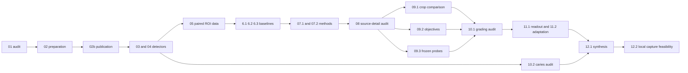

# 4. Notebook and Artifact Index

## 4.1 Complete current notebook register

The following 21 canonical notebooks are listed in the project README. A canonical training source can have run gates disabled or lack local outputs; collected remote executed copies are the evidence of successful training. The status column records the valid run rather than assuming that the latest remote version is always the valid one.

| Notebook | Task and research role | Actual status |
| --- | --- | --- |
| [01 — Data audit](../notebooks/01_data_audit.ipynb) | Extract archives, inspect annotations, verify geometry, report exclusions and duplicates | Executed; tables and figures saved |
| [02 — Prepare splits](../notebooks/02_prepare_splits.ipynb) | Normalize images/labels, lock groups and splits, verify every output, generate the data card | Executed; datasets saved |
| [02b — Upload to Kaggle](../notebooks/02b_upload_kaggle.ipynb) | Publish allowlisted data, code, ROI and results under configured visibility | Executed; latest versions and visibility in publication receipt |
| [03 — YOLOv8n baseline](../notebooks/03_yolov8n_baseline.ipynb) | Baseline experiments on T4 ×2 | v4 completed; executed evidence in data/runs/E0_full_v4 and docs/reports/training/E0_full_v4 |
| [04 — YOLO26n comparison](../notebooks/04_yolo26n_comparison.ipynb) | Comparison under the same protocol | v4 completed; executed evidence in data/runs/E1_full_v4 and docs/reports/training/E1_full_v4 |
| [05 — Validation audit and paired ROI data](../notebooks/05_error_audit_and_roi_data.ipynb) | Inspect saved detector evidence and derive train/validation local/context crops | Executed; 10,889 ROIs, 21,778 view files; test images unopened |
| [6.1 — Custom CNN baseline](../notebooks/dentalselfie-06-1-cnn.ipynb) | From-scratch convolutional classifier on local gingival ROIs | Public version 3; T4 x2 run complete |
| [6.2 - ResNet18 from scratch](../notebooks/dentalselfie-06-2-resnet18-scratch.ipynb) | Manually implemented residual network with random initialization | Public version 3 corrected scratch run complete; version 2 excluded |
| [6.3 - ImageNet ResNet18](../notebooks/dentalselfie-06-3-resnet18-pretrained.ipynb) | Same ResNet18 structure with ImageNet initialization | Public version 2 complete; validation results collected |
| [07.1 - Context and gated fusion](../notebooks/07_1_context_gated_fusion.ipynb) | Paired local/context features: concatenation vs learned gate, cross-entropy | Public version 1 complete; outputs collected |
| [07.2 - Ordinal combined method](../notebooks/07_2_ordinal_combined_method.ipynb) | Local CORAL vs gated local/context CORAL | Public version 1 complete; outputs collected |
| [08 - Source-resolution audit](../notebooks/08_source_resolution_and_error_audit.ipynb) | Verified original-source local crops and error analysis | Executed; 10,889 crops; raw ROI dataset public v1 |
| [09.1 - Resolution control](../notebooks/09_1_resolution_control.ipynb) | Matched old-crop vs raw-crop ResNet18 CE | Public v1 complete; results verified |
| [09.2 - Imbalance ablation](../notebooks/09_2_imbalance_ablation.ipynb) | Class-balanced CE vs Balanced Softmax; R1 shared control | Public v1 complete; results verified |
| [09.3 - Foundation-feature probe](../notebooks/09_3_foundation_feature_probe.ipynb) | Frozen ResNet18 vs DINOv3 linear probes | Valid v3 complete; probes verified; latest v4 cancelled |
| [10.1 - Gingival failure audit](../notebooks/10_1_gingival_failure_audit.ipynb) | Prediction verification, shared errors, source support, quality strata and review galleries | Executed; technical checks passed; clinical review pending |
| [10.2 - Caries full-image audit](../notebooks/10_2_caries_full_image_audit.ipynb) | Existing checkpoints, full-image errors, lesion size and fixed synthetic stress tests | Executed; eight CPU evaluations, 327 validation images each |
| [11.1 - DINOv3 patch readout](../notebooks/11_1_dinov3_patch_probe.ipynb) | Frozen CLS versus CLS plus mean spatial patch features | Full v8 complete and collected; patch macro-F1 52.21% |
| [11.2 - DINOv3 partial adaptation](../notebooks/11_2_dinov3_partial_adaptation.ipynb) | Frozen CE head versus final two blocks plus LayerNorm adaptation | Full v8 complete and collected; adapted macro-F1 47.64% |
| [12.1 - Research evidence synthesis](../notebooks/12_1_research_evidence_synthesis.ipynb) | Completed experiment matrix, figures, presentation narrative and evidence gaps | Executed locally; 17 classification rows and eight detector audit rows |
| [12.2 - Local phone-photo feasibility](../notebooks/12_2_phone_photo_feasibility.ipynb) | Private capture inspection and existing-weight caries inference | Local-only; two-model plumbing smoke passed; awaiting phone photos |

## 4.2 How to navigate the study

Arrows represent evidence dependencies and the narrative sequence, not a claim that every notebook must execute serially. Independent tracks were run on separate GPU workers where appropriate.

## 4.3 Execution and artifact locations

| Stage | Primary evidence |
|---|---|
| Source audit and preparation | [data card](../docs/reports/data_preparation/DATA_CARD.md), [audit records](../docs/reports/data_preparation/), `data/manifests/` and immutable `data/raw/` |
| Detector full v4 | [E0 collection](../docs/reports/training/E0_full_v4/collection_receipt.json), [E1 collection](../docs/reports/training/E1_full_v4/collection_receipt.json); `data/runs/E0_full_v4/` and `E1_full_v4/` |
| 6.x baselines | [baseline comparison](../docs/reports/training/roi_baseline_comparison.json), [findings](../docs/reports/training/ROI_BASELINE_FINDINGS_2026-10-21.md) |
| 07.x methods | [comparison](../docs/reports/training/roi_method_comparison.json), [protocol limitations](../docs/reports/training/ROI_METHOD_FINDINGS_2026-10-21.md) |
| 09.x recovery/probes | [combined findings](../docs/reports/training/ROI_09_COMBINED_FINDINGS_2026-10-22.md), [recovery metrics](../docs/reports/training/roi_recovery_comparison.json), [valid probe results](../docs/reports/training/roi_foundation_probe_comparison.json) |
| 10.x audit | [findings](../docs/reports/post09/FINDINGS_2026-10-22.md), [114-case reviewer sheet](../docs/reports/post09/gingival/reviewer_sheet.csv) |
| 11.x full v8 | [combined findings](../docs/reports/training/dinov3_publication/FULL_FINDINGS_2026-10-22.md); [executed 11.1](../data/runs/ROI_11_1_full_v8/executed.ipynb), [executed 11.2](../data/runs/ROI_11_2_full_v8/executed.ipynb) |
| 12.x synthesis | [synthesis findings](../docs/reports/synthesis/FINDINGS.md), [phone feasibility guide](../docs/PHONE_PHOTO_FEASIBILITY.md) |

## 4.4 Engineering work supporting the experiments

| Component | Why it was needed |
|---|---|
| Immutable raw archives and provenance | Make data transformations traceable |
| Split locks and hashes | Detect accidental changes and retain group membership |
| Notebook-first presentation | Expose processing and model logic with explanatory Markdown and actual outputs |
| Shared Python modules | Reuse implementation without diverging notebook copies; teaching baselines intentionally remain self-contained |
| Kaggle T4 x2 execution | Run expensive training with bounded, isolated workers and explicit configuration |
| Smoke checks and gradient checks | Catch access, shape, checkpoint and trainable-layer failures before interpreting full results |
| Collection and local recomputation | Verify IDs, probabilities, confusion matrices and selected checkpoints rather than trusting a dashboard alone |
| Public/private artifact separation | Publish research evidence while excluding personal captures, credentials and restricted base weights |

Notebook 12.2 is **local-only** and may contain personal images once captures are supplied. Its current smoke uses source-validation images, but it must still not be uploaded or casually bundled with the supervisor report. This report contains aggregate charts only and does not copy private photo material.

## 4.5 Rebuild and audit this report

`script/build_report.py` generates all report Markdown plus six PNG/SVG figure pairs. `evidence_manifest.json` records input file hashes and structural checks. The script uses installed NumPy, pandas and Matplotlib in the project environment and requires no new training or cloud access. Re-running replaces the report's generated files; edit narrative text in the script if regeneration is desired.
