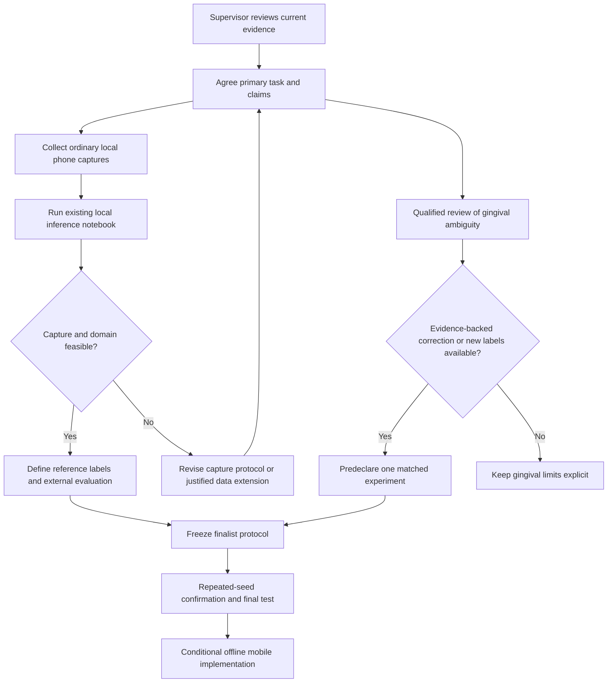

# 5. Supervisor Discussion and Next Decisions

## 5.1 What the work contributes so far

The current contribution is a reproducible, task-specific experimental study: audited oral datasets, traceable preparation, compact detector references, from-scratch model implementation, explicit method hypotheses, controlled recovery comparisons and failure analysis. The effort includes diagnosing unsuccessful ideas and documenting why they were not promoted.

The strongest result is not a newly combined gingival model. It is the evidence that several plausible combinations fail to improve the current grading task, while source-domain caries localization is considerably more promising. Reporting this distinction protects the scientific value of the work and informs a feasible application scope.

## 5.2 Suggested explanation during the supervisor meeting

| Step | Explanation | Evidence to show |
|---|---|---|
| 1 | We chose visible oral photographs to match an ordinary-phone input constraint. | Task definitions and source table |
| 2 | We audited the annotations instead of assuming every available image was a usable labelled example. | Retention/split chart and exclusion ledger |
| 3 | We established detectors first; weak gingival results led to a separate grading investigation. | Four detector baselines |
| 4 | We built scratch CNN/ResNet controls, then studied initialization. | 6.x notebook code and results |
| 5 | We tested context and ordered labels through explicit variants. The combination did not win. | M1-M4 table and protocol caveats |
| 6 | We investigated preprocessing and imbalance instead of only increasing model size. | Source-crop diagram and R0-R3 comparisons |
| 7 | We tested a foundation representation, spatial readout and limited adaptation. Improvements remained insufficient. | 09.3 and 11.x results; minority confusion matrix |
| 8 | We audited common errors and prepared a real-capture study. | Reviewer sheet, source-domain caries audit and current readiness |
| 9 | We need a scope decision based on feasibility and label review before claiming a completed mobile solution. | Evidence gaps and decision flow below |

Do not say that performance improved at every stage, that a later architecture is inherently better, or that the experiments reproduce all cited papers exactly. The valid narrative is a sequence of hypotheses tested against evidence.

## 5.3 Decisions to discuss with the supervisor

1. **Primary demonstration scope:** retain caries as the provisional main demonstration, subject to ordinary-photo feasibility. Keep gingival grading as a limited research branch unless stronger evidence emerges.
2. **Clinical annotation review:** arrange qualified review of the existing 114-case sheet. Model consensus alone is insufficient to change labels. Preserve original labels and document any future revision separately.
3. **Dataset extension:** if the capture domain differs substantially, define an expert-annotated, consented extension with a separate evaluation protocol rather than mixing unlabeled personal photos into existing splits.
4. **Final evaluation:** freeze the selected method, endpoints and operating thresholds before any held-out test evaluation. Repeated-seed work should target an evidence-supported candidate and control rather than every model.
5. **Offline deployment:** resume Android work only after model/data feasibility is established. On-phone optimization, export and latency remain future work.

## 5.4 Paused next-stage decision flow

This diagram is a proposed decision process, not a list of completed work or authorization to resume training. Development is paused for this reporting checkpoint. No real-phone accuracy, final-test performance, repeated-seed superiority or on-device benchmark has been established.

## 5.5 Concise progress statement

> We completed the data and modeling research pipeline through detector baselines, scratch/pretrained classifiers, context and ordinal variants, preprocessing and imbalance studies, foundation-model probes, limited adaptation and error audits. The caries detectors show strong source-validation localization, while gingival three-class grading remains below the project target and has persistent minority-class errors. We have prepared a local phone-capture feasibility pipeline and paused implementation to review scope and evidence with the supervisor.
