# 6. Technical Walkthrough: From an Oral Photograph to a Measured Prediction

**DentalSelfie | Supervisor presentation and technical reference | 23 October 2026**

This chapter explains what we implemented, why each step exists, how it works, and what the experiments actually established. Each numbered section can become one or more presentation slides. Figures use public research train/validation images, recorded experiment outputs, or explicitly labelled diagrams. They do not demonstrate clinical diagnosis or ordinary-phone generalization.

**Presentation route:** task definition -> trustworthy data -> image geometry -> scratch baselines -> contextual and ordinal methods -> resolution and imbalance -> DINO features and adaptation -> actual demonstrations -> conclusions.

## 6.1 What are we trying to predict?

| Task | Input used in this study | Output | What the result means |
| --- | --- | --- | --- |
| Caries detection | Full intraoral image | Bounding boxes, class and confidence | Localization of source-labelled visible caries patterns |
| Gingival detection | Full intraoral image | Gingival region boxes and source-derived classes | Detection experiment on the annotated dataset |
| Gingival ROI classification | An annotation-derived gingival crop | No-visible, mild or marked inflammation class | Classification **given the correct region**; localization is not evaluated here |
| Intended future phone workflow | Ordinary user photograph | Quality feedback and an assistive result | Not yet validated; actual phone captures and mobile implementation remain pending |

ROI means **region of interest**. Our classifier receives a region selected using a dataset annotation. It is easier than finding the region and grading it automatically. We must not describe ROI accuracy as end-to-end phone accuracy. The two source datasets have separate disease annotations: a missing caries label in the gum dataset does not mean that caries is absent.

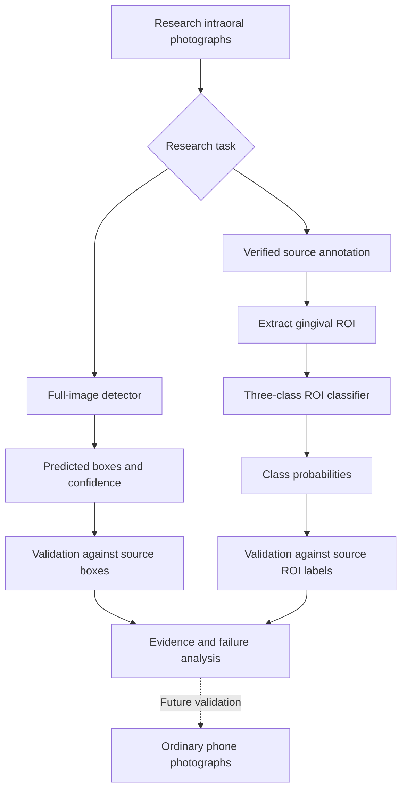

**Presenter takeaway:** We study both localization and classification, but report their evidence separately.

## 6.2 Technology choices and their purpose

| Technology | What it is | Why we use it | Important boundary |
| --- | --- | --- | --- |
| Python 3.11 and Jupyter notebooks | Executable code with explanations, tables and figures | Reproducible research and visible intermediate steps | A notebook file alone is not evidence that a run completed |
| Pillow, NumPy and pandas | Image geometry, numerical arrays and manifests | Inspectable local preprocessing and data provenance | Preserve source files; record changes |
| PyTorch and torchvision | Tensor operations, automatic differentiation, neural networks and pretrained weights | Scratch CNN/ResNet implementations and controlled fine-tuning | Architecture and initialization are separate variables |
| Ultralytics | Detector training/inference implementation | YOLOv8n baseline and YOLO26n comparison | Preserve each model's native inference behavior |
| Hugging Face Transformers / DINOv3 | Loading the pinned vision encoder and exposing token features | Test whether foundation features transfer to gingival grading | Gated model access and reproducible revision matter |
| StandardScaler and logistic regression | Feature scaling and a regularized linear classifier | Cheap frozen-feature probes | Fit scaling on training features only |
| Matplotlib | Reproducible scientific plots | Show real images, distributions and results | A feature heatmap is not automatically an explanation |
| Kaggle T4 x2 | Remote GPU environment | Run bounded independent experiments | Two GPUs do not automatically accelerate one model |

Local processing handles audits, crops and reports. GPU-heavy training runs on Kaggle, generally with one bounded worker per assigned GPU. Configurations, seeds, split hashes and executed outputs provide the audit trail. Notebook code stays readable for presentation rather than hiding every operation behind an opaque command.

## 6.3 Data sources, exclusions and labels

| Source | Research role | Original images | Retained images | Excluded images |
| --- | --- | ---: | ---: | ---: |
| D1: [Zenodo 14827784, Dataset.zip](https://zenodo.org/records/14827784) | Caries detection | 6,265 | 2,175 | 4,090 |
| D2: [Mendeley 3253gj88rr, version 1](https://data.mendeley.com/datasets/3253gj88rr/1) | Gingival detection and grading | 1,096 | 1,067 | 29 |

Exclusion is a data-integrity decision, not a way to remove difficult examples. Caries issues include missing annotations, unknown labels, invalid geometry and orientation ambiguity. Reasons can overlap; do not sum reason counts as if mutually exclusive. Gum exclusions include conflicting annotations and invalid geometry. Originals remain immutable.

| Original gum class IDs | Prepared class | Interpretation |
| --- | --- | --- |
| 0, 1 | Excluded from this target | Jaw-level regions, not target gingival severity ROIs |
| 2 | 0: no_visible_inflammation | Source-derived label, not a general healthy diagnosis |
| 3, 4 | 1: mild_inflammation | Source categories merged into the project target |
| 5, 6 | 2: marked_inflammation | Source categories merged into the project target |

The mapping is explicitly stored in [label_mappings.json](../src/configs/label_mappings.json). We verified actual annotation conventions and overlays before accepting it. This is not a newly invented clinical severity scale.

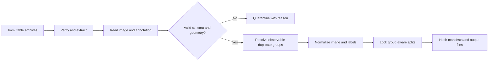

## 6.4 Splitting: what belongs to train, validation and test?

| Dataset | Train images | Validation images | Test images |
| --- | ---: | ---: | ---: |
| Caries | 1,522 | 327 | 326 |
| Gum | 747 | 160 | 160 |

The approximate 70/15/15 split uses seed 42 and observable grouping constraints. Exact duplicates and available filename/visual grouping evidence prevent obvious related examples from crossing splits. **Patient independence is not certified:** filenames are not verified patient identities.

| Partition | Permitted use in completed experiments | Prohibited shortcut |
| --- | --- | --- |
| Train | Gradients, augmentation, scaler fitting, class-frequency weights | Learning from validation/test labels |
| Validation | Model selection, early stopping, ablations and failure analysis | Treating repeated validation selection as independent confirmation |
| Test | Reserved final evaluation | Opening test images for the current report or tuning decisions |

ROI crops inherit their parent image's split and group. We do not split crops randomly after extraction: neighboring crops from the same image would leak highly similar content into validation. Source directories named `Training` or `Test` are historical source organization; the locked project manifest determines the actual project split.

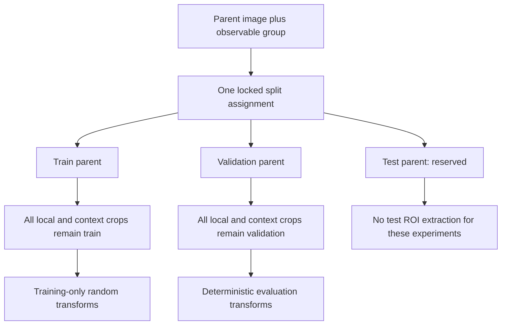

The ROI experiments contain 8,969 training crops and 1,920 validation crops. Paired local/context extraction produces 21,778 view files for 10,889 ROIs. Counts refer to regions, not independent people.

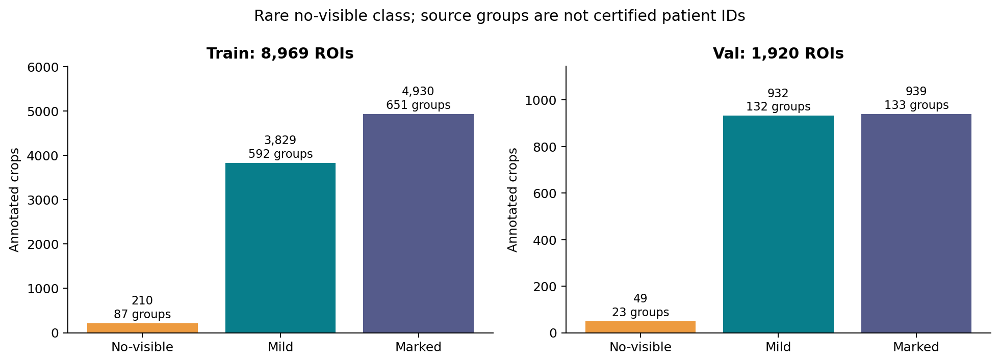

Only 210 training and 49 validation ROIs have the no-visible label. Those validation ROIs span 23 observable groups. This small minority strongly affects both learning and uncertainty.

## 6.5 Bounding boxes: converting labels into pixels

A bounding box is a rectangle enclosing an annotated target. `xyxy` represents its left, top, right and bottom coordinates. YOLO text labels use normalized center and size: `(class, cx, cy, w, h)` with coordinates relative to image width `W` and height `H`.

```text
x1 = (cx - w / 2) * W        y1 = (cy - h / 2) * H
x2 = (cx + w / 2) * W        y2 = (cy + h / 2) * H
```

Example for a hypothetical 1,000 x 800 image: `(cx=.5, cy=.5, w=.2, h=.25)` gives `(400, 300, 600, 500)`, a 200 x 200 region. This arithmetic example is not an annotation from the dataset.

For the real validation example below, the original-source integer crop bounds are **[1944, 1323, 2615, 1925]**. The box is a verified source annotation, not a model prediction. The crop ID is `0115edb823d4b9eee24f_00`; it was selected as the first validation row before inspecting predictions.

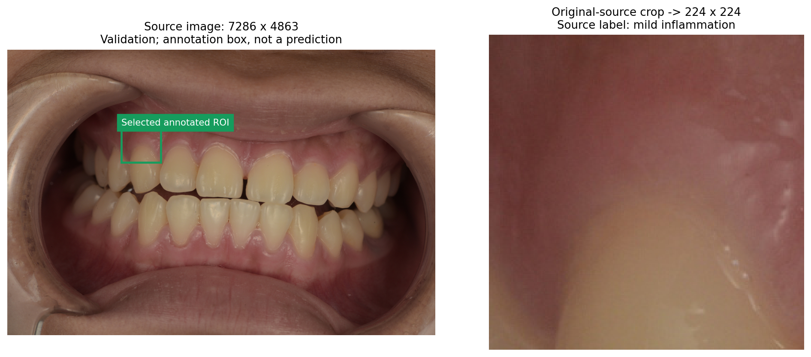

We reject invalid annotation geometry rather than silently clipping it. Floating boundaries become integer crop bounds using floor for left/top and ceil for right/bottom, preserving the annotated extent. Image orientation and source dimensions must agree with the annotation before conversion.

## 6.6 Cropping and context: what exactly changes?

**Cropping** selects pixels within a rectangle. It removes unrelated background and makes the model focus on the annotated tissue. **Context expansion** keeps the same center but enlarges width and height by 1.5, exposing nearby anatomy. Both views are resized to 224 x 224, so the context view trades local detail for a wider field of view.

```text
local_width = x2 - x1                  local_height = y2 - y1
context_width = 1.5 * local_width      context_height = 1.5 * local_height
context_center = local_center
```

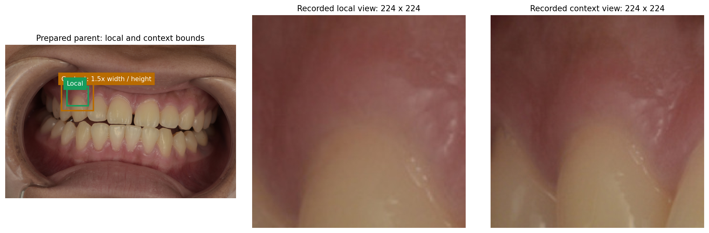

If an expanded rectangle extends outside the image, the implementation creates a canvas filled with RGB `(128,128,128)` and pastes the available intersection at the appropriate offset. This preserves requested geometry. It differs from accepting an invalid source annotation: an intentionally expanded context may exceed image boundaries, but the original annotation must be valid.

```python
# Teaching equivalent of the geometry; production code records bounds and padding.
left, top, right, bottom = requested_bounds
canvas = Image.new("RGB", (right - left, bottom - top), (128, 128, 128))
intersection = (max(0, left), max(0, top), min(image.width, right), min(image.height, bottom))
canvas.paste(image.crop(intersection), (intersection[0] - left, intersection[1] - top))
view = canvas.resize((224, 224), Image.Resampling.BILINEAR)
```

See [roi.py](../src/dentalselfie/roi.py) for the implemented, validated pipeline. This rectangular-to-square resize changes aspect ratio; we keep it fixed within comparisons rather than claiming anatomy is geometrically unchanged.

## 6.7 Why revisit the original source resolution?

The initial prepared image pipeline limits the longest edge to 1,280 pixels, without upscaling, and saves JPEG at quality 95. Small gingival regions can become much smaller before their eventual resize to 224. Resizing later cannot recover detail that was already discarded.

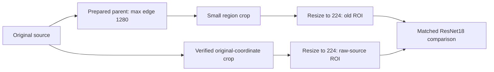

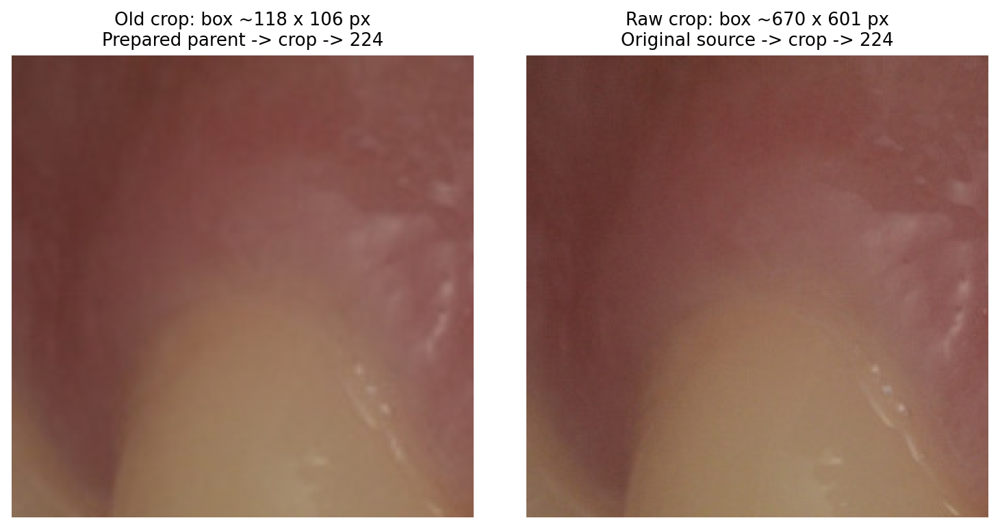

The replacement preserves ROI identity, labels and split assignments. Notebook 08 checks source correspondence before writing crops; 09.1 compares old and raw crops under a matched training configuration. This is **source-detail preservation**, not super-resolution or AI-generated enhancement. The observed macro-F1 change is 56.61% to 57.26%; the uncertainty interval includes zero, so we do not claim a proven large gain.

## 6.8 Training augmentation: flipping, rotating and changing appearance

Augmentation applies random, label-preserving changes during training so that a model sees more than one exact pixel arrangement of each example. It creates alternative views, not new independently annotated patients.

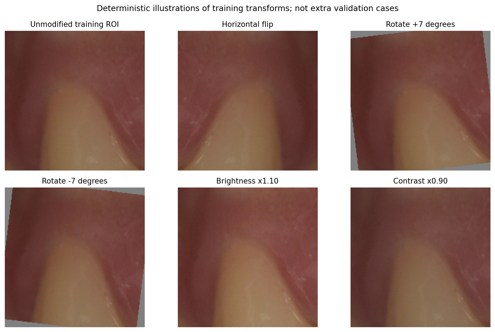

| Operation | Baseline configuration / illustration | Intended effect | Tradeoff |
| --- | --- | --- | --- |
| Resize | 224 x 224, bilinear | Fixed tensor shape | May distort aspect ratio |
| Horizontal flip | Probability 0.5 | Reduce dependence on left/right layout | Appropriate only if the target label is invariant |
| Small rotation | Random angle in [-7, +7] degrees, gray fill | Tolerate modest camera roll | Large angles or borders can become artificial cues |
| Brightness / contrast | Jitter magnitude 0.10 | Reduce sensitivity to exposure | Can change apparent inflammation cues |
| Saturation / hue | Magnitudes 0.08 / 0.02 in 6.x | Mild color variation | Color is medically relevant; keep perturbations small |
| Validation transforms | Resize, tensor conversion, normalization only | Deterministic comparison | No random augmentation during scoring |

The figure fixes individual transform values for explanation. Training samples random values; operations can be composed. The later 07 and 11.2 configurations do not simply inherit every 6.x color transform. Therefore cross-stage result differences cannot all be attributed to architecture alone.

These illustrations transform already-cropped classifier inputs. For full-image detector training, an image transformation must transform its bounding boxes consistently; rotating an image while leaving boxes unchanged corrupts supervision.

## 6.9 Tensor conversion and normalization

An RGB image is initially `H x W x 3`, with integer values 0-255. Tensor conversion produces a floating-point array `3 x H x W` with values 0-1. A batch of 32 images has shape `32 x 3 x 224 x 224`.

```python
# Equivalent normalization, shown explicitly for teaching.
x = np.asarray(image, dtype=np.float32) / 255.0
x = x.transpose(2, 0, 1)
mean = np.array([0.485, 0.456, 0.406])[:, None, None]
std = np.array([0.229, 0.224, 0.225])[:, None, None]
x = (x - mean) / std
```

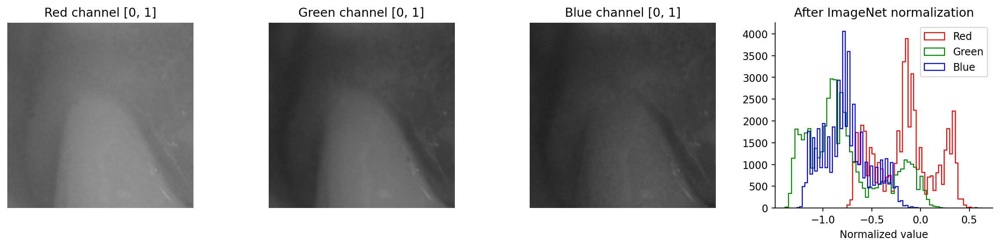

The fixed ImageNet statistics align inputs with the pretrained ResNet/DINO encoder conventions used here. Negative normalized values are expected; they mean a channel value lies below its reference mean. Normalization does not whiten teeth or remove disease. These are fixed constants, not statistics estimated from validation or test.

## 6.10 Baseline 1: a CNN built from scratch

A **convolution** slides a small learned filter across the image. Early filters can respond to local edges and color changes; deeper layers combine responses over larger spatial regions. Those descriptions are general intuitions, not verified clinical interpretations of particular filters.

| Stage | Operation | Output for a 224 x 224 input |
| --- | --- | --- |
| Block 1 | 3x3 convolution, BatchNorm, ReLU, 2x2 max pool | 32 x 112 x 112 |
| Block 2 | Same pattern, more channels | 64 x 56 x 56 |
| Block 3 | Same pattern | 128 x 28 x 28 |
| Block 4 | Same pattern | 256 x 14 x 14 |
| Pool | Adaptive global average pooling | 256 features |
| Head | Dropout 0.25, linear layer | 3 class logits |

**BatchNorm** normalizes intermediate activations using training statistics and learned scale/offset. **ReLU** adds nonlinearity. **Max pooling** reduces spatial size. **Global average pooling** averages each feature channel. **Dropout** randomly suppresses features during training to discourage dependence on a few activations.

All parameters begin randomly. The experiment tests how much the available labelled data can teach a compact model without external visual pretraining. Notebook 6.1 achieves 71.61% accuracy but only 48.32% macro-F1 and zero no-visible recall: accuracy alone conceals a major failure.

## 6.11 Baselines 2 and 3: ResNet18, scratch versus ImageNet

ResNet introduces an additive shortcut: `output = ReLU(F(x) + shortcut(x))`. The residual branch learns a transformation while the shortcut provides a direct path for information and gradients. A 1x1 projection matches dimensions when channels or resolution change. This is the key idea of the [original ResNet paper](https://arxiv.org/abs/1512.03385).

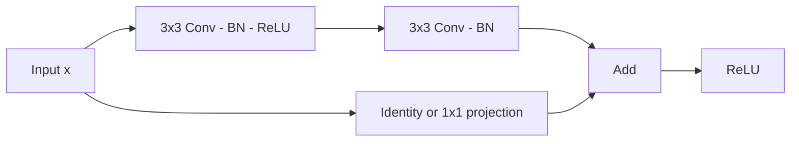

Our manual ResNet18 uses a 7x7 stride-2 stem, max pooling, then four stages of two residual blocks with channels 64, 128, 256 and 512. Spatial sizes are approximately 56, 28, 14 and 7. Global pooling produces 512 features, followed by a three-class head.

| Notebook | Initialization | Question | Observed macro-F1 |
| --- | --- | --- | ---: |
| 6.2 | Random | Does residual structure help without pretraining? | 55.42% |
| 6.3 | ImageNet weights, replaced three-class head | Does prior visual learning help the same architecture? | 55.76% |

The model structure is held aligned for the initialization comparison. We check weight compatibility rather than silently ignoring mismatched layers. ImageNet pretraining is transfer learning; our project did not pretrain ImageNet itself. One seed and repeatedly used validation data do not establish that a 0.34-point difference is robust.

## 6.12 What happens in one training step?

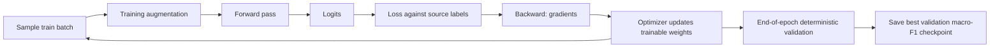

For ordinary three-class cross-entropy, logits `z` become probabilities through `p_k = exp(z_k) / sum_j exp(z_j)`, and the example loss is `-log(p_true)`. A wrong, confident prediction incurs a large loss. Backpropagation computes derivatives; the optimizer adjusts trainable parameters. Validation runs without gradient updates.

| Term | Meaning in this project |
| --- | --- |
| Batch | A small group of examples processed together |
| Epoch | One traversal of the training loader |
| Learning rate | Step scale for optimizer updates |
| Weight decay | Parameter regularization used by AdamW |
| AMP | Mixed-precision GPU computation to save memory and improve throughput; not a different target task |
| Early stopping | Stop after a configured number of epochs without improved selection metric |
| Best checkpoint | Parameters selected by validation metric, which may precede the last epoch |
| Resume checkpoint | Saved state that may include optimizer, epoch and configuration; distinct from inference weights |

Training histories, checkpoint restoration and run gates matter more than the elapsed runtime alone. The 12-hour Kaggle session cap is a ceiling, not a target duration. Independent arms can run in parallel once their input manifests are fixed; comparisons wait for collected results, not for one model's predictions to become another model's labels.

## 6.13 Combining local and context features

Notebook 07.1 tests whether tissue outside the tight crop helps grading. A shared ImageNet ResNet18 encoder maps both local and context images to 512-dimensional feature vectors `f_local` and `f_context`.

| Method | Calculation | Hypothesis |
| --- | --- | --- |
| Concatenation, M1 | Stack into 1,024 features; linear 1,024 -> 512, ReLU, dropout, class head | Let the head learn how to use both views |
| Gated fusion, M2 | Gate MLP: 1,024 -> 256 -> 512 with sigmoid; weighted feature mixture | Learn how much of each view to retain per feature |

```text
g = sigmoid(MLP(concat(f_local, f_context)))
f_fused = g * f_local + (1 - g) * f_context
logits = classifier(f_fused)
```

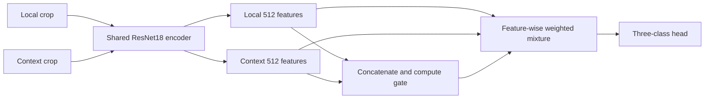

This is learned **feature fusion**, not averaging the final predictions of two independently trained models. A gate value is not a medical explanation. Shared BatchNorm receives two views during training, which is another implementation detail relevant to interpretation. M1 and M2 macro-F1 are 53.60% and 53.99%; adding context did not establish an improvement over our strongest earlier ROI baseline.

## 6.14 Ordinal classification: using the ordered labels

The classes have an intended order: no-visible < mild < marked. Ordinary cross-entropy treats class identities as separate categories. Notebook 07.2 implements a **CORAL-inspired cumulative ordinal head**, following the threshold idea in the [CORAL paper](https://arxiv.org/abs/1901.07884), rather than claiming a complete reproduction of that paper.

| Source label | Is severity greater than 0? | Is severity greater than 1? |
| --- | ---: | ---: |
| 0: no-visible | 0 | 0 |
| 1: mild | 1 | 0 |
| 2: marked | 1 | 1 |

The model produces a scalar score `s` and an ordered positive threshold gap `d = softplus(raw_gap) + epsilon`. Threshold probabilities are `q0 = sigmoid(s)` and `q1 = sigmoid(s-d)`. Since `d > 0`, `q0 >= q1`.

```text
P(class 0) = 1 - q0
P(class 1) = q0 - q1
P(class 2) = q1
```

The loss supervises the two binary threshold decisions. The historical implementation has a redundant score output and uses its first component; this should be disclosed when presenting code, not silently described as a different implementation. M3 uses local ordinal learning; M4 combines gating and the ordinal head. Their macro-F1 values are 51.46% and 49.48%. M3 increases no-visible recall to 65.31% but with low precision and reduced mild-class recall. A gain in one class does not prove that the overall method improved.

## 6.15 Class imbalance: changing the objective rather than the image

Notebook 09.2 asks whether abundant mild/marked examples dominate training. The raw-source ResNet18 CE run R1 is the shared reference.

| Objective | Mechanism | Observed macro-F1 |
| --- | --- | ---: |
| R1: ordinary CE | Equal example weighting | 57.26% |
| R2: class-balanced CE | Class weights derived from effective sample counts, beta 0.999 | 57.40% |
| R3: Balanced Softmax | Adjust training logits using training class frequencies | 53.36% |

Class-balanced weights are proportional to `(1-beta)/(1-beta^n_c)`, then normalized by the implementation. Rare classes receive more relative weight. Balanced Softmax applies the training-count adjustment inside the training objective; it is not arbitrary post-hoc multiplication of published probabilities. Counts come from train only.

The 0.14-point R2-over-R1 difference is small and its paired uncertainty includes zero. R2 is the best observed result, but not evidence that imbalance is solved: only 20 of 49 no-visible validation examples are recovered. See the exact loss and configuration cells in 09.2 before claiming equivalence to another implementation.

## 6.16 DINOv3: what it is and what we actually used

DINOv3 is a pretrained visual representation model. Our pinned model is `facebook/dinov3-vits16-pretrain-lvd1689m`, revision `114c1379950215c8b35dfcd4e90a5c251dde0d32`. We use the pretrained encoder as a starting point; we do **not** reproduce its large-scale self-supervised pretraining. The [official repository](https://github.com/facebookresearch/dinov3) and [Transformers documentation](https://huggingface.co/docs/transformers/model_doc/dinov3) describe the model and token interface.

### 6.16.1 Pixels become patch tokens

Our 224 x 224 RGB crop is divided into 16 x 16 patches: 14 x 14 = 196 patches. A learned projection represents each patch with 384 numbers. Transformer blocks exchange information between tokens through attention and feed-forward operations. Position information allows the network to distinguish locations.

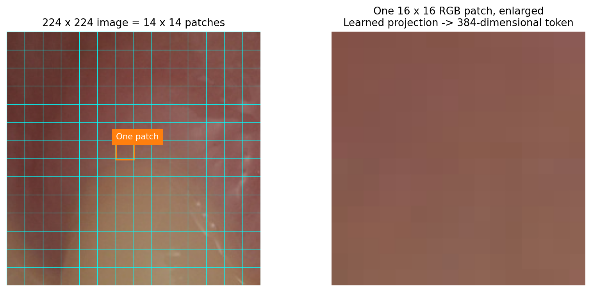

The model also has a global CLS token and register tokens. Code reads the register count from the pinned model configuration rather than assuming every output token is a spatial patch. In this experiment, the 196 spatial tokens are reshaped into a 14 x 14 feature grid.

### 6.16.2 Self-supervised pretraining versus our downstream labels

At pretraining scale, teacher/student representation learning uses transformed views to learn useful visual features without our gingival class labels. In our study, the pretrained encoder is already available. We then learn the mapping from its features to our **labelled** three-class target. A strong general representation can still miss subtle medical distinctions or dataset-specific label definitions.

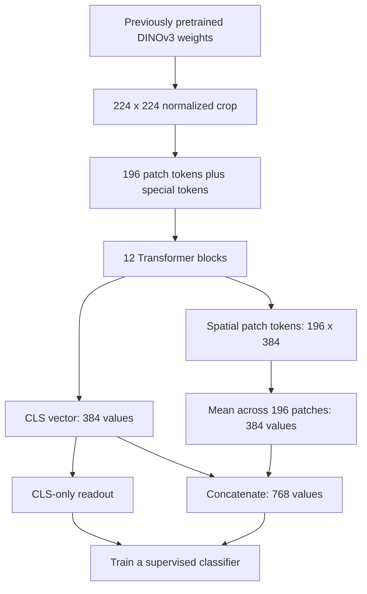

### 6.16.3 Why inspect patch features?

The hypothesis is that a global CLS representation may omit useful local tissue information. Notebook 11.1 adds the mean spatial feature vector to CLS. Mean pooling is an inexpensive, inspectable readout; it is not a learned lesion segmentation or an attention-selected region.

```python
# Teaching excerpt of the implemented readout.
tokens = model(pixel_values=batch).last_hidden_state
cls_features = tokens[:, 0, :]
prefix = 1 + model.config.num_register_tokens
patch_features = tokens[:, prefix:, :]
mean_patch_features = patch_features.mean(dim=1)
combined_features = torch.cat([cls_features, mean_patch_features], dim=1)
```

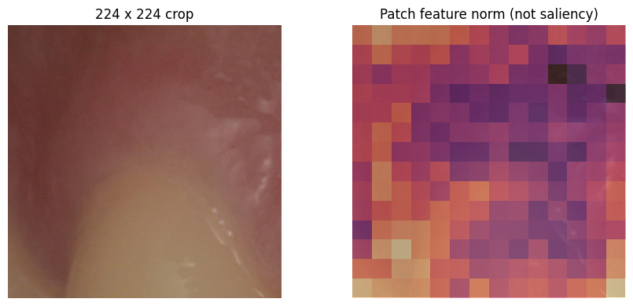

This image is the saved full-v8 diagnostic from 11.1, reproduced without rerunning the encoder. The right panel displays the magnitude of each patch feature vector. **It is not saliency, an attention map, a lesion mask, or proof that DINO identified inflammation.** The figure helps explain spatial feature extraction, not causal model reasoning.

## 6.17 Frozen probing: what learns when the encoder is frozen?

Notebook 09.3 compares frozen ResNet18 and DINOv3 features. Notebook 11.1 compares DINO CLS and CLS-plus-patch features. Encoder parameters do not receive gradient updates. We extract features, fit a training-only StandardScaler, then fit a regularized logistic regression classifier using the source labels.

```text
image -> fixed encoder -> feature vector
feature -> training-fitted scaler -> learned linear classifier -> probabilities
```

The classifier still **learns**: its weights determine how feature coordinates predict each class. Logistic regression applies a linear score followed by multiclass probabilities. The regularization search uses `C` values 0.01, 0.1, 1 and 10; larger `C` means weaker regularization. Selected `C` is 1 for CLS and 0.1 for CLS-plus-patch in 11.1.

| Probe | Feature size | Encoder updated? | Validation macro-F1 |
| --- | ---: | --- | ---: |
| Frozen ResNet18, 09.3 | 512 | No | 50.08% |
| Frozen DINO CLS, 09.3 / repeated 11.1 control | 384 | No | 47.83% |
| Frozen DINO CLS + patch mean, 11.1 | 768 | No | 52.21% |

The repeated CLS control is not another independent successful experiment. The patch readout improves its matched CLS control, but remains below R2's observed 57.40%. “Newer foundation model” does not automatically mean “better for this target.”

## 6.18 Partial adaptation: how did we teach DINO more?

Notebook 11.2 replaces the logistic probe with a neural linear CE head and compares two arms with matched head initialization and data protocol:

1. **Frozen CE:** only the 384-to-3 head learns.
2. **Partial adaptation:** the final two Transformer blocks, final normalization and head learn; earlier encoder parameters remain frozen.

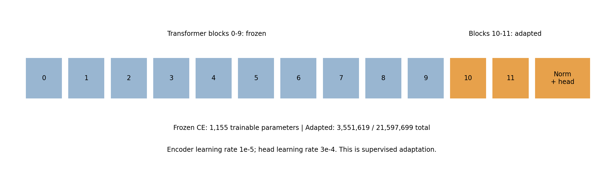

| Setting | Value in the completed experiment |
| --- | --- |
| Seed / batch size | 42 / 32 |
| Maximum epochs / early-stop patience | 30 / 8 |
| Optimizer / weight decay | AdamW / 0.0005 |
| Head learning rate | 0.0003 |
| Adapted encoder learning rate | 0.00001 |
| Training augmentation | Mild flip/rotation; no new color jitter |
| Frozen-arm trainable parameters | 1,155 |
| Adapted-arm trainable parameters | 3,551,619 of 21,597,699 total |
| Selection | Best validation macro-F1 checkpoint |
| Gradient checks | Finite head gradients; only allowed encoder blocks/norm updated |

A smaller encoder learning rate aims to adjust useful pretrained features gradually. Freezing most layers reduces training cost and limits how much the representation can drift. This is ordinary supervised partial fine-tuning, not LoRA, full-model pretraining, self-training or distillation.

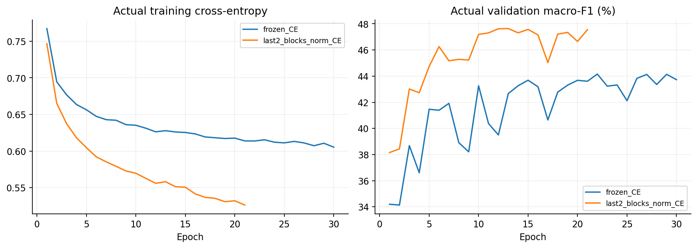

Frozen CE ran 30 epochs and selected epoch 22. Adaptation stopped after 21 epochs and selected epoch 13. Their macro-F1 values are 44.16% and 47.64%. The matched change is +3.48 points, with a group-bootstrap 95% interval of +2.07 to +4.97. Both still recover **0 of 49** no-visible examples. Improving a weak matched control is useful research evidence but does not establish a usable grader.

The logistic CLS probe and frozen neural CE head are different downstream training procedures. Their scores should not be described as a pure freeze/unfreeze comparison; the controlled adaptation comparison is **within 11.2**.

## 6.19 One gingival image, three actual DINO predictions

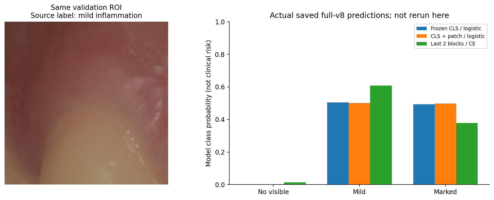

| Model | No-visible probability | Mild probability | Marked probability |
| --- | ---: | ---: | ---: |
| Frozen CLS / logistic | 0.18% | 50.47% | 49.36% |
| Frozen CLS + patch / logistic | 0.04% | 50.20% | 49.76% |
| Adapted final two blocks / CE | 1.41% | 60.71% | 37.88% |

All three predict the source mild label in this example. The first two are almost tied between mild and marked. The adapted model's higher mild probability on this image does not prove improved calibration or a generally superior model. These values are model outputs, not validated probabilities of a patient's clinical disease state.

**Execution provenance:** these are real predictions from the collected full-v8 Kaggle runs, joined by the exact crop ID. The report did not rerun DINO locally. The local machine does not have the encoder artifact, and the adapted 11.2 checkpoint was not exported from Kaggle temporary storage. Its prediction tables and learning curves exist, but reconstructing a reusable adapted model requires recovering or retraining the missing checkpoint in a separately authorized stage. We do not substitute a random model for the missing weights.

## 6.20 One full-image caries example: fresh inference

Unlike the DINO adaptation, both caries checkpoints are available locally. The report-generation script verifies their hashes and **actually runs** YOLOv8n and YOLO26n on the first sorted locked caries validation image, `014f6255c69d00613d65`.

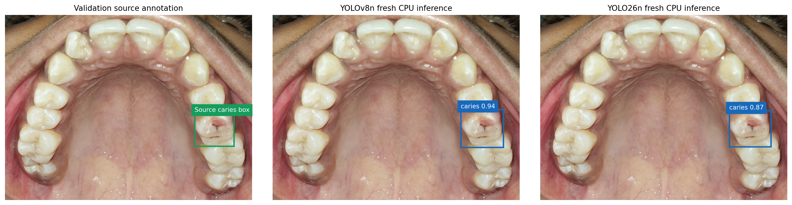

The left panel shows source annotations; the other panels show model predictions and confidence. Inference uses CPU, `imgsz=640`, confidence 0.25, IoU setting 0.7, maximum 300 detections and no test-time augmentation. Each detector retains its native postprocessing; this is not a forced common-NMS experiment. The same nominal IoU option need not affect both architectures identically.

YOLO processes a full image and predicts localization and class information. This differs from the ResNet/DINO experiments, where the correct region is supplied. Its preprocessing maintains detector-compatible image geometry and maps predictions back to original coordinates. Image classification's square ROI resize should not be confused with the detector's full-image preprocessing.

One successful image is a plumbing demonstration, not performance estimation. The earlier complete 327-image validation audit provides the measured evidence:

| Detector | mAP50 | mAP50-95 | Precision at fixed operating point | Recall at fixed operating point |
| --- | ---: | ---: | ---: | ---: |
| YOLOv8n | 93.54% | 72.73% | 78.71% | 95.07% |
| YOLO26n | 94.12% | 73.01% | 87.62% | 85.96% |

The fixed precision/recall analysis uses confidence 0.25 and matching IoU 0.5. mAP summarizes performance across confidence rankings; it is not the accuracy of a single threshold. CPU timing in the demo receipt is not a OnePlus phone benchmark.

## 6.21 Metrics: why accuracy and macro-F1 tell different stories

| Metric | Definition / interpretation | Why it matters here |
| --- | --- | --- |
| Accuracy | Correct predictions / all examples | Can be dominated by mild/marked classes |
| Per-class precision | TP / (TP + FP) | How often predictions of a class are correct |
| Per-class recall | TP / (TP + FN) | How much of that source-labelled class is recovered |
| F1 | 2PR / (P + R) | Balances class precision and recall |
| Macro-F1 | Mean of the three class F1 values | Gives the rare class equal weight in the summary |
| Confusion matrix | True class versus predicted class counts | Reveals which labels are confused |
| IoU | Box intersection area / union area | Measures localization overlap |
| AP / mAP | Area under precision-recall behavior, averaged as specified | Evaluates ranked detector predictions and localization criteria |

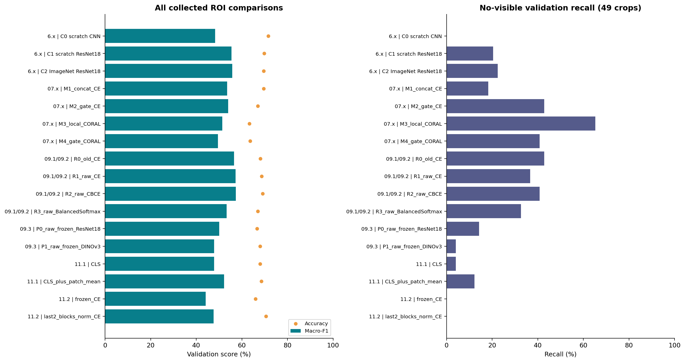

Related ROIs are not independent samples. For paired uncertainty estimates we resample observable groups, comparing predictions on the same validation cases. This addresses within-group dependence better than treating every crop as independent, but does not repair uncertain patient identities or repeated validation reuse.

## 6.22 The research story: hypotheses tested and decisions made

| Step | Question | Technical action | What we learned |
| --- | --- | --- | --- |
| Establish data | Are labels and coordinates trustworthy enough to train? | Audit, quarantine, mapping, duplicate constraints, split locks | Data validation is a first-class part of the work |
| Establish detectors | Can annotated targets be localized? | YOLOv8n then YOLO26n | Caries has strong in-domain validation evidence |
| Establish grading baselines | Does structure or pretraining help? | CNN scratch, manual ResNet scratch, ImageNet ResNet | Accuracy hides minority-class failure |
| Add contextual information | Does surrounding anatomy help? | Shared local/context encoder, concatenation and gate | More inputs did not ensure better macro-F1 |
| Encode label ordering | Does ordinal supervision improve severity grading? | Ordered cumulative thresholds, then gated ordinal combination | Changed class tradeoffs; no overall breakthrough |
| Recover source detail | Did preprocessing remove useful detail? | Verified original-source crops and matched CE comparison | Small observed gain, uncertain robustness |
| Address imbalance | Does loss reweighting recover the minority class? | CB-CE and Balanced Softmax | CB-CE best observed, still inadequate |
| Test foundation features | Can a newer representation transfer? | Frozen ResNet versus DINO, then patch readout | Patch pooling helps its control, not the historical best |
| Adapt the representation | Can limited supervised adaptation help? | Last two DINO blocks and norm trainable | Matched improvement, still no minority recovery |
| Check task limitations | Are model choices the only bottleneck? | Error overlap, annotation review, full-image stress analysis | Expert review and real-photo feasibility remain necessary |

This is a transparent sequence of hypothesis-driven experiments, not a claim that every stage improved results or that we invented the underlying methods. Our contribution is the implemented pipeline, controlled comparisons, diagnosis of failures and reproducible evidence for this task.

## 6.23 Notebook map: where each technical step is visible

| Notebook | Technical content to show during presentation |
| --- | --- |
| 01 | Archive/source audit, labels, geometry, exclusions, duplicates |
| 02 | Normalization, groups, fixed splits, hashes, dataset validation |
| 02b | Allowlisted Kaggle packaging and publication |
| 03 | YOLOv8n training and detector outputs |
| 04 | YOLO26n comparison |
| 05 | ROI geometry, local/context pairing, class support |
| 6.1 | Each preprocessing step and scratch CNN blocks |
| 6.2 | Manual residual blocks and scratch optimization |
| 6.3 | Matched structure with ImageNet initialization |
| 07.1 | Shared features, concatenation, gate and CE |
| 07.2 | Ordinal targets, ordered thresholds and combined method |
| 08 | Source-resolution verification and regenerated crops |
| 09.1 | Old/raw resolution ablation |
| 09.2 | Training-count loss adjustments |
| 09.3 | Frozen features, training-only scaling and probe search |
| 10.1 | Verified predictions, shared errors and review cases |
| 10.2 | Full-image matching, operating points and stress tests |
| 11.1 | CLS/patch token extraction, pooling and probing |
| 11.2 | Freeze masks, gradient checks, differential learning rates and curves |
| 12.1 | Consolidated experiment and uncertainty evidence |
| 12.2 | Local-only photo feasibility pipeline; actual phone inputs still pending |

For clickable notebook paths and exact successful versions, use the [complete notebook and artifact index](04_NOTEBOOK_AND_ARTIFACT_INDEX.md). In particular, 09.3's valid result is v3, not its cancelled latest v4; excluded failed runs are not successful experiments.

## 6.24 Reproduce these figures and inspect the evidence

Run from the project root with the existing environment:

```powershell
.venv\Scripts\python.exe report/script/build_technical_report.py
```

The script verifies selected asset hashes, creates the teaching figures, copies the real DINO diagnostic and runs the existing caries detectors on one locked validation image. It does not train, upload anything, read personal phone captures or open held-out test images. The Markdown is authored separately so rerunning figures preserves editorial explanations.

| Artifact | Purpose |
| --- | --- |
| [build_technical_report.py](script/build_technical_report.py) | Readable image transforms, evidence joins, plotting and fresh inference |
| [technical_demo_evidence.json](technical_demo_evidence.json) | Input hashes, selected IDs, DINO probabilities, fresh YOLO boxes and settings |
| [Original technical pipeline](../src/dentalselfie/roi.py) | Production crop/context geometry |
| [Original-source ROI implementation](../src/dentalselfie/raw_roi.py) | Source correspondence and crop generation |
| [Detailed quantitative report](03_RESULTS_AND_LIMITATIONS.md) | Full result interpretation and evidence boundaries |

**What can be defended today:** audited datasets, locked splits, implemented scratch baselines, pretrained comparisons, contextual/ordinal/imbalance experiments, foundation-feature probing, partial adaptation and verified validation evidence.

**What remains unestablished:** clinically reliable gingival grading, certified patient-independent generalization, ordinary-phone performance, on-device speed and a deployable adapted DINO checkpoint. No ensemble, distillation, segmentation system, RNA modality or mobile implementation is being claimed as completed work.
