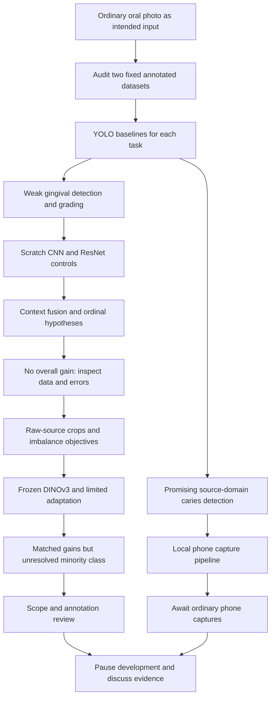

# DentalSelfie: Supervisor Progress Report

**Reporting date: 23 October 2026. Evidence cutoff: completed work through 22 October 2026.**

## 1. Purpose and current position

DentalSelfie investigates AI-assisted analysis of ordinary oral photographs, with an eventual offline mobile application. The present report covers data preparation, object detection, gingival ROI classification, method development, error analysis and a local capture-feasibility pipeline. Development is temporarily paused at the student's request while this report is prepared.

The strongest practical evidence is source-domain caries detection. Gingival three-class grading remains unresolved: the best observed validation macro-F1 is **57.40%**, and more complex foundation-model variants did not surpass the ResNet18 references. This is a progress report, not a claim that a clinically usable mobile system has been delivered.

## 2. Reading guide

| Chapter | Contents |
|---|---|
| [01 - Data and problem formulation](01_DATA_AND_PROTOCOL.md) | Fixed sources, exclusions, labels, splits, crop preparation and evaluation units |
| [02 - The research journey](02_RESEARCH_JOURNEY.md) | Questions, methods, reasons for choices, measured outcomes and subsequent decisions |
| [03 - Results and interpretation](03_RESULTS_AND_LIMITATIONS.md) | Complete result tables, uncertainty, confusion matrices and validity limits |
| [04 - Notebook and artifact index](04_NOTEBOOK_AND_ARTIFACT_INDEX.md) | Every current notebook, its task, execution evidence and provenance |
| [05 - Supervisor discussion and next decisions](05_DISCUSSION_AND_NEXT_STEPS.md) | Contributions, unresolved issues, reporting narrative and paused next milestones |
| [06 - Technical walkthrough](06_TECHNICAL_WALKTHROUGH.md) | Detailed theory, image geometry, augmentation, model methods, DINO adaptation and actual demonstrations |

## 3. Project progression



## 4. Key observations

| Question | Evidence at this checkpoint |
|---|---|
| Is data preparation complete? | Two sources audited; 2,175 caries images and 1,067 gingival images retained; splits locked |
| Was learning from scratch implemented? | Custom CNN and manually implemented ResNet18 trained with random initialization |
| Were methods developed beyond simple fine-tuning? | Context concatenation, learned gating, ordinal supervision, source-detail recovery, imbalance objectives and foundation readout/adaptation were studied |
| Did every improvement attempt work? | No. Several increased complexity or minority recall while reducing macro-F1 |
| Best observed gingival reference? | R2 ResNet18 + class-balanced CE: 69.11% accuracy, 57.40% macro-F1; R1 is near-tied at 57.26% macro-F1 |
| Caries result? | Full-image CPU re-evaluation: YOLO26n mAP50 94.12%, mAP50-95 73.01%; operating-point trade-offs remain |
| Is a phone demo validated? | No personal phone captures processed; both existing detectors passed a three-image source-validation plumbing check |
| What remains unopened? | The project held-out test split is not used for model selection or final performance claims |

## 5. Report structure and reproduction

```text
report/
  README.md
  01_DATA_AND_PROTOCOL.md
  02_RESEARCH_JOURNEY.md
  03_RESULTS_AND_LIMITATIONS.md
  04_NOTEBOOK_AND_ARTIFACT_INDEX.md
  05_DISCUSSION_AND_NEXT_STEPS.md
  script/build_report.py
  figure/                         PNG and SVG versions of six figures
  evidence_manifest.json          Input hashes and generation checks
```

From the project root:

```powershell
.venv\Scripts\python.exe report/script/build_report.py
```

The script regenerates the Markdown and charts from existing evidence. It reads collected tables and manifests, performs no training or downloads, and opens no dataset images or private captures. Mermaid blocks require a Markdown viewer with Mermaid support; PNG figures are embedded directly. Source archives and detailed experiment artifacts remain in their original locations. Relative links are intended for use within this project folder.
